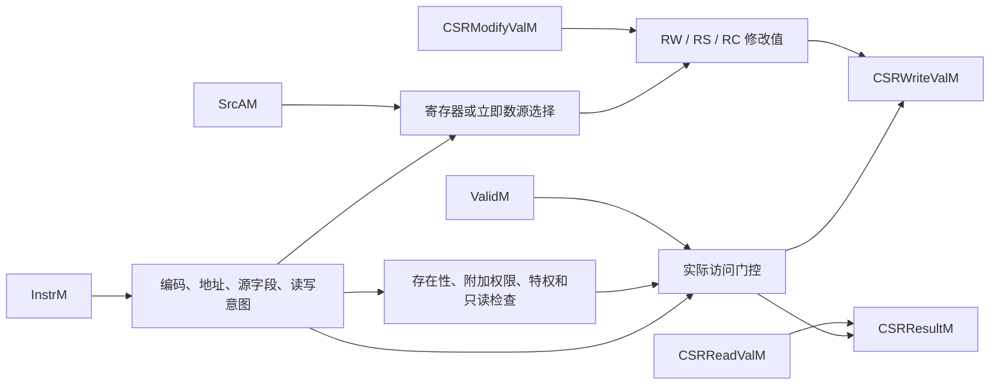

# 01：CSRAccess——CSR 指令访问与读改写

本轮新增 `riscvpipeline.privileged.CSRAccess`，固定 RV32，无时钟、复位或状态的
组合 `RawModule`，没有接入 CPU。测试包装层带观察时钟，但所有功能检查均在更改输入后
直接读取输出，不推进时钟。模块只生成访问意图、修改值与非法访问标志，不保存 CSR。

## 依据与适配

- 教材 §8.2.2.1，书页 341（PDF 页 376）：六种 CSR 指令和常用伪指令。
- 教材 §8.2.3，书页 342–343（PDF 页 377–378）：12 位地址、访问属性及特权编码。
- 教材 §8.4.2–8.4.3，书页 370–371（PDF 页 405–406）：特权译码与 CSR 子模块划分。
- 本地 CVW revision `2f82f001139358be7646e910ff6fa2a140bed620`：
  `src/privileged/csr.sv:175–197` 提供源选择和 RW/RS/RC 数据通路，
  `:203–214` 提供地址及提交门控，`:312–317` 汇总非法访问；
  `src/ieu/controller.sv:307–308` 根据源字段抑制 RS/RC 写入。
- [官方 Zicsr 2.0](https://docs.riscv.org/reference/isa/v20260120/unpriv/zicsr.html)
  的访问条件表用于核对读写抑制；
  [官方 CSR 地址约定](https://docs.riscv.org/reference/isa/priv/priv-csrs.html)
  用于核对只读和最低特权检查。

本模块重新用 Chisel 表达上述访问逻辑，并将译码和权限判断集中到独立边界。
采用规范规定的 RW `rd=x0` 读抑制；存在性和权限检查独立于读使能，保证只写访问
也可报异常。当前仅支持 U/S/M，拒绝当前模式 `10` 和地址最低特权编码 `10`，
即使 M 模式且调用方声称 CSR 存在也不能访问该地址类别。

CVW 对 `mip/sip` 的 RS/RC 使用内部可写状态，而非包含外部中断输入的软件读值。
本模块把这种差异抽象为 `CSRReadValM` 与 `CSRModifyValM` 两个输入，
不在此处硬编码寄存器选择。普通 CSR 的调用方应给两个输入提供相同旧值；
`mip/sip` 的调用方负责选择内部状态、S 模式可见范围及实际可写位掩码。

## 接口契约

生产 RTL 的 Bundle 端口名带 `io_` 前缀。所有数据均为无符号位型，组合延迟，无周期状态。

| 方向 | 字段 | 位宽 | 含义 |
| --- | --- | --- | --- |
| 入 | `InstrM` | 32 | 当前 M 级指令编码 |
| 入 | `ValidM` | 1 | 当前指令有效；门控访问、异常及结果/写值输出 |
| 入 | `PrivilegeModeW` | 2 | 当前模式，U=`00`、S=`01`、M=`11` |
| 入 | `SrcAM` | 32 | 执行前源寄存器值；调用方保证 x0 为零并处理前递 |
| 入 | `CSRReadValM` | 32 | 软件可见旧值，供结果返回 |
| 入 | `CSRModifyValM` | 32 | RS/RC 修改基值 |
| 入 | `CSRExistsM` | 1 | 目标 CSR 已实现；必须由地址译码提供 |
| 入 | `CSRAccessAllowedM` | 1 | 计数器使能、TVM、调试限制等额外权限的汇总结果 |
| 出 | `IsCSRInstrM` | 1 | 编码识别，与 `ValidM` 和权限无关 |
| 出 | `CSRAdrM` | 12 | 始终为 `InstrM[31:20]` |
| 出 | `CSRSrcM` | 32 | bit 14 为 1 时零扩展五位字段，否则为 `SrcAM` |
| 出 | `CSRReadM` | 1 | 有效且合法的实际读取意图 |
| 出 | `CSRWriteM` | 1 | 有效且合法的实际写入意图 |
| 出 | `CSRWriteValM` | 32 | 写使能时输出修改值，否则为零 |
| 出 | `CSRResultM` | 32 | 读使能时输出软件旧值，否则为零 |
| 出 | `IllegalCSRAccessM` | 1 | 有效 CSR 指令的非法访问；不能随读抑制消失 |

存在性、附加权限及两个 CSR 值必须基于地址和当前模式产生，不能依赖已门控的
`CSRReadM/CSRWriteM` 反向生成，以免形成组合环。对于未来按访问类型判断的限制，
调用方可自行从 `InstrM` 计算原始读写意图。

## 六种指令真值表

前提为 opcode=`0x73`、`ValidM=1` 且访问合法。令 `B=CSRModifyValM`，
`S=CSRSrcM`。读使能为 1 时结果总是 `CSRReadValM`。

| 指令 | funct3 | 源 S | 读取条件 | 写入条件 | 写值（写使能为 1 时） |
| --- | --- | --- | --- | --- | --- |
| CSRRW | `001` | `SrcAM` | `rd != x0` | 总是 | `S` |
| CSRRS | `010` | `SrcAM` | 总是 | `rs1 != x0` | `B OR S` |
| CSRRC | `011` | `SrcAM` | 总是 | `rs1 != x0` | `B AND NOT S` |
| CSRRWI | `101` | 零扩展 uimm[4:0] | `rd != x0` | 总是 | `S` |
| CSRRSI | `110` | 零扩展 uimm[4:0] | 总是 | `uimm != 0` | `B OR S` |
| CSRRCI | `111` | 零扩展 uimm[4:0] | 总是 | `uimm != 0` | `B AND NOT S` |

`funct3=000`（例如 ECALL、MRET）和 `100` 均不是本模块的 CSR 指令。
后续 `PrivDecode`/控制器负责特权指令及非法指令译码；这里不报告非 CSR 指令异常。

合法性要求：CSR 存在、附加权限允许、当前模式和地址最低模式均受支持、
当前模式不低于最低模式，并且不向 `CSRAdrM[11:10]=11` 的只读地址发起写入。
非法访问保留异常标志，读写使能和结果/写值均为零。
无效或非 CSR 指令的异常、使能和结果/写值均为零；地址和源值仍是组合译码。
`IsCSRInstrM` 在有效 CSR 编码但 `ValidM=0` 时仍为 1。

## 数据流与算例



以下算例是假定寄存器模块已提供值时的接口示例，尚不能在当前 CPU 执行：

```asm
csrr  t0, mscratch       # CSRRS t0, 0x340, x0：读旧值，不写
csrw  mscratch, t1       # CSRRW x0, 0x340, t1：写 t1，不读
csrrsi t0, mscratch, 31  # 旧值 0xA5A5A5A5，写值 0xA5A5A5BF
csrrci t0, mscratch, 31  # 同一旧值，写值 0xA5A5A5A0
```

若 `t1` 是非零寄存器且持有零，`csrrs t0, mscratch, t1` 仍发起写入，
即使写值与旧值相同。若把 `t1` 改成 `x0`，则不发起写入。

假设 `mip` 软件旧值为 `0x82`（外部输入贡献 `0x80`），内部修改基值为 `0x02`：
`csrrsi t0, mip, 1` 返回 `0x82`，产生写值 `0x03`；
`csrrci t0, mip, 1` 返回 `0x82`，产生写值 `0x02`。
外部中断输入不会被 OR 到内部可写状态。真实可写位筛选由 `CSRInterrupt` 实施。

## 测试与复现

从 `riscv-pipeline` 目录运行，沿用现有 JDK 17、sbt 1.10.7、Scala 2.13.14、
Chisel 3.6.1、chiseltest 0.6.2：

```bash
./scripts/sbt-local.sh compile 'Test / compile'
make test-csr-access SBT=./scripts/sbt-local.sh
make generate-csr-access SBT=./scripts/sbt-local.sh
verilator --lint-only --top-module CSRAccess generated/csr-access/CSRAccess.v
make test-pipeline SBT=./scripts/sbt-local.sh
make test SBT=./scripts/sbt-local.sh
```

生成入口 `GenerateCSRAccess [targetDir]`，默认输出 `generated/csr-access`；
Makefile 可用 `CSR_ACCESS_TARGET_DIR` 覆盖目录。无 XLEN 参数，避免暗示 RV64 已支持。
生成产物和测试缓存依照现有 `.gitignore` 排除。

`CSRAccessSpec` 覆盖 10 项测试：六种指令的手算值；RW 读抑制；源字段写抑制；
只读读/写；U/S/M 权限矩阵和不支持编码；存在性与附加权限；分离软件旧值与内部基值；
无效及非 CSR 编码；固定种子随机参考；RTL 全部 16 个端口的方向、位宽和组合属性。
手算向量包括零、全一、高位、混合掩码及立即数 0/1/31。
随机参考使用独立操作表及逐位布尔运算，种子 `0x8c5a2026`，2048 个输入；
不调用生产实现或复用硬件选择器。全部功能检查不推进时钟，可观察相邻输入变化。

## 实际验证结果

2026-10-07 在本地现有工具链执行：

| 验证 | 实际结果 |
| --- | --- |
| `compile`、`Test / compile` | 通过 |
| `make test-csr-access` | 10/10 通过，包含 2048 个固定种子随机输入 |
| `make generate-csr-access` | 通过，生成 `generated/csr-access/CSRAccess.v` |
| RTL 接口和组合属性 | 16 个端口方向/位宽匹配，无 clock、reset、寄存器或时序块 |
| Verilator 5.036 `--lint-only` | 退出码 0，无 lint 警告 |
| `make test-pipeline` | 3 个 suite、18/18 通过 |
| `make test` | 15 个 suite、132/132 通过，包含本轮 10 项和原 122 项 |

测试先写：缺少模块时测试编译失败；添加仅输出零的接口骨架后，9 个行为测试失败，
接口检查通过；补齐功能后 10 项全部通过。生成和测试沿用现有 `chisel3.stage.ChiselStage`，
编译会报告该 API 的弃用提示；本轮未升级工具链或迁移 FIRRTL 后端。
原始日志归档在 `target/chapter8/csr-access/`，属于忽略的构建产物。
本轮未重复大型 CoreMark 或架构软件验收，也未运行 CPU CSR 程序。

独立只读审查未发现功能或接口问题；已落实文档门控措辞澄清和实际结果补录。
审查覆盖源码、测试参考模型、生成 RTL 和验证日志；教材/CVW 引用位置由实现者
对照本地 PDF 与源码核实。后续 CPU 集成、CSR 存储/位掩码、RV64、综合与形式验证
不属于本轮审查范围。

## 用户检查清单与停止点

- [ ] 检查接口命名、固定 RV32 位宽及纯组合属性。
- [ ] 检查 RW 的 rd=x0 和 RS/RC 的源字段零抑制。
- [ ] 检查只写指令的存在性/权限检查、只读 CSR 写异常。
- [ ] 检查 U/S/M 矩阵及编码 10 拒绝策略。
- [ ] 检查旧值与内部基值分离、关闭使能时数据清零约定。
- [ ] 复现测试、生成和 lint，检查本轮结果。
- [ ] 明确认可本轮后再开始 `PrivDecode`。

本轮没有实现 CSR 寄存器、WARL/WPRI 掩码、陷阱状态或 CPU 写回。
提交时还需复位、停顿和冲刷门控，正确前递执行前源值，并处理 CSR 写入后的流水线
重取及危险；`ValidM` 不是这些机制的替代。没有验证综合面积、时序收敛或整机 CSR 程序。
交付后停止，下一模块尚未开始。
