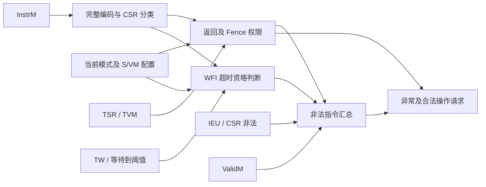

# 02：PrivDecode——特权指令译码与权限检查

本轮新增 `riscvpipeline.privileged.PrivDecode`，固定 RV32、纯组合 `RawModule`，
无时钟、复位或状态，尚未接入 CPU。实现 ECALL、EBREAK、MRET、SRET、WFI 的完整编码
识别、返回权限判断、可选 SFENCE.VMA 译码，以及非法指令异常汇总。
不更改第一轮 `CSRAccess` 的硬件接口或行为。

## 参考位置与适配

教材第八章书页 335–381（PDF 页 370–416）中，本模块主要对应：

- §8.2.2.2，书页 341–342（PDF 页 376–377）：ECALL、EBREAK。
- §8.2.2.3–8.2.2.4，书页 342（PDF 页 377）：陷阱返回和 WFI。
- §8.4.2，书页 370（PDF 页 405）：特权指令译码、非法指令及等待超时。
- 本地 CVW revision `2f82f001139358be7646e910ff6fa2a140bed620` 的
  `src/privileged/privdec.sv`：编码/权限判断、WFI 超时规则、非法指令汇总。
- [官方 Machine-Level ISA](https://docs.riscv.org/reference/isa/priv/machine.html)
  的 Virtualization Support、Trap-Return Instructions、Wait for Interrupt 规则，
  以及 [官方特权规范 PDF](https://docs.riscv.org/reference/isa/v20240411/_attachments/riscv-privileged.pdf)
  的指令编码。

本轮直接检查全部 32 位指令，无需依赖尚未实现的 IEU `PrivilegedM`。
CVW 中部分固定指令检查依赖上层译码和字段约束；这里独立检查 opcode、funct3、rd、rs1，
避免接收相似但畸形的编码。SRET 的 TSR 和 SFENCE.VMA 的 TVM 只影响 S 模式，M 模式不受拦截。

CVW 将 WFI 等待计数和 `wfiW` 流水寄存器放在 `privdec`；本路线已单列后续 `WFI` 模块，
因此此处只接收“计数已到阈值”的 `WFITimeoutM`。计数器、唤醒、中断、停顿及超时阈值
留给第十轮，不提前加入时序逻辑。本轮也不支持 H、Svinval、URET、调试返回或新增 SYSTEM 扩展。

## 配置与接口

构造参数如下；配置开关不会删除端口。

| 参数 | 默认值 | 限制与含义 |
| --- | --- | --- |
| `supervisorSupported` | `true` | U/M 始终支持；S 可裁剪，不支持时 S 当前模式和 SRET 非法 |
| `virtualMemorySupported` | `false` | 默认拒绝 SFENCE.VMA；设为 true 仅启用译码，并要求 S 支持 |

“支持 S 译码”不等于当前 CPU 已有 S 模式。虚拟内存可选配置仅为后续 MMU 接口准备，
不产生地址转换、页表访问或 TLB 失效硬件。`new PrivDecode(false, true)` 在 elaboration 时拒绝。

| 方向 | 字段 | 位宽 | 含义 |
| --- | --- | --- | --- |
| 入 | `InstrM` | 32 | M 级完整指令 |
| 入 | `ValidM` | 1 | 指令有效；为零时本模块全部输出为零 |
| 入 | `PrivilegeModeW` | 2 | 当前特权编码，U=`00`、S=`01`、M=`11`；`10` 不支持 |
| 入 | `STATUS_TSR` | 1 | 拦截 S 模式 SRET |
| 入 | `STATUS_TVM` | 1 | 拦截 S 模式 SFENCE.VMA；satp 访问检查由 CSR 模块负责 |
| 入 | `STATUS_TW` | 1 | 为低于 M 的 WFI 开启超时拦截 |
| 入 | `WFITimeoutM` | 1 | 等待计数达到阈值；不是已经过权限判断的异常标志 |
| 入 | `IllegalIEUInstrM` | 1 | 上游整数指令译码产生的非法指令标志 |
| 入 | `IllegalCSRAccessM` | 1 | 第一轮 CSRAccess 产生的非法 CSR 访问标志 |
| 出 | `EcallFaultM` | 1 | 有效、模式受支持且没有非法指令异常的 ECALL |
| 出 | `BreakpointFaultM` | 1 | 相同门控下的 EBREAK |
| 出 | `sretM` | 1 | 编码与权限合法且没有非法指令异常的 SRET 请求 |
| 出 | `mretM` | 1 | 相同门控下的 MRET 请求 |
| 出 | `RetM` | 1 | `sretM OR mretM` |
| 出 | `wfiM` | 1 | 有效、模式受支持且无上游非法的 WFI 识别请求；超时仍保持 |
| 出 | `sfencevmaM` | 1 | 配置/编码/权限允许且没有非法指令异常的 SFENCE.VMA 请求 |
| 出 | `IllegalPrivilegedInstrM` | 1 | 本地 SYSTEM 编码、模式或权限非法，不包含超时和上游异常 |
| 出 | `IllegalInstrFaultM` | 1 | 本地非法、上游非法和 WFI 超时异常的汇总 |

生产 RTL 端口均带 `io_` 前缀，18 个端口，无额外时钟和复位。
输入异常必须与同一条有效 M 级指令对齐。上游异常独立汇总，并非只用于 SYSTEM 指令。
本模块不会替 IEU 判断普通 RV32I 编码的合法性。

## 指令与权限表

前提 `ValidM=1` 且无上游非法指令/CSR 异常。

| 操作 | 编码/条件 | U | S（已支持） | M |
| --- | --- | --- | --- | --- |
| ECALL | `0x00000073` | ECALL 标志 | ECALL 标志 | ECALL 标志 |
| EBREAK | `0x00100073` | 断点标志 | 断点标志 | 断点标志 |
| MRET | `0x30200073` | 非法 | 非法 | 返回请求 |
| SRET | `0x10200073`，需支持 S | 非法 | TSR=0 时允许 | 允许，不受 TSR 影响 |
| WFI | `0x10500073` | 识别请求，受超时条件限制 | 识别请求，受 TW 超时限制 | 识别请求，不受 TW 超时限制 |
| SFENCE.VMA | opcode=`0x73`，funct3=`000`，rd=0，funct7=`0001001` | 非法 | 配置启用且 TVM=0 时允许 | 配置启用时允许，不受 TVM 影响 |

五种固定指令的 `rd`、`rs1` 必须为零；SFENCE.VMA 的 `rs1/rs2` 可为任意寄存器编号。
当前默认配置对所有 SFENCE.VMA 编码产生本地非法，不默默忽略该操作。
模式 `10`、已裁剪的 S 当前模式对任何 SYSTEM 指令都产生本地非法。

六种 CSR `funct3`（001/010/011/101/110/111）交给 `CSRAccess`，本模块不重复其 CSR
存在性、地址权限或读写数据逻辑。SYSTEM `funct3=100`、未知 funct12 和错误保留字段
产生本地非法。ECALL 是主动异常，不是非法指令；具体 U/S/M ECALL 原因编码由后续 Trap 生成。

## WFI 超时和异常门控

令 `Expired=WFITimeoutM`，WFI 超时异常条件为：

```text
ValidM && 完整WFI编码 && 当前模式受支持 && 当前模式 != M && Expired
  && (STATUS_TW || (支持S && 当前模式 == U))
```

因此 S 模式 TW=0 时不因 Expired 报异常；M 模式始终忽略该输入；
支持 S 时，U 模式即使 TW=0 也受有界等待限制。U/M 配置下，U 只有 TW=1 才受此限制。
非 WFI 指令忽略 Expired；无效指令全部输出零。
这里采用教材与 CVW 的“等待到阈值再拦截”接口，未规定实际等待周期数。

```text
IllegalInstrFaultM = ValidM &&
  (IllegalIEUInstrM || IllegalCSRAccessM || 本地特权非法 || WFI超时异常)
```

有非法指令异常时，ECALL/EBREAK/返回/SFENCE 请求清零；`wfiM` 表示识别请求，
在 WFI 超时异常时仍保持为 1，供后续等待逻辑识别当前 WFI、避免请求撤销让计数重启。
**集成必须优先处理 `IllegalInstrFaultM`，不能因 `wfiM=1` 继续无限停顿。**
`wfiM` 不是成功退休、睡眠或时钟门控信号；上游非法异常会抑制它。

## 数据流与汇编示例



以下是假设已提供模式、CSR 和等待逻辑时的独立接口算例，尚不能在当前 CPU 执行：

```asm
ecall                     # U中输出EcallFaultM，由Trap形成环境调用原因
ebreak                    # 输出BreakpointFaultM
mret                      # 仅M中可输出mretM/RetM
sret                      # S中TSR=1非法；M中即使TSR=1仍可返回
wfi                       # S中TW=1：到阈值后IllegalInstrFaultM=1，wfiM仍=1
sfence.vma a0, a1         # 默认配置非法；启用VM译码后检查模式及TVM
```

例如 `0x302000F3` 虽然高 12 位像 MRET，但 rd 非零，必须非法。
`0x30201073` 是 CSR 指令编码，不是 MRET；由 CSRAccess 检查地址 `0x302`。
`0x30200013` opcode 不是 SYSTEM，本地特权译码不操作；是否为合法普通指令由 IEU 判断。

## 验证命令与覆盖

从 `riscv-pipeline` 目录执行：

```bash
./scripts/sbt-local.sh compile 'Test / compile'
make test-priv-decode SBT=./scripts/sbt-local.sh
make generate-priv-decode SBT=./scripts/sbt-local.sh
verilator --lint-only --top-module PrivDecode target/generated/priv-decode/PrivDecode.v
make test-pipeline SBT=./scripts/sbt-local.sh
make test SBT=./scripts/sbt-local.sh
```

入口 `GeneratePrivDecode [targetDir] [supervisorSupported] [virtualMemorySupported]`：
参数依次为输出目录、S 支持、虚拟内存译码支持（布尔值 true/false）。
Makefile 对应 `PRIV_DECODE_TARGET_DIR`、`PRIV_DECODE_SUPERVISOR_SUPPORTED`、
`PRIV_DECODE_VIRTUAL_MEMORY_SUPPORTED`。

```bash
make generate-priv-decode SBT=./scripts/sbt-local.sh \
  PRIV_DECODE_TARGET_DIR=target/generated/priv-decode-vm \
  PRIV_DECODE_SUPERVISOR_SUPPORTED=true PRIV_DECODE_VIRTUAL_MEMORY_SUPPORTED=true
```

12 项测试覆盖：五个固定编码；返回权限和 TSR；WFI 超时真值表；全部 32×32 个
SFENCE rs1/rs2 组合及 TVM；S 裁剪；固定指令全部非零 rd/rs1；全部 4096 个 funct12；
无效/非 SYSTEM/异常汇总；真实 CSRAccess 组合测试；固定种子随机参考；RTL 端口及
组合属性；非法配置拒绝。所有功能检查更改输入后直接读取，不推进时钟。
随机参考使用完整字映射、显式模式集合和独立 SFENCE 掩码匹配，种子 `0x8dec2026`，
三种支持配置各 2048 个输入（合计 6144），包含原始编码、单 bit 扰动和随机指令。
组合测试仅在测试包装层连接两个真实模块，不修改 CPU。

## 实际结果与提交

2026-10-07，在现有 JDK 17 / sbt 1.10.7 / Scala 2.13.14 / Chisel 3.6.1 /
chiseltest 0.6.2 工具链执行：

| 检查 | 实际结果 |
| --- | --- |
| `compile`、`Test / compile` | 通过 |
| `make test-priv-decode` | 12/12 通过 |
| 默认、U/M、S/VM 三种配置生成 | 均通过 |
| 三种 RTL 接口/组合属性 | 均为约定的 18 个端口，位宽匹配，无状态、clock、reset |
| Verilator 5.036 lint | 三种配置最终均退出码 0，无 lint 警告 |
| `make test-pipeline` | 3 suites、18/18 通过 |
| `make test` | 16 suites、144/144 通过，包含两轮特权模块及原 122 项回归 |

测试先写：模块缺失时编译失败，补齐零行为接口骨架后 10 个行为测试失败，
接口/配置两项通过；实现功能后全部通过。生成及测试沿用项目现有 `ChiselStage` API，
首次编译会报告其弃用提示，本轮未升级依赖或迁移生成后端。
一次 VM 配置 lint 提前于生成完成，因文件尚不存在退出失败；等待生成进程完成后重跑通过。
初次失败和最终成功日志均保存在 `target/chapter8/privdecode/`（忽略的构建产物）。
未重复大型 CoreMark/架构软件验收，未执行整机特权程序或综合时序检查。

独立只读审查未发现功能或接口缺陷；审查覆盖源码、独立期望表/参考模型、实际 RTL
和验证日志，并核实教材及 CVW 对应位置。审查提到的实际结果补录已经完成。
CPU 连接、Trap 仲裁、WFI 计数/唤醒、CSR 存储/状态及物理时序仍属于后续模块或集成验收。

用户在本轮补充要求每次继续前 Git 提交，首轮已单独提交为 `7f70103`。
第二轮验证通过后以 `feat(privileged): add standalone RV32 privileged instruction decoder`
单独提交，可用 `git log -1 --oneline` 查看提交号；不提前实现第三轮 `CSRStatus`。

## 用户检查清单与停止点

- [x] 检查完整编码，尤其 rd/rs1 保留字段及 opcode/funct3。
- [x] 检查 MRET/SRET 权限、M 模式忽略 TSR/TVM。
- [x] 检查默认 SFENCE 禁用、可选配置仅提供译码。
- [x] 检查 WFI 超时资格及超时时 wfiM 仍为识别请求。
- [x] 检查无效指令门控、非法异常汇总及与 CSRAccess 的责任边界。
- [x] 复现测试、生成、lint 和完整回归，检查独立提交。
- [x] 明确认可本轮后再开始 CSRStatus。

独立译码验证不等于 CPU 已支持特权指令。尚未实现模式状态、陷阱记录、返回 PC、
等待计数/唤醒或流水线停顿/冲刷/提交门控；这些仍按原路线逐轮交付。
