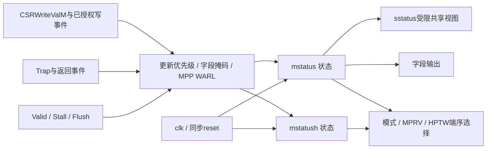

# 03：CSRStatus——RV32 共享状态寄存器

本轮新增 `riscvpipeline.privileged.CSRStatus`，保存 `mstatus` 和 RV32 高半部
`mstatush`，并从同一状态组合生成 `sstatus` 受限视图。采用显式 `clk/reset` 的
`RawModule`，高有效同步复位、上升沿更新、无读写穿透。尚未接入 CPU。
本轮不修改已交付的 CSRAccess 和 PrivDecode，不提前实现 CSRInterrupt。

## 教材与 CVW 依据

- 教材 §8.2.3.1，书页 343–346（PDF 页 378–381）：状态字段及受限视图。
- 图 8.3，书页 344（PDF 页 379）：RV32 `mstatus/mstatush` 布局。
- §8.2.2.3，书页 342（PDF 页 377）：MRET/SRET 的中断栈及 MPRV 更新。
- §8.4.3，书页 370（PDF 页 405）：CSR 状态子模块 `csrsr`。
- 本地 CVW revision `2f82f001139358be7646e910ff6fa2a140bed620` 的
  `src/privileged/csrsr.sv`：RV32 拼接、硬连字段、MPP WARL、端序选择及状态更新优先级。
- [官方 Machine-Level ISA](https://docs.riscv.org/reference/isa/priv/machine.html)
  的 Machine Status、Memory Privilege、Trap-Return、Reset 规则；编码布局同时参照
  [官方特权规范 PDF](https://docs.riscv.org/reference/isa/v20240411/_attachments/riscv-privileged.pdf)。

本模块用 Chisel 状态及位掩码重新表达 CVW 的更新规则。`sstatus` 是共享视图，
不是另一份寄存器；RV32 软件写 `mstatus` 不改写 `mstatush`。
本工程没有浮点、向量或其他扩展状态，FS/VS/XS/SD 固定为零，不保留 CVW 的浮点脏位输入。
H、调试、双陷阱和其他新扩展字段未实现。不存在标准 `sstatush` 接口。

CVW 在上层门控写事件、内部使用 StallW。本模块增加 ValidM/FlushM，
让独立测试和后续集成能够明确阻止无效更新，同时保护非法模式/目标的 Trap 和返回请求。
后续 Trap/PrivMode 仍负责事件仲裁、权限异常和实际当前模式转换。

## 配置、字段与视图

固定 RV32，U/M 始终支持；以下构造参数不会改变端口集合：

| 参数 | 默认 | 行为 |
| --- | --- | --- |
| `supervisorSupported` | true | 可裁剪 S 字段和 SRET/到 S 的 Trap；裁剪后 sstatus 视图为零 |
| `virtualMemorySupported` | false | 启用 SUM 和 SelHPTW 的 S 模式端序选择；要求支持 S |
| `bigEndianSupported` | false | 默认所有端序位为零；启用 UBE/SBE/MBE 状态及选择输出 |

配置只表示本模块字段/译码能力。可选 VM/端序并不意味着当前 CPU 有 MMU、页表遍历器
或大端字节交换；这些功能仍属于后续模块/章节。VM=true 且 S=false 在 elaboration 时拒绝。

| 字段 | mstatus 位 | sstatus 可见/可写 | 当前实现 |
| --- | --- | --- | --- |
| SIE | 1 | 是 | 支持 S 时可写 |
| MIE | 3 | 否 | 可写，Trap/返回更新 |
| SPIE | 5 | 是 | 支持 S 时可写 |
| UBE | 6 | 是 | 大端配置启用时可写；U 始终支持 |
| MPIE | 7 | 否 | 可写，Trap/返回更新 |
| SPP | 8 | 是 | 支持 S 时可写，U=0/S=1 |
| VS | 10:9 | 无有效状态 | 固定 0 |
| MPP | 12:11 | 否 | U=00/M=11；S 启用时还支持 01；10 和未支持值保留旧字段 |
| FS、XS | 14:13、16:15 | 无有效状态 | 固定 0 |
| MPRV | 17 | 否 | 可写；返回低于 M 时清零 |
| SUM | 18 | 是 | VM 启用时可写，否则固定 0 |
| MXR | 19 | 是 | 支持 S 时可写；无 MMU 时尚无访存效果 |
| TVM | 20 | 否 | 支持 S 时可写，供后续 CSR/PrivDecode 检查 |
| TW | 21 | 否 | 可写，供 PrivDecode/WFI 检查 |
| TSR | 22 | 否 | 支持 S 时可写，供 SRET 权限检查 |
| SD | 31 | 固定 0 | 无脏扩展状态 |
| 其他位 | — | — | 未实现/保留位读零、写入不保存 |

RV32 `mstatush` 只实现 MBE bit 5、SBE bit 4（需 S）；其他位固定零。
默认可写掩码为 `mstatus=0x007A19AA`、`sstatus=0x00080122`、`mstatush=0`。
启用 VM 和大端后分别为 `0x007E19EA`、`0x000C0162`、`0x30`。
这些是字段能力掩码；MPP=10 时不能直接按整字掩码接受，必须保留旧 MPP。

平台选择全部已实现状态复位为零，MPP=U 合法；这并不设置 CPU 当前模式为 U。
规范的整机复位进入 M 由后续 PrivMode 实现。不能把本模块的确定复位值推广为
所有实现都必须清零所有状态字段。

## 接口

生产端口共 30 个：显式 clk/reset，13 个 Bundle 输入、15 个 Bundle 输出。
Bundle RTL 端口带 `io_` 前缀。

| 方向 | 字段 | 位宽 | 用途 |
| --- | --- | --- | --- |
| 入 | `clk` | Clock | 更新上升沿 |
| 入 | `reset` | Bool | 高有效同步复位，优先于所有门控和事件 |
| 入 | `ValidM` | 1 | 当前状态更新事件有效；为零则保持 |
| 入 | `StallW`、`FlushM` | 各 1 | 任一为 1 时保持，不能清零寄存器 |
| 入 | `WriteMSTATUSM`、`WriteMSTATUSHM`、`WriteSSTATUSM` | 各 1 | 已经授权的软件写事件 |
| 入 | `CSRWriteValM` | 32 | 经 CSRAccess 读改写计算的写值 |
| 入 | `TrapM` | 1 | 确定进入目标模式的 Trap 事件 |
| 入 | `PrivilegeModeW` | 2 | Trap 来源/返回前当前模式，也用于数据访问端序选择 |
| 入 | `NextPrivilegeModeM` | 2 | Trap 目标；只接受 M 或启用的 S，且目标不低于来源 |
| 入 | `mretM`、`sretM` | 各 1 | 已译码返回事件；模块另检查模式与 SRET 的 TSR |
| 入 | `SelHPTW` | 1 | VM 配置下选择页表访问的 S 端序，优先于 MPRV |
| 出 | `MSTATUS_REGW`、`SSTATUS_REGW`、`MSTATUSH_REGW` | 各 32 | 组合读取当前保存状态及共享视图 |
| 出 | `STATUS_MPP`、`STATUS_FS` | 各 2 | MPP 状态、固定为 00 的 FS |
| 出 | `STATUS_SPP`、`STATUS_TSR`、`STATUS_TW`、`STATUS_TVM` | 各 1 | 状态字段 |
| 出 | `STATUS_MIE`、`STATUS_SIE`、`STATUS_MXR`、`STATUS_SUM`、`STATUS_MPRV` | 各 1 | 状态字段 |
| 出 | `BigEndianM` | 1 | 当前数据访问应选择大端的组合判断 |

ValidM 指“状态更新事件有效”。软件写/返回必须对应有效指令；若后续在流水线气泡间
提交中断 Trap，调用方必须把该 Trap 事件标为有效，不能仅依赖取到的指令有效位。
地址译码、CSR 存在性和软件访问权限由 CSR 汇总及 CSRAccess 提供，本叶模块不重复判断
Write 标志的地址/模式来源。S 被裁剪时，调用方必须把 sstatus 地址报告为不存在；
此处输出零视图不代表该 CSR 可合法访问。

## 更新顺序与陷阱返回

```text
reset > 保持门控(!ValidM || StallW || FlushM)
      > TrapM > mretM > sretM > WriteMSTATUSM > WriteMSTATUSHM > WriteSSTATUSM
```

同步复位只在上升沿清零；拉高 reset 但不发生边沿时，旧读值仍可见。
无效、停顿、冲刷只保持状态。输入改变不会提前修改 CSR 读值。

| 事件 | 用旧状态计算的更新 | 保持字段 |
| --- | --- | --- |
| Trap 到 M | MPIE=旧 MIE，MIE=0，MPP=当前来源模式 | S 栈、控制位、端序 |
| Trap 到 S | SPIE=旧 SIE，SIE=0，SPP=来源是否为 S | M 栈、控制位、端序 |
| MRET | MIE=旧 MPIE，MPIE=1，MPP=最低支持 U；旧 MPP 不为 M 时清 MPRV | S 栈、其他位、高半部 |
| SRET | SIE=旧 SPIE，SPIE=1，SPP=U，MPRV=0 | M 栈、其他位、高半部 |
| 写 mstatus | 更新当前配置可写字段；MPP 非法编码保留旧 MPP | mstatush |
| 写 mstatush | 只更新当前配置支持的 MBE/SBE | mstatus、sstatus |
| 写 sstatus | 只更新共享 S 视图字段 | M 专有字段和高半部 |

MRET 只在当前 M 时更新；SRET 要求支持 S，且当前 M 或 S 且 TSR=0。
当前模式 10、被裁剪的 S、到 U/保留目标的 Trap、从 M 向 S 的 Trap 不更新状态。
非法 Trap/返回请求仍占据对应优先级，保持整个状态，不落入同拍的低优先级软件写。
本模块不产生非法指令异常；PrivDecode 和后续 Trap/CSR 模块仍负责异常报告。
多个软件 Write 标志同拍为 1 时按表优先，集成通常应使它们互斥。

## 数据访问端序

默认大端配置关闭时 BigEndianM 始终为零。启用后有效访问模式按以下顺序选择：

1. VM 已启用且 SelHPTW=1：使用 SBE。
2. 当前 M 且 MPRV=1：按保存的 MPP 选择 MBE/SBE/UBE。
3. 否则按当前模式选择对应端序；不支持编码 10 输出零。

没有 VM 时 SelHPTW 输入被忽略；MPRV 在当前 S/U 时不会改变端序选择。
该输出是组合状态选择，ValidM/停顿/冲刷不会把它当状态寄存器清零。
这里不实现字节交换，也不改变指令取指端序。



## 算例

以下为独立模块的接口算例，尚不能作为当前 CPU 的特权程序执行：

```asm
csrsi mstatus, 8       # MIE=1
# U到M陷阱：MPIE=1，MIE=0，MPP=U
mret                  # MIE恢复1，MPIE=1，MPP=U，MPRV清零

li t0, 2
csrw sstatus, t0       # SIE=1；保留mstatus的MIE/MPIE/MPP/MPRV等M字段
```

默认配置写全一：mstatus 读回 `0x007A19AA`，sstatus 读回 `0x00080122`。
随后写 sstatus=0，只清 S 共享字段，M 专有字段仍保留。
若已有 MPP=M，写值的 MPP=10，MPP 仍为 M，而本次写值里的 MIE 等合法字段照常更新。
启用大端后先写 mstatush=0x30，再写 mstatus=0，高半部仍读回 0x30。

## 验证命令与覆盖

```bash
./scripts/sbt-local.sh compile 'Test / compile'
make test-csr-status SBT=./scripts/sbt-local.sh
make generate-csr-status SBT=./scripts/sbt-local.sh
verilator --lint-only --top-module CSRStatus generated/csr-status/CSRStatus.v
make test-pipeline SBT=./scripts/sbt-local.sh
make test SBT=./scripts/sbt-local.sh
```

生成入口 `GenerateCSRStatus [targetDir] [S] [VM] [bigEndian]`（布尔值 true/false），
Makefile 可覆盖 `CSR_STATUS_TARGET_DIR`、`CSR_STATUS_SUPERVISOR_SUPPORTED`、
`CSR_STATUS_VIRTUAL_MEMORY_SUPPORTED`、`CSR_STATUS_BIG_ENDIAN_SUPPORTED`。

```bash
make generate-csr-status SBT=./scripts/sbt-local.sh \
  CSR_STATUS_TARGET_DIR=generated/csr-status-vm-be \
  CSR_STATUS_SUPERVISOR_SUPPORTED=true CSR_STATUS_VIRTUAL_MEMORY_SUPPORTED=true \
  CSR_STATUS_BIG_ENDIAN_SUPPORTED=true
```

16 项测试覆盖同步复位与优先级、六种配置的手算可写掩码、共享视图及 M 字段保护、
MPP WARL、M/S 陷阱和中断栈、MRET/SRET 的旧值恢复与 MPRV、三个软件写优先级、
Valid/Stall/Flush 保持、无效事件不落入软件写、组合端序选择、三模块真实组合、
按字段随机状态参考、六种配置的 RTL 接口/时钟/同步复位，以及非法配置。
随机模型按字段维护状态，不复用 RTL 整字更新表达式；固定种子 `0x85a72026`，
六种合法配置各 512 拍（3072 拍），每拍检查边沿前旧值与边沿后新值。
真实组合包装层连接 CSRAccess、PrivDecode、CSRStatus，验证读改写、非法写不改变状态、
TSR 对 SRET 的权限控制及冲刷/停顿门控，CPU 生产代码仍不改变。

## 实际结果与提交

2026-10-07 在现有工具链上完成以下验证：

| 检查 | 实际结果 |
| --- | --- |
| 工程与测试编译 | `compile`、`Test / compile` 均通过 |
| CSRStatus 独立测试 | 16/16 通过，包含六种配置共 3072 拍随机状态序列 |
| RTL 生成 | 六种合法配置均成功，接口保持 30 个端口 |
| Verilator lint | 六种配置全部通过，无诊断；Verilator 5.036 |
| 流水线定向回归 | 18/18 通过，3 个测试套件 |
| 全部测试 | 160/160 通过，17 个测试套件 |
| 代码及文档检查 | `git diff --check`、Scala 行宽/空白、文档本地链接检查通过 |
| 独立只读审查 | 未发现严重或重要问题；实际结果占位内容已补齐 |

测试先确认缺失模块编译失败，再确认只有接口骨架时状态行为失败，最后实现后通过。
日志保存在本地忽略目录 `target/chapter8/csr-status/`：`compile.log`、`green.log`、
`generate.log`、`generate-configs.log`、六份 `lint-*.log`、`pipeline.log`、`suite.log`。
生成入口沿用工程已有的 `ChiselStage`，编译出现其弃用提示；未升级工具链。

前两轮提交为 `7f70103`、`711afd1`；第三轮在验证及独立审查后单独提交。
下一模块 CSRInterrupt 尚未开始。

## 用户检查清单

- [x] 检查 RV32 字段位置、共享 sstatus 视图和高半部独立写入。
- [x] 检查当前配置固定为零的字段和 MPP WARL 保留策略。
- [x] 检查同步复位、更新门控和所有优先级。
- [x] 检查陷阱/返回使用旧 IE/PIE/PP 状态，尤其 MPRV 清零条件。
- [x] 检查数据端序选择及可选配置未被误认为 CPU 功能。
- [x] 复现测试/生成/lint/回归，检查独立提交。
- [x] 明确认可本轮后再继续 CSRInterrupt。

本模块没有实际改变当前特权级、PC、Trap 仲裁、CSR 地址映射或 LSU 权限。
独立状态模块验证不等于 CPU 已支持 CSR、陷阱或大端访问；整机集成及验收仍按路线推进。
