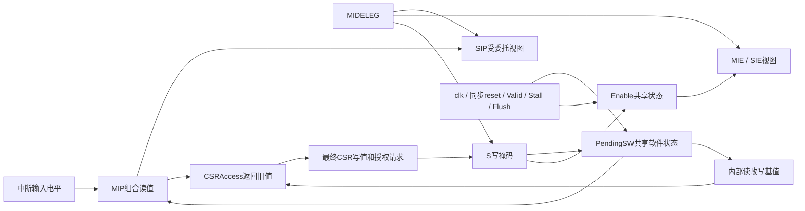

# 第四轮：CSRInterrupt 中断 pending 与 enable 状态

本轮新增独立 `riscvpipeline.privileged.CSRInterrupt`，实现 `mie/mip/sie/sip` 的状态、
共享视图和中断输入组合。当前 CPU 仍为第七章 RV32I；本模块没有接入流水线，
没有中断仲裁、陷阱跳转或外设控制器。上一轮 CSRStatus 已认可并提交为 `ebd56b5`。

## 参考位置与适配

- 教材 §8.2.5.3–§8.2.5.4，书页 354–356（PDF 页 389–391）：六种中断、委托视图、
  图 8.7 的位图和图 8.9 的 pending 来源。书页 357 的图 8.10 全局中断生成属于后续 Trap。
- 教材 §8.4.3，书页 370（PDF 页 405）：CSR 子模块划分，`csri` 负责 pending 与 enable。
- 本地 CVW `src/privileged/csri.sv`，参考版本
  `2f82f001139358be7646e910ff6fa2a140bed620`：写掩码、两组共享状态、M 写优先于 S 写，
  以及可选 Sstc 的 STIP 来源选择。

官方规范说明：`mip.SEIP` 的软件可写位与外部输入共同决定读取结果，CSRRS/CSRRC
只对软件位做读改写。否则一次无关位修改就可能把短暂外部电平变成持续的软件中断。
见 [Machine-Level ISA，中断寄存器](https://docs.riscv.org/reference/isa/priv/machine.html)。
`sip/sie` 访问对应的 `mip/mie` 字段，未委托位读为零；`sip` 的 SEIP/STIP 只读，SSIP 可写。
见 [Supervisor-Level ISA，中断寄存器](https://docs.riscv.org/reference/isa/priv/supervisor.html)。

适配保留 CVW 的 12 位内部中断总线，CSR 软件视图由调用方零扩展为 RV32 的 32 位。
本模块用独立四个写请求替代 CVW 内部的地址译码，沿用 CSRStatus 的 Valid/Stall/Flush 门控。
增加明确的 S 读取视图及两种读改写基值输出，便于后续连接 CSRAccess。
所有配置保持接口字段与位宽，暂不创建通用 CSR 地址映射或修改已有模块。

## 配置、时序与接口

```scala
new CSRInterrupt(supervisorSupported = true, sstcSupported = false)
```

支持三种配置：U/M、U/S/M、U/S/M 加 Sstc 输入选择；Sstc 必须同时启用 S，非法组合
在 elaboration 时通过 `require` 拒绝。默认支持 S，关闭 Sstc。
可选 Sstc 仅提供本模块需要的输入选择逻辑，**不表示 CPU 已支持 Sstc 扩展**。

生产模块是 `RawModule`，显式 `clk: Clock` 和高有效 `reset: Bool`，复位同步于时钟上升沿。
软件寄存器在沿后更新，CSR 访问的旧值在沿前读取；输入电平和 S 视图是组合输出。
包括 `clk/reset` 共 23 个端口：15 个 Bundle 输入、6 个 Bundle 输出。

| 输入 | 位宽 | 含义 |
| --- | --- | --- |
| `clk` | 1 | 状态更新时钟 |
| `reset` | 1 | 高有效同步复位，清零 enable 和软件 pending |
| `ValidM` | 1 | 当前软件写请求有效 |
| `StallW`、`FlushM` | 各 1 | 阻止本轮软件写提交 |
| `WriteMIEM`、`WriteMIPM` | 各 1 | 已授权的机器 CSR 写请求 |
| `WriteSIEM`、`WriteSIPM` | 各 1 | 已授权的监督 CSR 写请求，M 模式也可访问 S CSR |
| `CSRWriteValM` | 32 | CSRAccess 算出的最终写值，仅取低 12 位 |
| `MIDELEG_REGW` | 12 | 当前委托状态，只使用 S 中断位 1、5、9 |
| `MExtInt`、`SExtInt` | 各 1 | M/S 外部中断电平，需已经同步到 clk 域 |
| `MTimerInt`、`STimerInt` | 各 1 | M/S 定时器中断电平，需已经同步到 clk 域 |
| `MSwInt` | 1 | M 软件中断电平，需已经同步到 clk 域 |
| `ENVCFG_STCE` | 1 | 可选 Sstc 的 STIP 来源控制；无 Sstc 时忽略 |

| 输出 | 位宽 | 含义 |
| --- | --- | --- |
| `MIP_REGW` | 12 | 完整软件可见 pending，含硬件电平 |
| `MIE_REGW` | 12 | 共享中断 enable 状态 |
| `SIP_REGW`、`SIE_REGW` | 各 12 | 仅含已委托 S 中断的 pending/enable 视图 |
| `MIP_REGW_writeable` | 12 | 内部软件 pending，供 mip 的读改写基值使用 |
| `SIP_REGW_writeable` | 12 | 内部软件 pending 的受委托视图，供 sip 的读改写使用 |

`writeable` 拼写沿用 CVW。两个基值输出都不混入硬件输入；它们不是写权限掩码。
例如 `SIP_REGW_writeable` 可以包含软件 SEIP/STIP 的旧值，但通过 SIP 写时仍只更新 SSIP。
叶模块不重复检查当前模式、CSR 地址存在性或访问权限，也不产生非法访问异常：调用方必须
使用 CSRAccess 等逻辑授权后再发出写请求。未启用 S 时，后续 CSR 汇总模块应报告
`sie/sip` 不存在；本模块同时将 S 输出固定为零并忽略 S 写入。

## 六种中断字段与来源

未列出的所有位，以及扩展中断位，固定为零。

| 位 | pending/enable 名称 | pending 来源 | mip 写 | sip 写 |
| --- | --- | --- | --- | --- |
| 11 | MEIP / MEIE | `MExtInt` | 忽略 | 忽略 |
| 9 | SEIP / SEIE | `SExtInt OR PendingSW[9]`，要求 S | 写软件位 | 忽略 |
| 7 | MTIP / MTIE | `MTimerInt` | 忽略 | 忽略 |
| 5 | STIP / STIE | 软件位或可选 `STimerInt`，要求 S | 默认可写；Sstc+STCE 时忽略 | 忽略 |
| 3 | MSIP / MSIE | `MSwInt` | 忽略 | 忽略 |
| 1 | SSIP / SSIE | `PendingSW[1]`，要求 S | 可写 | 委托 bit 1 为 1 时可写 |

机器 pending 电平不保存为 CSR 状态，不能通过写 `mip` 清除；外设必须解除请求。
S 未启用时，SEIP、STIP、SSIP 及对应 enable 都为零，甚至 `SExtInt=1` 也不会冒出 SEIP。
本模块没有单独的 S 软件中断输入，SSIP 来自软件注入，保持教材及 CVW 的接口。

## 写掩码、共享视图和优先级

底层只保存 `Enable[11:0]` 与 `PendingSW[11:0]`，初值都为零；S CSR 不另建寄存器。
定义 `DelegatedMask = MIDELEG_REGW & (S ? 0x222 : 0)`，于是：

```text
SIE_REGW = Enable    & DelegatedMask
SIP_REGW = MIP_REGW  & DelegatedMask
SIP_REGW_writeable = PendingSW & DelegatedMask
```

即使调用方错误地把 MIDELEG 的 M 位也置一，S 视图仍不能暴露或修改 M 中断字段。
改变委托只改变组合视图和 S 写掩码，不改共享状态。撤销委托时，原有 enable 与 pending
继续保存在底层；再次委托后重新可见。MIDELEG 本身留给 CSRMachine 实现。

| 配置 | MIE 写掩码 | MIP 写掩码 | SIE 写掩码 | SIP 写掩码 |
| --- | --- | --- | --- | --- |
| S 关闭 | `0x888` | `0x000` | `0x000` | `0x000` |
| S 开启，Sstc 关闭 | `0xAAA` | `0x222` | `DelegatedMask` | `0x002 & DelegatedMask` |
| Sstc 开启，STCE=0 | `0xAAA` | `0x222` | `DelegatedMask` | `0x002 & DelegatedMask` |
| Sstc 开启，STCE=1 | `0xAAA` | `0x202` | `DelegatedMask` | `0x002 & DelegatedMask` |

机器写按掩码替换整组状态；S 写只合并其掩码内的位，保留所有其他字段。
同一拍的规则如下：

1. 同步复位优先，软件状态清零。
2. `ValidM && !StallW && !FlushM` 为假时保持软件状态。
3. Enable 组：`WriteMIEM` 优先于 `WriteSIEM`。
4. PendingSW 组：`WriteMIPM` 优先于 `WriteSIPM`。

两组更新彼此独立，接口允许一拍同时更新 enable 和 pending；后续正常 CSR 译码一般只
产生一个地址的请求。门控只针对软件状态，不抑制硬件 pending，也不使委托视图停止变化。
同步复位也不会掩盖已拉高的输入：复位后的 MIP 仍可显示硬件中断。

## 可选 Sstc 的边界

Sstc 开启且 `ENVCFG_STCE=1` 时，STIP 直接取 `STimerInt`；否则取软件 STIP。
该行为对应图 8.9 及 [官方 Sstc 规范](https://docs.riscv.org/reference/isa/v20250508/priv/sstc.html)。
默认配置忽略 `STimerInt` 与 `ENVCFG_STCE`，不会意外把定时器输入 OR 到软件 STIP。

仅切换 STCE 不更改软件状态。因此之前注入的 STIP 可以暂时隐藏，恢复 STCE=0 后重新可见。
沿用 CVW 的整字替换规则：STCE=1 时一次 MIP 写会用 `0x202` 保存新软件状态，清掉潜藏的
软件 STIP；SIP 写只修改 SSIP，会保留潜藏的 STIP。软件若恢复注入模式，需要按需重写 STIP。
`MIP_REGW_writeable` 始终返回内部软件状态，可以显示潜藏位；动态写掩码阻止其作为有效
STIP 写回。这里不额外发明独立的历史寄存器或边沿中断锁存。

本轮不生成 `time/stimecmp`，不实现 `menvcfg.STCE` 的状态或 Sstc CSR 权限，不实现 CLINT/PLIC。
未来连接方负责给 STimerInt 提供正确的比较结果，并把扩展存在性与访问权限对齐。

## 与 CSRAccess 的连接及数据流

后续 CSR 汇总模块应按地址选择下表（四个视图都先从 12 位零扩展到 32 位）：

| 地址 | CSR | `CSRReadValM` | `CSRModifyValM` |
| --- | --- | --- | --- |
| `0x304` | mie | `MIE_REGW` | `MIE_REGW` |
| `0x344` | mip | `MIP_REGW` | `MIP_REGW_writeable` |
| `0x104` | sie | `SIE_REGW` | `SIE_REGW` |
| `0x144` | sip | `SIP_REGW` | `SIP_REGW_writeable` |



这里的真实连接仅存在于测试包装层，生产 CPU 和前三轮模块没有修改。

## 汇编与手算示例

以下仅用于说明独立模块的接口行为，当前 CPU 尚不能运行这些 CSR 程序。

```asm
li t0, 0x80
csrs mie, t0          # 设置MTIE；不改变其他enable，不能用5位立即数表示0x80
li t0, 0x222
csrw mideleg, t0      # 由未来CSRMachine实现，委托三种S中断
csrsi mip, 2          # M模式注入SSIP
csrci sip, 2          # S模式清SSIP；只有已委托SSIP时有效
```

SEIP 的关键算例：`PendingSW=0`，`SExtInt=1`，执行 `csrrs t0, mip, t1`，`t1=2`。
`t0=0x200`，最终写值为 `0x002`，沿后 `PendingSW=0x002`、MIP=0x202。
随后外部电平下降，MIP 变为 `0x002`，没有粘住 SEIP。
若把软件可见 MIP 用作读改写基值，就会错误地把 0x200 写入软件状态。

共享视图算例：MIE=0xAAA，MIDELEG=0x020，写 SIE=0 后 MIE=0xA8A。
只清 STIE，M 使能和未委托的 SSIE/SEIE 均保留；把委托改成 0x222 后可读 SIE=0x202。
MIP=0x222、委托=0x222，写 SIP=0 后软件状态为 0x220，仅 SSIP 被清除。

## 验证命令与覆盖

```bash
./scripts/sbt-local.sh compile 'Test / compile'
make test-csr-interrupt SBT=./scripts/sbt-local.sh
make generate-csr-interrupt SBT=./scripts/sbt-local.sh
verilator --lint-only --top-module CSRInterrupt generated/csr-interrupt/CSRInterrupt.v
make test-pipeline SBT=./scripts/sbt-local.sh
make test SBT=./scripts/sbt-local.sh
```

生成入口 `GenerateCSRInterrupt [targetDir] [S] [Sstc]` 使用 true/false 参数。
例如生成可选 Sstc 输入选择配置：

```bash
make generate-csr-interrupt SBT=./scripts/sbt-local.sh \
  CSR_INTERRUPT_TARGET_DIR=generated/csr-interrupt-sstc \
  CSR_INTERRUPT_SUPERVISOR_SUPPORTED=true CSR_INTERRUPT_SSTC_SUPPORTED=true
```

U/M 配置把两个开关都设为 false。默认、U/M、Sstc 三种配置都需单独运行 lint。

16 项测试覆盖：同步复位和硬件电平、独立手算掩码、高位截断、每种输入位位置、SEIP 四种
组合、委托切换和错误 M 委托位、SIE/SIP 部分写、门控、两组写优先级、Sstc 来源及潜藏位、
真实 CSRAccess 读改写与权限连接、无 S 配置，以及生成接口/复位与非法配置。
随机参考模型按单个中断字段保存状态，不复用硬件整字更新表达式；固定种子 `0x8C512026`，
三种合法配置各 1024 拍，共 3072 拍；每拍检查沿前旧状态和沿后新状态。
接口测试实际生成 RTL，检查 23 个端口的名称/方向/位宽和上升沿同步复位。

## 实际结果与提交

2026-10-07 在现有工具链上完成以下验证：

| 检查 | 实际结果 |
| --- | --- |
| 工程与测试编译 | `compile`、`Test / compile` 均通过 |
| CSRInterrupt 独立测试 | 16/16 通过，包含三种配置共 3072 拍随机状态序列 |
| RTL 生成 | 默认、U/M、Sstc 三种配置均成功，接口保持 23 个端口 |
| Verilator lint | 三种配置全部通过，无诊断；Verilator 5.036 |
| 流水线定向回归 | 18/18 通过，3 个测试套件 |
| 全部测试 | 176/176 通过，18 个测试套件 |
| 代码及文档检查 | `git diff --check`、Scala 行宽/空白、文档本地链接检查通过 |
| 独立只读审查 | 源码、测试、说明及三配置 RTL 均已审查，无严重、重要或次要问题 |

测试先确认缺失模块编译失败，再确认只有接口骨架时状态行为失败，最后实现后通过。
日志保存在本地忽略目录 `target/chapter8/csr-interrupt/`：`compile.log`、`green.log`、
`module.log`、`generate.log`、`generate-configs.log`、三份 `lint-*.log`、`pipeline.log`、
`suite.log`。生成入口沿用现有 `ChiselStage`，编译出现其弃用提示；未升级工具链。

本轮单独 Git 提交；不自动推进下一模块 CSRMachine。

## 用户检查清单

- [x] 核对六种中断位位置及无 S 配置的固定零字段。
- [x] 核对 SEIP 读值与读改写基值分离，外部电平不会被保存。
- [x] 核对 S 视图受委托限制，SIP 只写 SSIP，SIE 保留不可写字段。
- [x] 核对同步复位、提交门控、两组优先级以及实时硬件输入。
- [x] 核对可选 Sstc 的来源选择、潜藏 STIP 规则与尚未实现的扩展功能。
- [x] 复现生成、测试和 lint，检查独立提交。
- [x] 明确认可本轮后，再继续 CSRMachine。

本模块已验证的是状态及接口行为；CPU 尚未支持 CSR 或处理中断。
中断使能的全局条件、优先级、陷阱处理、WFI 唤醒及整机验收留在后续轮次。
仿真及 lint 不代表综合质量或时序收敛结果。
