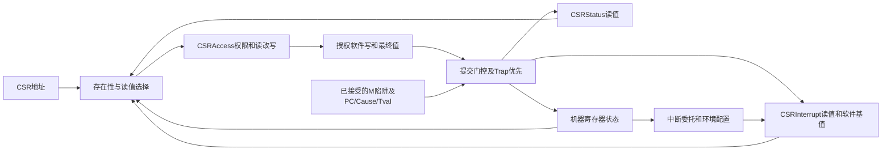

# 第五轮：CSRMachine 机器模式 CSR

新增独立 `riscvpipeline.privileged.CSRMachine`，管理机器陷阱记录、向量、委托、计数控制、
环境配置和标识读取，并连接已有机器状态及中断 CSR 的地址接口。当前生产 CPU 未接入这些
模块，仍为第七章 RV32I。第四轮已认可并提交为 `1970fc7`；本轮完成后停在检查点。

## 参考与适配

- 教材 §8.2.3.2–§8.2.3.6，书页 346–349（PDF 页 381–384）：misa、标识、计数控制、
  环境配置及图 8.5 的 RV32 高低半部。
- §8.2.4–§8.2.5，书页 349–357（PDF 页 384–392）：复位、机器陷阱记录、委托和向量。
- §8.4.3，书页 370（PDF 页 405）：CSR 子模块、地址译码、标识与固定 misa。
- §8.4.6，书页 377–378（PDF 页 412–413），图 8.17：Wally 向量模式采用 64 字节对齐。
- 本地 CVW `src/privileged/csrm.sv` 及 `csr.sv`，版本
  `2f82f001139358be7646e910ff6fa2a140bed620`：机器寄存器、掩码、EPC/Cause 格式及读值选择。

依据 [官方 Machine-Level ISA](https://docs.riscv.org/reference/isa/priv/machine.html)，
固定 IALIGN=32 时 EPC 的低两位始终为零；计数器访问许可与停止增长是两种不同控制，
`mcountinhibit` 不控制 time。misa 地址属于读写类别，但实现可以固定字段；不能把“写入后
不变”与对只读 CSR 地址写入的非法访问混同。

本轮将 CVW 上层完成的 EPC/Cause 选择和格式化移入本模块，让软件写与陷阱写各自明确。
MTrap 优先所有软件提交，也抑制向其他叶模块发出的写请求。未知 CSR 用存在性输出交给
CSRAccess 判定。PMP 不在本轮实现；未启用 VM 时屏蔽页故障委托位，未配置 HPM 时屏蔽
对应计数控制位。标识使用本项目默认零值，**不复制 OpenHW/Wally 的厂商或架构编号**。

## 配置与时序

```scala
new CSRMachine(
  supervisorSupported = true,
  virtualMemorySupported = false,
  sstcSupported = false,
  vectoredInterruptsSupported = true,
  hpmCounters = 0,
  hartId = 0
)
```

固定 RV32、IALIGN=32、I/U；S 可选。VM、Sstc 必须启用 S，HPM 个数为 0–29，对应
HPM3 到 HPM(hpmCounters+2)，hartId 为 32 位无符号值。非法参数在 elaboration 时拒绝。
这些配置只控制本叶模块的字段和接口行为，不意味着 CPU 已具备 VM、Sstc 或性能计数器。
后续调用方必须为全部叶模块和计数器采用一致配置。

`RawModule` 显式 `clk` 和高有效同步 `reset: Bool`；所有自有状态复位为零。
地址读值、存在性、修改基值和转发写请求为组合逻辑；寄存器写在上升沿提交。
64 位环境状态使用两份独立 32 位寄存器保存。共 34 个端口，所有配置保持方向及位宽。

| 输入 | 位宽 | 含义 |
| --- | --- | --- |
| `clk/reset` | 各 1 | 时钟与高有效同步复位 |
| `ValidM` | 1 | 本次更新事件有效，包含无有效指令时接受的中断事件 |
| `StallW/FlushM` | 各 1 | 抑制本次状态更新 |
| `CSRWriteM` | 1 | 已由 CSRAccess 授权的写意图 |
| `MTrapM` | 1 | 已由调用方仲裁、目标为 M 的陷阱事件 |
| `CSRAdrM` | 12 | CSR 地址，读取无需 ValidM 或写请求 |
| `CSRWriteValM` | 32 | CSRAccess 计算出的软件最终写值 |
| `NextEPCM` | 32 | 陷阱原始返回位置，模块清低两位 |
| `NextCauseM` | 6 | bit 5 为中断标志，bits 4:0 为原因编号 |
| `NextXtvalM` | 32 | 陷阱辅助值；其选择由后续 CSR/Trap 汇总负责 |
| `MSTATUS_REGW/MSTATUSH_REGW` | 各 32 | 来自 CSRStatus 的合法状态读值 |
| `MIP_REGW/MIE_REGW` | 各 12 | 来自 CSRInterrupt 的 pending/enable |
| `MIP_REGW_writeable` | 12 | 中断软件状态，供 mip 读改写，不包含外部输入 |

| 输出 | 位宽 | 含义 |
| --- | --- | --- |
| `CSRMExistsM` | 1 | 此地址在当前机器寄存器组中存在，不是访问授权 |
| `CSRMReadValM/CSRMModifyValM` | 各 32 | 软件读值及读改写基值，未知地址为零 |
| `MTVEC_REGW/MEPC_REGW/MCAUSE_REGW/MTVAL_REGW/MSCRATCH_REGW` | 各 32 | 向量、陷阱记录及 scratch 状态 |
| `MCOUNTEREN_REGW/MCOUNTINHIBIT_REGW` | 各 32 | 访问许可及停止增长控制 |
| `MEDELEG_REGW/MIDELEG_REGW` | 16 / 12 | 异常及中断委托，CSR 读取零扩展为 32 位 |
| `MENVCFG_REGW` | 64 | 环境配置完整值，低/高 CSR 分开读写 |
| `WriteMSTATUSM/WriteMSTATUSHM` | 各 1 | 转发给 CSRStatus 的已门控写请求 |
| `WriteMIEM/WriteMIPM` | 各 1 | 转发给 CSRInterrupt 的已门控写请求 |

本模块不检查当前特权级，不产生非法指令标志。调用方把 `CSRMExistsM` 接入存在性汇总，
由 CSRAccess 检查权限及只读地址；正常的 `CSRWriteM` 必须已经授权。
即使误传只读地址或未知地址的写请求，本模块也不修改任何状态，不发出写 strobe。
地址存在性只依赖地址和配置，绝不依赖 CSRWriteM，避免与 CSRAccess 构成组合环。

## 地址表与可写字段

除下表地址外，本机器组报告不存在；S 关闭时 `medeleg/mideleg` 也不存在且输出为零。
PMP、计数器本体、调试及其他扩展地址不能以“固定零读取”伪装成已实现 CSR。
后续其他 CSR 组可以通过存在性汇总实现它们。

| 地址 | CSR | 读取与写入行为 |
| --- | --- | --- |
| `0x300` | mstatus | 读 CSRStatus；软件写转发，不另建状态 |
| `0x301` | misa | 固定 RV32 I/U/(S)，软件写合法但忽略 |
| `0x302` | medeleg | S 存在时可写；无 VM 掩码 `0x03FF`，有 VM 为 `0xB3FF` |
| `0x303` | mideleg | S 存在时可写，掩码 `0x222`，M 中断不可委托 |
| `0x304` | mie | 读 CSRInterrupt 并零扩展；软件写转发 |
| `0x305` | mtvec | Direct 四字节对齐，Vectored 64 字节对齐 |
| `0x306` | mcounteren | CY/TM/IR 与已配置 HPM 位；默认掩码 `0x7` |
| `0x30A` | menvcfg | 环境配置低半，仅可选 FIOM bit 0 |
| `0x310` | mstatush | RV32 始终存在；由 CSRStatus 决定可写字段 |
| `0x31A` | menvcfgh | 环境配置高半，仅可选 STCE bit 31，即完整 bit 63 |
| `0x320` | mcountinhibit | CY/IR 与已配置 HPM 位，TM bit 1 固定零；默认掩码 `0x5` |
| `0x340` | mscratch | 全 32 位读写 |
| `0x341` | mepc | 软件和陷阱写都清低两位 |
| `0x342` | mcause | 保存 bit 31 中断标志与 bits 4:0 原因；其他位为零 |
| `0x343` | mtval | 全 32 位读写，陷阱时记录原始 NextXtvalM |
| `0x344` | mip | 读硬件/软件 pending，修改基值只取内部软件状态；软件写转发 |
| `0xF11/0xF12/0xF13` | mvendorid/marchid/mimpid | 只读零，表示未分配/未提供本项目标识 |
| `0xF14` | mhartid | 只读配置 hartId，默认零 |
| `0xF15` | mconfigptr | 只读零，没有配置描述结构 |

默认 misa=`0x40140100`；关闭 S 为 `0x40100100`。MXL=01、I=bit 8、U=bit 20、S=bit 18，
不报告 M/A/C/F/D/H 等未实现的单字母扩展。Zicsr 等多字母扩展不能单靠 misa 表示。
这些常量描述本独立特权组的目标配置，不能当作当前生产 CPU 的可执行能力证明。

MEDELEG 保留原因 0–9；VM 配置再保留 12、13、15 页故障。bit 11 的 M-ECALL 永远为零；
委托掩码不能导致 M 模式异常向下降权，实际目标选择由后续 Trap 负责。
HPM 个数为 29 时，MCOUNTEREN 可写掩码 `0xFFFFFFFF`，MCOUNTINHIBIT 为 `0xFFFFFFFD`。
本轮只提供控制状态，没有计数递增、退休判定或低特权计数读取权限逻辑。

环境低半 FIOM 只有 VM 配置才可写；无 VM 时固定零。STCE 只有 Sstc 配置才可写。
其余 PBMTE、ADUE、缓存管理和新扩展字段均固定零。低半写不改变高半，高半写不改变低半。
完整 STCE 值可用于上一轮 CSRInterrupt 的 STIP 选择，stimecmp/time 及其权限仍未实现。

## 更新优先级、WARL 和陷阱格式

1. 同步复位优先，所有自有状态清零，转发写请求在 reset 拉高时就被抑制。
2. `ValidM && !StallW && !FlushM` 为假时，软件状态和陷阱记录均保持。
3. 允许更新且 `MTrapM=1`：原子更新 MEPC/MCAUSE/MTVAL，禁止所有软件写与转发写请求。
4. 其余情况下，已授权且存在的 CSR 软件写只更新选中的寄存器或生成相应转发请求。

读取始终返回当前旧状态，不以 Valid/Stall/Flush 门控。复位在沿前也不异步清空状态。
MTrapM 表示已被接受的机器事件，不是原始中断引脚；调用方负责异常/中断优先级及精确 PC。
ValidM 是更新事件有效性，后续集成不能只用指令有效位而丢掉指令气泡边界的合法中断。

```text
MTrapM: MEPC = NextEPCM & 0xFFFFFFFC
        MCAUSE = (NextCauseM[5] << 31) | NextCauseM[4:0]
        MTVAL = NextXtvalM
```

mcause 的软件写采用同样的 bit 31/低 5 位格式，遵循本章 CVW 的原因宽度。
这不实现完整新扩展原因集合；调用方不得把更宽原因静默截成 5 位输入。

TVEC 采用 CVW 的确定 WARL 规则，而不是保存保留模式编码：

| 原始 MODE[1:0] | 向量支持开启 | 向量支持关闭 |
| --- | --- | --- |
| 00 / 10 | Direct，清低两位 | Direct，清低两位 |
| 01 / 11 | Vectored，清低六位后置 bit 0 | Direct，清低两位 |

模式 10/11 都映射为合法模式。此轮只保存向量状态；`BASE + 4*cause` 的实际入口计算留给
CSR 汇总，MTVEC 并不直接驱动当前 CPU 的 PC。

## 数据流与真实连接



测试包装层把 CSRAccess 的地址、存在性、读值、修改基值及写结果实际接上 CSRMachine，
再连接 CSRStatus/CSRInterrupt；验证共享旧值、机器委托、外部 SEIP 与陷阱时写请求抑制。
生产代码中的叶模块保持独立，CPU 及前四轮源码没有变动。

## 汇编与手算示例

以下为独立接口算例，当前 CPU 尚不能执行这些 CSR 指令。

```asm
li t0, 0x8000013d
csrw mtvec, t0         # 向量支持开启：读回0x80000101，BASE=0x80000100
li t0, 0x80001237
csrw mepc, t0          # 固定IALIGN32：读回0x80001234
li t0, -1
csrw medeleg, t0       # 默认无VM配置：读回0x000003ff
csrw mideleg, t0       # 读回0x222，机器中断位不能委托
csrw mcounteren, t0    # 默认HPM=0：读回7
csrw mcountinhibit, t0 # 默认HPM=0：读回5，time不能被它停止
```

机器定时器事件：NextEPC=0x80001237、NextCause=`0b100111`、NextXtval=0，允许的上升沿后
MEPC=0x80001234、MCAUSE=0x80000007、MTVAL=0。同拍软件写 mscratch 或 mie 不会提交。
外部 SEIP=1、内部软件状态=0，`csrrs t0, mip, t1` 且 t1=2 时读回 0x200，最终软件写值为 2，
从外部输入读取的 0x200 不会被写回锁存。

## 验证入口与覆盖

```bash
./scripts/sbt-local.sh compile 'Test / compile'
make test-csr-machine SBT=./scripts/sbt-local.sh
make generate-csr-machine SBT=./scripts/sbt-local.sh
verilator --lint-only --top-module CSRMachine generated/csr-machine/CSRMachine.v
make test-pipeline SBT=./scripts/sbt-local.sh
make test SBT=./scripts/sbt-local.sh
```

生成入口：`GenerateCSRMachine [targetDir] [S] [VM] [Sstc] [vector] [HPM] [hartId]`。
布尔参数 true/false，hartId 支持十进制和 0x 十六进制。Makefile 默认与构造参数一致，例如：

```bash
make generate-csr-machine SBT=./scripts/sbt-local.sh \
  CSR_MACHINE_TARGET_DIR=generated/csr-machine-vm-sstc \
  CSR_MACHINE_SUPERVISOR_SUPPORTED=true CSR_MACHINE_VIRTUAL_MEMORY_SUPPORTED=true \
  CSR_MACHINE_SSTC_SUPPORTED=true CSR_MACHINE_VECTORED_INTERRUPTS_SUPPORTED=true \
  CSR_MACHINE_HPM_COUNTERS=29 CSR_MACHINE_HART_ID=0xffffffff
```

17 项测试覆盖全部已知地址及不存在地址、固定 misa/标识、读值/修改基值分离、写 strobe、
同步复位、EPC/Cause 格式、TVEC 模式、陷阱原子记录和所有门控、委托、计数控制及环境半字、
真实四模块连接、随机状态模型、生成接口及非法配置。无 S/有 S 各遍历所有 4096 个 CSR 地址；
64 种陷阱原因全部检查，HPM 掩码手算向量覆盖 0/1/3/29。
固定种子 `0x8D612026`，四种代表配置各 512 拍，共 2048 拍，逐拍检查沿前/沿后状态与读值。
参考模型采用地址字典、逐位允许集与算术对齐，不复用 RTL 掩码或构造函数。

RTL 生成/lint 采用十组配置：U/M、基本 S、S+VM、S+Sstc、S+VM+Sstc 各配 Direct-only 和
支持 Vectored 两种开关；最后两组同时检查 HPM=29、hartId=0xFFFFFFFF。仿真和接口测试另
覆盖 HPM=1/3、默认及最高 hartId；这不等于所有 30 个 HPM 个数均进行了穷举仿真。

## 实际结果与提交

2026-10-07 在现有工具链上完成以下验证：

| 检查 | 实际结果 |
| --- | --- |
| 工程与测试编译 | `compile`、`Test / compile` 均通过 |
| CSRMachine 独立测试 | 17/17 通过，含 8192 次地址检查、64 种 cause、2048 拍随机序列 |
| RTL 生成 | 十组配置均成功，接口保持 34 个端口 |
| Verilator lint | 十组配置全部通过，无诊断；Verilator 5.036 |
| 流水线定向回归 | 18/18 通过，3 个测试套件 |
| 全部测试 | 193/193 通过，19 个测试套件 |
| 代码及文档检查 | `git diff --check`、Scala 行宽/空白、文档本地链接检查通过 |
| 独立只读审查 | 无严重或重要问题；审查时的实际结果占位内容已补齐 |

测试先确认缺失模块时有 5 个类型错误，再确认无状态接口骨架的 17 项测试中 16 项失败，
实现后全部通过。日志位于本地忽略目录 `target/chapter8/csr-machine/`，包括 `compile.log`、
`green.log`、`module.log`、`generate.log`、`generate-configs.log`、十份 `lint-*.log`、
`pipeline.log` 和 `suite.log`。沿用工程 `ChiselStage` 的弃用提示保留，未升级工具链。

本轮单独提交，不开始下一模块 CSRSupervisor。

## 用户检查清单

- [x] 核对机器 CSR 地址、未知/PMP/计数器本体不存在的边界。
- [x] 核对固定 misa 与本项目标识值，不把写忽略误当非法访问。
- [x] 核对陷阱原子记录、旧值读取、所有门控及转发写抑制。
- [x] 核对 EPC/Cause 格式和 Direct/Vectored 的 WARL 对齐规则。
- [x] 核对 S/VM 委托掩码、计数控制范围及 TM 不能 inhibit。
- [x] 核对 MENVCFG 高低半保持和未实现扩展固定零。
- [x] 复现测试、生成、lint，检查独立 Git 提交。
- [x] 明确认可本轮后，再继续 CSRSupervisor。

本轮通过的是独立机器寄存器和接口验证，不等于 CPU 已支持 CSR、陷阱或中断。
PMP、MMU、完整 Sstc、计数器本体、特权转换、Trap 仲裁及 PC 入口计算仍留在后续范围。
未以仿真或 lint 宣称形式等价、综合质量或物理时序收敛。
