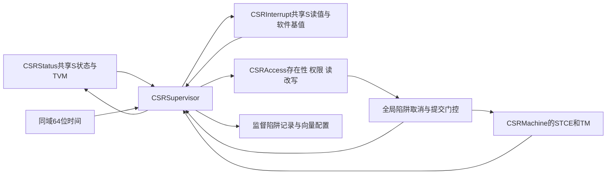

# 第六轮：CSRSupervisor 监督模式 CSR

新增独立 `riscvpipeline.privileged.CSRSupervisor`，保存监督陷阱记录、向量、scratch、
计数访问许可、环境配置、satp 和可选 Sstc 比较值，并转发已有 sstatus/sie/sip 视图。
第五轮已认可并提交为 `bcdc7d8`。本轮完成测试和单独提交后停止，等待检查。
**独立模块已验证不等于 CPU 已支持 CSR**：生产 `RiscvPipeline` 仍为第七章 RV32I。

## 参考与适配

- 教材第八章，书页 335–381（PDF 页 370–416）；§8.2.3，书页 342–343（PDF 页 377–378）
  的监督 CSR；§8.2.3.1 的 TVM 以及 §8.2.3.4–6，书页 346–349（PDF 页 381–384）
  的计数许可、环境配置与 RV32 半字。
- §8.2.5，书页 350–357（PDF 页 385–392）：监督陷阱记录、Sstc、中断与向量。
- §8.4.3，书页 370（PDF 页 405）：CSR 子模块组织；§8.4.6，书页 377–378
  （PDF 页 412–413）：CVW 的向量入口与 64 字节对齐。
- 本地 CVW `src/privileged/csrs.sv`、`csr.sv`，版本
  `2f82f001139358be7646e910ff6fa2a140bed620`：地址表、寄存器、读值选择、
  satp/STCE 权限、stimecmp 两半及时间比较。

本轮沿用 CVW 的 EPC/Cause 格式、向量 WARL 规则和复位零，但将格式化与权限明确放在
独立叶模块中。共享状态由 CSRStatus/CSRInterrupt 保存，不另建 sstatus/sie/sip 寄存器。

两处按官方规范调整本地 CVW 的配置分支：

1. S 存在时 satp 始终存在；无 VM 实现 Bare、读取零、合法写忽略。有 VM 时保存 Sv32 的
   MODE/PPN 与配置的低 ASID 位；Bare 写规范化为零。本项目不实现 Bare 自定义字段。
   官方要求 Bare 软件将其余字段写零，非零字段不能作为可移植的软件行为依赖。
   [Supervisor-Level ISA](https://docs.riscv.org/reference/isa/priv/supervisor.html)。
2. M 模式可访问 stimecmp/stimecmph，即使 STCE 或 mcounteren.TM 为零；S 模式要求两者
   同时为一。存在性与这些权限独立，不能把权限禁止误报为未实现地址。
   [官方 Sstc 扩展](https://docs.riscv.org/reference/isa/v20250508/priv/sstc.html)。

TVM 只禁止 S 访问 satp，M 不受影响。这里不执行 SFENCE.VMA，其译码由 PrivDecode 完成，
实际 TLB 行为属于后续章节。
[Machine-Level ISA](https://docs.riscv.org/reference/isa/priv/machine.html)。

## 配置、时序与接口

```scala
new CSRSupervisor(
  supervisorSupported = true,
  virtualMemorySupported = false,
  sstcSupported = false,
  vectoredInterruptsSupported = true,
  hpmCounters = 0,
  asidBits = 0
)
```

固定 RV32、IALIGN=32。VM/Sstc 要求 S；HPM 个数 0–29；Sv32 ASID 位数 0–9，非零 ASID
要求 VM。配置错误在 elaboration 时拒绝。这些开关只描述本叶模块，不表示当前 CPU 已有
MMU、计数器或 Sstc 整机能力。后续调用方必须为各叶模块使用一致配置。

`RawModule` 显式时钟与高有效同步 Bool 复位；十份 32 位自有状态均复位为零，比较值分两半
保存。共 38 个端口，各配置方向/位宽稳定。S 关闭时所有输出恒零、地址均不存在，
不接受任何软件写或陷阱；生成器可优化掉全部状态，仍保留 clk/reset 接口。

| 输入 | 位宽 | 含义 |
| --- | --- | --- |
| `clk/reset` | 各 1 | 时钟及高有效同步复位 |
| `ValidM` | 1 | 更新事件有效；后续须覆盖气泡边界接受的中断事件 |
| `StallW/FlushM` | 各 1 | 抑制本次状态更新 |
| `CSRWriteM` | 1 | CSRAccess 已授权的软件写意图 |
| `STrapM` | 1 | 调用方已仲裁、目标为 S 的陷阱事件 |
| `CSRAdrM/CSRWriteValM` | 12 / 32 | CSR 地址与最终软件写值 |
| `NextEPCM/NextXtvalM` | 各 32 | 陷阱原始返回地址及辅助值 |
| `NextCauseM` | 6 | bit 5 为中断标志，bits 4:0 为原因 |
| `PrivilegeModeW` | 2 | 事件前模式：U=00、S=01、M=11；10 不支持 |
| `STATUS_TVM` | 1 | CSRStatus 的 TVM |
| `ENVCFG_STCE/MCOUNTEREN_TM` | 各 1 | CSRMachine 的 STCE、TM 许可 |
| `TIME_REGW` | 64 | 调用方提供的同一时钟域、一致的完整时间值 |
| `SSTATUS_REGW` | 32 | CSRStatus 已合法化的共享 S 视图 |
| `SIP_REGW/SIE_REGW` | 各 12 | CSRInterrupt 已按委托过滤的共享读视图 |
| `SIP_REGW_writeable` | 12 | 已过滤的内部软件 pending，不含外部电平 |

| 输出 | 位宽 | 含义 |
| --- | --- | --- |
| `CSRSExistsM` | 1 | 地址在此组中存在，仅依赖地址与配置 |
| `CSRSAccessAllowedM` | 1 | 地址存在且通过模式及附加权限检查 |
| `CSRSReadValM/CSRSModifyValM` | 各 32 | 软件旧值与修改基值；禁止访问时均为零 |
| `STVEC_REGW/SEPC_REGW/SCAUSE_REGW/STVAL_REGW/SSCRATCH_REGW` | 各 32 | 向量、陷阱记录及 scratch |
| `SCOUNTEREN_REGW/SATP_REGW/SENVCFG_REGW` | 各 32 | 计数许可、地址空间和环境配置 |
| `STIMECMP_REGW` | 64 | 比较值完整状态，高/低 CSR 各写一半 |
| `STimerInt` | 1 | 原始无符号比较结果，非已接受的陷阱 |
| `WriteSSTATUSM/WriteSIEM/WriteSIPM` | 各 1 | 已门控的软件写 strobe |

读取、存在性和权限是组合输出，不依赖 Valid/Stall/Flush，也不依赖 CSRWriteM，避免与
CSRAccess 构成组合环。叶模块不生成非法指令异常；CSRAccess 用 Exists/Allowed 判定。
虽然输入写意图应已授权，本模块仍检查 Allowed，禁止未授权状态更新和转发写。

## 地址、权限与数据格式

| 地址 | CSR | 行为 |
| --- | --- | --- |
| `0x100` | sstatus | 共享读值，写转发给 CSRStatus |
| `0x104` | sie | 共享 12 位读值零扩展，写转发给 CSRInterrupt |
| `0x105` | stvec | Direct 四字节对齐；Vectored 64 字节对齐 |
| `0x106` | scounteren | CY/TM/IR 和已配置 HPM 位；默认写掩码 7 |
| `0x10A` | senvcfg | 有 VM 仅 FIOM bit 0 可写，否则固定零 |
| `0x140` | sscratch | 全 32 位读写 |
| `0x141` | sepc | 软件和陷阱写均清低两位 |
| `0x142` | scause | 保存 bit 31 中断标志和 bits 4:0 原因 |
| `0x143` | stval | 全 32 位读写；陷阱时记录 NextXtvalM |
| `0x144` | sip | 读含外部 pending，修改基值只含内部软件状态；写转发 |
| `0x180` | satp | S 存在即存在；S 访问受 TVM 限制 |
| `0x14D/0x15D` | stimecmp/stimecmph | 仅 Sstc 配置存在，读写低/高 32 位 |

默认 11 个地址，Sstc 为 13 个；其他地址报告不存在。时间计数器、HPM 本体、调试、
MMU/PMP 等不能以固定零读值伪装成已经实现的地址。

| 当前模式 | 普通本组地址 | satp | stimecmp 两半（已配置 Sstc） |
| --- | --- | --- | --- |
| M=11 | 允许 | 允许，不受 TVM 影响 | 允许，不受 STCE/TM 影响 |
| S=01 | 允许 | 要求 TVM=0 | 要求 STCE=1 且 TM=1 |
| U=00 / 保留 10 | 禁止 | 禁止 | 禁止 |

无 S 或未知地址：Exists=0、Allowed=0。存在但禁止：Exists=1、Allowed=0，读取及修改基值
均为零。共享 SIP 输入应已按 MIDELEG 过滤，本组不重复过滤；外部 SEIP=1、软件 pending=0
时，sip 可读到 0x200，但 RS/RC 基值为零，外部电平不会被锁存为软件 pending。

stvec 的确定 WARL 规则与上一轮相同：原 MODE 00/10 映射 Direct 并清低两位；01/11 在
支持向量时清低六位后置 bit 0，不支持向量时都映射 Direct。此轮不计算陷阱入口 PC。
scounteren 的 HPM0/1/3/29 掩码为 0x7/0xF/0x3F/0xFFFFFFFF；这些访问许可不驱动计数增长。
senvcfg 不支持的缓存管理及新扩展字段均固定零，FIOM 的实际 Fence 效果也未接入 CPU。

satp 的 Sv32 格式为 MODE[31]、ASID[30:22]、PPN[21:0]。MODE=1 时保留完整 22 位 PPN，
ASID 只保留配置数量的最低位；ASID0/1/4/9 的整字掩码分别为
0x803FFFFF/0x807FFFFF/0x83FFFFFF/0xFFFFFFFF。MODE=0 写入统一保存零。
无 VM 时任何合法写忽略并保持零，S TVM=1 仍禁止访问。保存 satp 不执行地址翻译、
TLB 刷新或内存访问，不应在当前 CPU 上启用 Sv32 软件流程。

## 提交、陷阱及时间比较

1. 同步复位优先；沿前不异步清空状态，但 reset 拉高立即抑制转发写请求。
2. `ValidM && !StallW && !FlushM` 为假时保持所有状态。
3. `STrapM=1` 优先软件写：来源为 U/S 时原子更新 SEPC/SCAUSE/STVAL，所有软件和转发写
   均取消。来源 M/保留 10 时保持所有状态，不能落入同拍软件写。
4. 其余情况下，授权软件写只修改选中状态或发出对应共享状态写 strobe。

```text
SEPC   = NextEPCM & 0xFFFFFFFC
SCAUSE = (NextCauseM[5] << 31) | NextCauseM[4:0]
STVAL  = NextXtvalM
```

软件 scause 写只保留 bit 31/低五位，遵循本章原因宽度，不支持更宽的新扩展原因集合。
STrapM 是已接受的事件；委托、异常/中断仲裁、精确 EPC 和特权转换仍由后续模块负责。
ValidM 是事件有效性，集成时不能仅用指令有效位而丢掉气泡边界的合法中断。
**跨 CSR 组的写取消由调用方统一完成**：MTrap 或 STrap 任一成立，应屏蔽所有 CSR 软件写。
本叶模块只认识 STrap；不能依赖它独自取消机器组或其他组的写入。

Sstc 配置下 `STimerInt = (TIME_REGW >= STIMECMP_REGW)`，两侧均为无符号 64 位。
写 stimecmp/stimecmph 各只改变一半，读取允许状态下返回对应旧半字。
TIME_REGW 的来源和跨域一致性由调用方保证，本轮不实现 CLINT 或 time 计数器。
比较输出不受 Valid/Stall/Flush、特权级、STCE、TM 或 reset 电平直接门控。
比较寄存器复位为零，因此复位完成后时间为零也可产生原始 pending=1；
CSRInterrupt 使用 STCE 选择 Sstc 比较或软件 STIP，Trap 再判断使能与是否接受。
没有 S/Sstc 时比较输出和完整比较状态恒零。

## 数据流与算例



测试包装层实际连接 CSRAccess、CSRMachine、CSRSupervisor、CSRStatus、CSRInterrupt 五个
模块，验证共享视图、权限反馈、软件修改基值、计时中断和跨组陷阱写隔离。
包装层仅属于测试，生产 CPU 与前五轮源码均未改动。

以下为独立接口算例，当前 CPU 尚不能执行：

```asm
li t0, 0x8000013d
csrw stvec, t0        # 支持向量时读回0x80000101
li t0, 0x80001237
csrw sepc, t0         # 读回0x80001234
li t0, -1
csrw scounteren, t0   # HPM=0时读回7
csrw satp, t0         # 无VM时读回0；VM且ASID=4时读回0x83ffffff
```

U/S 来源陷阱：NextEPC=0x807、NextCause=0b100101、NextXtval=0xCAFE，提交后 SEPC=0x804、
SCAUSE=0x80000005、STVAL=0xCAFE。同拍 sscratch/sie 写不提交。
比较值 0x8000000000000000、时间 0x7FFFFFFFFFFFFFFF 时 STimerInt=0；
反向两值时为 1，相等时为 1。M 写比较值不要求 STCE/TM；S 写需要两项许可。

## 验证入口与覆盖

```bash
./scripts/sbt-local.sh compile 'Test / compile'
make test-csr-supervisor SBT=./scripts/sbt-local.sh
make generate-csr-supervisor SBT=./scripts/sbt-local.sh
verilator --lint-only --top-module CSRSupervisor target/generated/csr-supervisor/CSRSupervisor.v
make test-pipeline SBT=./scripts/sbt-local.sh
make test SBT=./scripts/sbt-local.sh
```

生成入口 `GenerateCSRSupervisor [targetDir] [S] [VM] [Sstc] [vector] [HPM] [ASID]`；
布尔参数 true/false，HPM/ASID 为十进制整数，Makefile 默认与构造器一致。例如：

```bash
make generate-csr-supervisor SBT=./scripts/sbt-local.sh \
  CSR_SUPERVISOR_TARGET_DIR=target/generated/csr-supervisor-vm-sstc \
  CSR_SUPERVISOR_SUPPORTED=true CSR_SUPERVISOR_VIRTUAL_MEMORY_SUPPORTED=true \
  CSR_SUPERVISOR_SSTC_SUPPORTED=true CSR_SUPERVISOR_VECTORED_INTERRUPTS_SUPPORTED=true \
  CSR_SUPERVISOR_HPM_COUNTERS=29 CSR_SUPERVISOR_ASID_BITS=9
```

21 项测试覆盖同步复位、全部地址、模式/权限矩阵、共享软件基值、所有状态与门控、
陷阱优先及非法来源、向量、配置掩码、satp、比较半字、无符号比较边界、真实五模块连接、
随机参考模型、38 端口与非法配置。无 S/默认 S/Sstc 三配置各遍历 4096 地址，共 12288 次；
64 种陷阱原因全部检查。固定种子 `0x8E712026`，五种代表配置各 512 拍，共 2560 拍，
逐拍检查沿前读取、写请求与沿后状态。参考模型使用独立字段表、权限集合和算术对齐，
不调用生产模块的掩码或构造逻辑。

RTL/lint 十组配置为无 S、基本 S、S+VM、S+Sstc、S+VM+Sstc 各配 Direct-only/Vectored。
VM 代表配置包含 ASID4/9，完整扩展组包含 HPM29；仿真另覆盖 ASID0/1、HPM0/1/3。
这些是代表配置与边界验证，不声称所有 HPM/ASID 数量组合均已穷举。

## 实际结果与提交

2026-10-07 使用现有工具链完成以下验证：

| 检查 | 实际结果 |
| --- | --- |
| 工程与测试编译 | `compile`、`Test / compile` 均通过 |
| 独立模块测试 | 21/21 通过，含 12288 次地址、64 种 cause、2560 拍随机序列 |
| RTL 生成 | 十组配置成功，38 个端口保持稳定 |
| Verilator lint | 十组配置均通过，无警告或错误；Verilator 5.036 |
| 流水线定向回归 | 18/18 通过，3 个测试套件 |
| 全部测试 | 214/214 通过，20 个测试套件 |
| 代码及文档检查 | Scala 行宽/空白、38 端口、同步 RTL、本地文档链接均通过 |
| 独立只读审查 | 未发现严重、重要或次要问题；独立模块范围内可提交 |

测试先确认缺失模块时 5 个类型错误，再确认接口骨架的 21 项测试中 19 项失败，
实现后全部通过。日志保存在本地忽略目录 `target/chapter8/csr-supervisor/`，包含
`baseline.log`、`red-missing.log`、`red-behavior.log`、`green.log`、`compile.log`、
`module.log`、`generate.log`、`generate-configs.log`、十份 `lint-*.log`、
`pipeline.log`、`suite.log`。沿用 ChiselStage 弃用提示，未升级工具链。

本轮单独提交并停止，不开始 CSRCounters。

## 用户检查清单

- [x] 核对 Exists/Allowed 分离、未知地址与 U/保留模式禁止。
- [x] 核对 S TVM 限制与 M 绕过；Sstc 对 S 同时检查 STCE/TM。
- [x] 核对无 VM 的 satp 存在、Bare 零值、Sv32 ASID/PPN 掩码。
- [x] 核对共享 SIP 软件基值不包含外部 pending，SSTATUS/SIE/SIP 无重复状态。
- [x] 核对 U/S 陷阱原子记录、非法来源保持、所有门控及跨组写取消职责。
- [x] 核对向量 WARL、计数许可和环境字段支持范围。
- [x] 核对 64 位无符号比较、半字保持、复位零和原始 pending 语义。
- [x] 复现测试、生成、lint，检查本轮 Git 提交；认可后再继续 CSRCounters。

本轮未实现 MMU/TLB、PMP、CLINT/PLIC、计数器本体、Trap 仲裁、特权转换及 CPU 集成。
通过独立接口仿真与 lint 不等于完整 Sstc/监督模式整机验收，也不证明综合时序收敛。
