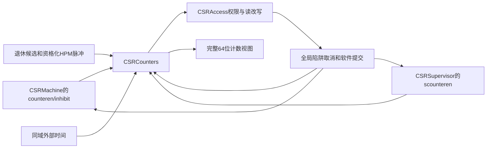

# 第七轮：CSRCounters 周期、退休和性能计数器

新增独立 `riscvpipeline.privileged.CSRCounters`，实现 RV32 的 64 位周期/退休计数器、
外部时间只读视图和可选 HPM 事件计数器。第六轮已认可并提交为 `26f8215`。
本轮测试、说明和单独提交完成后停止，不自动开始 PrivMode。
**独立模块已验证不等于 CPU 已支持 CSR**：生产 `RiscvPipeline` 仍为第七章 RV32I。

## 教材、CVW 和适配

- 教材 §8.2.3.4，书页 346–348（PDF 页 381–383）：64 位计数器、RV32 高低半字、
  时间来源、计数访问许可与停止增长的区别。
- §8.4.3–§8.4.3.1，书页 370–371（PDF 页 405–406）：CSR 分组和性能计数器实现。
- 表 8.10，书页 372（PDF 页 407）：CVW 周期、退休、分支、跳转、缓存、停顿等事件。
- 本地 CVW `src/privileged/csrc.sv`、`csr.sv`，版本
  `2f82f001139358be7646e910ff6fa2a140bed620`：计数地址、增长事件、控制位、时间读值。

官方规范定义 64 位 cycle/time/instret，以及 RV32 对应高半 CSR；同步异常的指令不退休。
跨两次读取不能保证原子快照，软件可采用“高—低—高，变化则重读”。
[Zicntr/Zihpm 2.0](https://docs.riscv.org/reference/isa/v20260120/unpriv/counters.html)。

mcounteren/scounteren 控制访问，mcountinhibit 控制增长，time 不受其停止控制。
HPM 事件的具体含义由平台定义，但编号 0 必须表示无事件；不活动的计数器和选择器可实现
固定零。RV32 软件写只改变指定半字。
[Machine-Level ISA 1.13](https://docs.riscv.org/reference/isa/v20250508/priv/machine.html)。

显式 CSR 写覆盖同一 CSR 的隐式更新，读取获得执行该指令前的值。特别是写 minstret 的
指令不应再把自己的退休增量叠加到所写值上。
[Zicsr 2.0](https://docs.riscv.org/reference/isa/v20260120/unpriv/zicsr.html)。

本轮作以下适配：

1. 用明确的退休候选和 32 位调用方资格化事件脉冲，替代 CVW 的缓存、预测器、除法器等
   跨流水级输入。当前 CPU 没有这些单元，不提前增加虚假的事件提取逻辑。
2. 活动 HPM 采用可写事件编号 0–32，而非 CVW 的固定事件连线和固定零 mhpmevent。
   这样事件零的含义明确；调用方后续负责记录编号对应的微架构事件。
3. 计数器任一半软件写均覆盖该计数器整个 64 位的同拍增长，另一半保存沿前值。
   不沿用 CVW 分半更新时可能让另一半仍受到加法进位/增长影响的路径。
4. 29 个 HPM 槽的机器计数、事件和用户影子地址均存在；只为前 hpmCounters 个创建活动
   状态，其余固定零。固定零地址合法，不能与不存在的 mtime CSR 混淆。
5. Exists、Allowed、读值分开，交给 CSRAccess 统一处理非法指令；不存在写反馈环。

## 配置与接口

```scala
new CSRCounters(supervisorSupported = true, hpmCounters = 0)
```

固定 RV32 和 64 位计数精度。HPM 个数为 0–29，依次激活 mhpmcounter3 至
mhpmcounter(hpmCounters+2)；非法个数在 elaboration 时拒绝。
基础 cycle/instret 始终有状态，time 始终来自外部输入。S 关闭只改变权限链，不关闭计数器。
后续调用方应与 CSRMachine/CSRSupervisor 的 S、HPM 配置一致。

`RawModule` 显式 `clk` 和高有效同步 `reset: Bool`。周期、退休、活动 HPM 及其选择器均
复位为零；外部时间不被复位。每个活动计数器使用 64 位状态，选择器保存 6 位合法编号。
IO 有 14 个输入字段、8 个输出字段；数组摊平且计入 clk/reset 后，各配置均为 80 个端口。

| 输入 | 位宽 | 含义 |
| --- | --- | --- |
| `clk/reset` | 各 1 | 时钟与高有效同步复位 |
| `ValidM` | 1 | 当前软件提交/退休候选事件有效 |
| `StallW/FlushM` | 各 1 | 抑制软件提交及退休候选 |
| `TrapM` | 1 | 全局已接受陷阱，抑制软件提交和该退休候选 |
| `CSRWriteM` | 1 | CSRAccess 授权的软件写意图 |
| `CSRAdrM/CSRWriteValM` | 12 / 32 | 地址和读改写后的最终软件写值 |
| `PrivilegeModeW` | 2 | 当前模式 U=00、S=01、M=11；10 不支持 |
| `InstrRetiredM` | 1 | 当前 M 级的退休候选；不能包含 ECALL/EBREAK 等异常指令 |
| `HPMEventsM` | 32 | 每拍已资格化事件脉冲，编号 n 对应 bit n−1 |
| `MCOUNTINHIBIT_REGW` | 32 | CSRMachine 的增长禁止控制 |
| `MCOUNTEREN_REGW` | 32 | CSRMachine 的下层读取许可 |
| `SCOUNTEREN_REGW` | 32 | CSRSupervisor 的 U 读取许可 |
| `TIME_REGW` | 64 | 同域一致的完整外部时间，与 Sstc 可共用来源 |

| 输出 | 位宽 | 含义 |
| --- | --- | --- |
| `CSRCExistsM` | 1 | 本计数组地址存在，与模式/写/有效无关 |
| `CSRCAccessAllowedM` | 1 | 存在且满足模式/计数访问许可 |
| `CSRCReadValM/CSRCModifyValM` | 各 32 | 当前旧半字或选择器读值；禁止时为零，两者相同 |
| `MCYCLE_REGW/MINSTRET_REGW` | 各 64 | 完整周期/退休状态 |
| `HPMCOUNTER_REGW` | 29×64 | 索引 0–28 对应计数器 3–31，未激活项固定零 |
| `HPMEVENT_REGW` | 29×32 | 相同索引的事件编号视图，未激活项固定零 |

模块不拥有 mcounteren/scounteren/mcountinhibit，也不提取生产 CPU 的退休或事件信号。
TIME_REGW 的来源、频率、跨域桥接、一致性和单调性由调用方保证；此轮不实现 CLINT。
当前输入的两半始终来自同一个 64 位值，但跨周期软件读取仍需防止低半进位。

## 地址与权限

本组共 155 个已实现地址，活动 HPM 个数不会改变存在性。

| 地址 | CSR | 行为 |
| --- | --- | --- |
| `0xB00/0xB80` | mcycle/mcycleh | M 可写低/高半，增长由 CY 控制 |
| `0xB02/0xB82` | minstret/minstreth | M 可写低/高半，增长由 IR 控制 |
| `0xB03–0xB1F/0xB83–0xB9F` | mhpmcounter3–31 及高半 | 活动槽 64 位可写；不活动槽写忽略、读零 |
| `0x323–0x33F` | mhpmevent3–31 | 活动槽选择编号；不活动槽写忽略、读零 |
| `0xC00/0xC80` | cycle/cycleh | mcycle 的只读影子 |
| `0xC01/0xC81` | time/timeh | 外部 TIME_REGW 的只读低/高半 |
| `0xC02/0xC82` | instret/instreth | minstret 的只读影子 |
| `0xC03–0xC1F/0xC83–0xC9F` | hpmcounter3–31 及高半 | 对应机器 HPM 的只读影子，未激活读零 |
| `0xB01/0xB81` | 不存在 | mtime 属于内存映射设备，没有这个机器 CSR |
| `0x723–0x73F` | 不存在 | 未实现 Sscofpmf 的事件高半扩展 |

机器计数地址有 62 个、事件地址有 29 个、只读影子有 64 个。固定零机器字段的地址仍属于
读写 CSR 类别，M 写合法但不改变值；CSRAccess 不应把它当作只读地址写异常。
未知地址 Exists=0、Allowed=0，读取/修改值零。

| 当前模式 | 机器计数/事件地址 | 只读影子地址（含 time） |
| --- | --- | --- |
| M=11 | 允许，不受 counteren 影响 | 允许，不受 counteren 影响 |
| S=01，S 配置开启 | 禁止 | 对应 mcounteren[n] 必须为 1 |
| U=00，S 配置开启 | 禁止 | 对应 mcounteren[n] 与 scounteren[n] 均须为 1 |
| U=00，S 配置关闭 | 禁止 | 只检查 mcounteren[n] |
| 保留 10，或 S=01 但 S 配置关闭 | 禁止 | 禁止 |

高/低半使用相同计数编号 n：CY=0、TM=1、IR=2、HPM=3–31。权限只控制读取/软件访问，
不会停止增长。Denied 时 Exists 仍为一，Allowed 为零，读值/修改值为零。
读值不以 Valid/Stall/Flush/Trap 门控，沿前返回旧状态。

本模块不直接生成非法指令异常。CSRAccess 负责只读影子地址写检查；本叶也防守性忽略
任何影子/time 写、低特权机器写和未知地址写，即使误传 CSRWriteM=1。

## 增长、软件写与事件选择

软件写使能条件：`ValidM && !StallW && !FlushM && !TrapM`，还需授权写意图、
当前 M 模式和本组访问许可。所有自有状态使用同步复位的 RegInit，复位在上升沿优先于
软件写和增长，因此使能无需再与 `!reset`。这个内部组合使能在 reset 高时可以为一，
但不会提交写入；本模块没有向其他模块输出组合写请求。

| 状态 | 增长条件 | 与流水线门控的关系 |
| --- | --- | --- |
| mcycle | 每个 clk 上升沿，CY=0 | 气泡、停顿、冲刷、陷阱期间仍计数 |
| minstret | 有效退休候选且 IR=0 | Valid、Stall、Flush、Trap 决定能否退休 |
| 活动 HPMn | 旧选择器对应脉冲为 1，且 inhibit[n]=0 | 脉冲由调用方资格化，不统一套用 Valid/Trap |
| time | 外部 TIME_REGW | 不由本模块增长，也不受 inhibit/reset 控制 |

退休条件为 `ValidM && InstrRetiredM && !StallW && !FlushM && !TrapM`。
停顿时保持候选不会重复计数；释放后只提交一次。异常指令不提供退休候选，Trap 同拍也
抑制该候选。精确退休、写回时点及异步中断与指令的先后关系仍须在流水线集成中确定。

HPM 脉冲可以描述停顿周期、已退休分支、已接受中断或异常等不同事件。调用方分别资格化：
退休类事件须排除停顿重复和被冲刷指令，周期类事件可逐拍持续，接受类事件应单次脉冲。
本叶在 Trap/无有效指令期间仍能记录已资格化事件；统一清零这些脉冲会漏掉中断或停顿。
没有实际预测器、缓存或除法器时，不应为这些来源编造非零事件。

事件编号 0 不计数；1–32 分别选择 HPMEventsM 的 bit 0–31。每个计数器每拍最多加一，
多个脉冲同时为一也只观察选中的一位。写选择器的整字在 0–32 内保存，其他值 WARL 为零；
不会把非法整字的低六位截成合法事件。选择器写入沿的增长采用旧选择器，下一拍才用新值。
编号的微架构含义需由后续调用方记录，本轮只定义稳定的“编号→输入位”关系。

对某个计数器的软件半字写优先于该计数器整拍增长，独立于 inhibit：

```text
低半写：新64位值 = 旧高半 : CSRWriteValM
高半写：新64位值 = CSRWriteValM : 旧低半
无软件写且事件允许：新64位值 = (旧64位值 + 1) mod 2^64
```

因此旧低半为 0xFFFFFFFF 时，同拍写低半不会给旧高半进位；写高半也不会让旧低半增长。
其他计数器仍正常增长。mcountinhibit 的位改变由其他叶提交，本模块在同一个沿使用沿前
控制值；写 inhibit/selector 的效果从下一拍开始，不提前反馈组合新写值。
本轮不实现按特权级过滤计数、溢出中断、计数委托、事件高半或多 hart 共享计数。

## 数据流与算例



测试包装层实际连接 CSRAccess、CSRCounters、CSRMachine、CSRSupervisor，验证两级访问
许可、读改写旧值、控制掩码、停止增长、软件写优先、事件编号和 Trap 取消。
生产 CPU 与此前六轮叶模块源码保持原有交付版本。

以下仅为独立接口算例，当前 CPU 尚不能执行这些 CSR 指令：

```asm
li t0, 5
csrw mcountinhibit, t0 # 停止cycle/instret；time不受影响
li t0, 0xffffffff
csrw mcycle, t0
li t0, 0x12345678
csrw mcycleh, t0      # 完整值0x12345678ffffffff
li t0, 0
csrw mcountinhibit, t0 # 提交该写的沿仍使用旧禁止值，下一拍恢复增长

again:
rdcycleh t1
rdcycle  t0
rdcycleh t2
bne t1, t2, again     # 得到一致的t1:t0

li t0, 32
csrw mhpmevent3, t0   # HPM3选择调用方的事件bit31
```

若低半 0xFFFFFFFF 正在允许增长，同时软件将低半写为 7，完整新值为
0x1234567800000007。若此时改为写高半 0x89ABCDEF，新值为 0x89ABCDEFFFFFFFFF。
只有无软件写的正常增长才得到 0x1234567900000000。
time 输入为 0x1234567889ABCDEF 时，读取 time/timeh 得到 0x89ABCDEF/0x12345678。

## 验证入口与覆盖

```bash
./scripts/sbt-local.sh compile 'Test / compile'
make test-csr-counters SBT=./scripts/sbt-local.sh
make generate-csr-counters SBT=./scripts/sbt-local.sh
verilator --lint-only --top-module CSRCounters generated/csr-counters/CSRCounters.v
make test-pipeline SBT=./scripts/sbt-local.sh
make test SBT=./scripts/sbt-local.sh
```

生成入口 `GenerateCSRCounters [targetDir] [S] [HPM]`，布尔参数 true/false，HPM 为十进制。
Makefile 默认与构造器一致；例如最大 HPM 且无 S：

```bash
make generate-csr-counters SBT=./scripts/sbt-local.sh \
  CSR_COUNTERS_TARGET_DIR=generated/csr-counters-no-s-hpm29 \
  CSR_COUNTERS_SUPERVISOR_SUPPORTED=false CSR_COUNTERS_HPM_COUNTERS=29
```

20 项测试覆盖同步复位、外部时间、存在性/权限、周期与退休、64 位进位/回绕、停止控制、
半字写优先、其他计数器增长、所有提交门控、错误写防守、共享高低读值、事件编号与 WARL、
不活动槽、真实四模块连接、随机模型、RTL 接口及非法参数。
四配置各检查 4096 地址，共 16384 次；全部 155 地址在两种 S 配置下检查模式和两级独立
权限位，共 4960 个权限组合。活动槽的 HPM3/HPM31 边界、事件编号 1–32 和编号零均覆盖。
固定种子 `0x8F812026`，五种代表配置各 512 拍，共 2560 拍，逐拍检查沿前/沿后状态和读值。
参考模型采用地址集合、64 位算术和半字替换，不复用 RTL 地址分组译码、动态选择或生产助手。

RTL 生成/lint 采用八组：S 关闭/开启各配 HPM0/1/3/29。接口测试另从实际生成 Verilog
核对 80 个端口的方向/位宽和同步属性。不声称全部 30 种 HPM 数量均穷举验证。

## 实际结果与提交

2026-10-07 至 2026-10-08，使用现有工具链完成以下验证：

| 检查 | 实际结果 |
| --- | --- |
| 工程与测试编译 | `compile`、`Test / compile` 均通过 |
| 独立模块测试 | 20/20 通过，含 16384 次地址、4960 个权限组合、2560 拍随机序列 |
| RTL 生成与接口 | 八组配置均成功，80 个端口方向/位宽稳定，同步状态确认 |
| Verilator lint | 八组配置均通过，无警告或错误；Verilator 5.036 |
| 流水线定向回归 | 18/18 通过，3 个测试套件 |
| 全部测试 | 234/234 通过，21 个测试套件 |
| 代码及文档检查 | Scala 95 列/空白、27 个本地文档链接、`git diff --check` 均通过 |
| 独立只读审查 | 未发现严重、重要或次要问题；独立模块范围内可提交 |

测试先确认缺失模块时有 6 个类型/参数错误，再确认零接口骨架 20 项测试中 19 项失败，
实现后全部通过。日志位于本地忽略目录 `target/chapter8/csr-counters/`，包含 baseline、
red-missing、red-behavior、green、compile、module、generate、generate-configs、
八份 lint 日志，以及 pipeline、suite 日志。沿用工程 ChiselStage 弃用提示，不升级工具链。

2026-10-08 按检查意见移除内部软件写使能的 `!reset` 后，重新运行模块测试 20/20
通过；八组 RTL 重新生成、Verilator lint 均通过，80 个端口保持稳定。生成逻辑确认
所有计数器和事件选择器仍在上升沿优先复位，相关日志位于 `reset-gate/` 子目录。

本轮单独 Git 提交并停止，等待检查后再继续 PrivMode。

## 用户检查清单

- [x] 核对固定零 HPM 槽与不存在的 mtime/扩展地址。
- [x] 核对两级读取许可、关闭 S 时的 U 权限链、只读影子写异常。
- [x] 核对周期覆盖停顿、退休候选单次提交和异常指令不退休。
- [x] 核对 HPM 编号零、编号 32、非法整字 WARL 及调用方资格化职责。
- [x] 核对半字写保持、全 64 位增长优先、进位/回绕和其他计数器继续增长。
- [x] 核对 inhibit/selector 的沿前控制值与外部 time 独立性。
- [x] 复现测试、生成和 lint，检查本轮提交；认可后再继续 PrivMode。

本轮未完成生产 CPU 的精确退休、性能事件提取、特权转换、Trap 仲裁或计数器整机验收。
没有实现 CLINT/PLIC、跨域桥接、MMU/PMP，以及模式过滤或溢出中断扩展。
仿真及 lint 不代表完整架构认证、形式证明或物理时序收敛。
