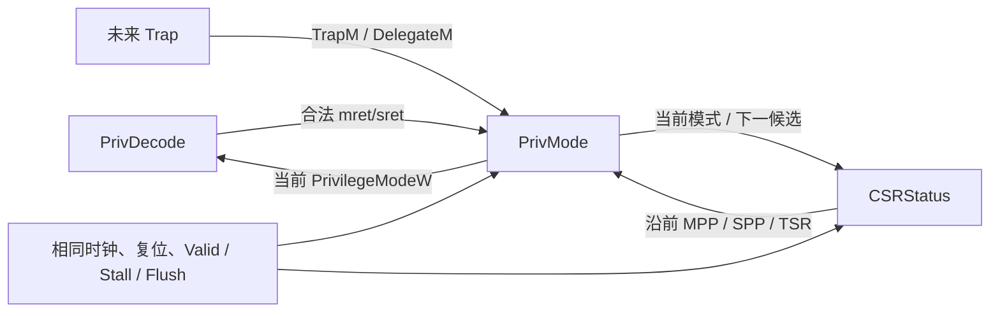

# 第八轮：PrivMode 特权级状态与陷阱返回

本轮实现独立的 `riscvpipeline.privileged.PrivMode`，保存当前特权级，并根据已仲裁的
陷阱或合法返回请求计算下一特权级。只增加本模块、测试、生成入口、Make 目标及说明。
生产 `RiscvPipeline` 仍为第七章 RV32I 核心，**独立模块验证通过不等于 CPU 已支持
特权转换**。下一轮 `Trap` 尚未开始。

## 依据与适配

- 教材 §8.4.5.1，书页 374 / PDF 页 409：陷阱在 M 级确定，模式与 CSR 状态在进入
  W 级的同一上升沿更新；这样避免架构状态分批提交。
- 教材 §8.4.5.2，书页 375 / PDF 页 410：MRET/SRET 同样在进入 W 级的上升沿更新
  特权级和 PC，并冲刷后续指令。PC 与冲刷生成留给后续集成。
- 本地 CVW `src/privileged/privmode.sv`，参考版本
  `2f82f001139358be7646e910ff6fa2a140bed620`：组合优先级为 Trap、MRET、SRET、保持，
  两位寄存器复位为 M，`!StallW` 使能。
- [官方特权规范 Machine-Level ISA](https://docs.riscv.org/reference/isa/v20250508/priv/machine.html)：
  陷阱不会降低特权级；返回采用沿前 xPP，状态栈和 MPRV 随返回更新。

本工程沿用显式 `clk/reset` 和 `RawModule`，U/M 始终实现，可选择关闭 S。
相比 CVW，这个独立模块补充 Valid/Flush 提交门控、返回权限与 MPP 编码防守，以及
M 模式误置 Delegate 时仍进入 M 的保护。CVW 原逻辑依赖上游提供合法请求；这里的
防守检查便于独立验收，不替代 `PrivDecode` 的异常报告或未来 `Trap` 的仲裁。

接口注释中的 M 表示沿前事件与候选，W 表示沿后保存的当前特权级。模块内部没有新增
流水级，也没有延迟队列。

源码：[PrivMode.scala](../../src/main/scala/riscvpipeline/privileged/PrivMode.scala)。
测试：[PrivModeSpec.scala](../../src/test/scala/riscvpipeline/privileged/PrivModeSpec.scala)。
生成：[GeneratePrivMode.scala](../../src/main/scala/riscvpipeline/GeneratePrivMode.scala)。

## 配置与接口

`supervisorSupported: Boolean = true`。模式编码：U=0、S=1、M=3，编码 2 未实现。
关闭 S 时可达状态仅 U/M；两个配置均保留全部 14 个生产端口。

| 端口 | 方向/位宽 | 契约 |
| --- | --- | --- |
| `clk` | 输入 Clock | 上升沿 |
| `reset` | 输入 Bool | 高有效同步复位到 M，优先于全部更新门控 |
| `ValidM` | 输入 Bool | 当前事件有效；陷阱和返回更新均需有效 |
| `StallW` | 输入 Bool | 沿后状态保持；候选仍组合计算 |
| `FlushM` | 输入 Bool | 取消当前状态更新；候选仍组合计算 |
| `TrapM` | 输入 Bool | 已仲裁、待提交的陷阱事件，不是原始异常集合 |
| `mretM`、`sretM` | 输入 Bool，各 1 位 | 上游译码确认的返回请求 |
| `DelegateM` | 输入 Bool | 已仲裁陷阱委托到 S；不会单独触发更新 |
| `STATUS_MPP` | 输入 UInt(2.W) | `CSRStatus` 保存的 M 陷阱前模式 |
| `STATUS_SPP` | 输入 Bool | `CSRStatus` 保存的 S 陷阱前模式：0=U、1=S |
| `STATUS_TSR` | 输入 Bool | S 模式的 SRET 限制；不限制 M 中的 SRET |
| `NextPrivilegeModeM` | 输出 UInt(2.W) | 沿前组合候选，供模式寄存器与状态栈同时消费 |
| `PrivilegeModeW` | 输出 UInt(2.W) | 当前特权级，只有上升沿才可能改变 |

不存在异常输出。非法返回由 [PrivDecode](02-priv-decode.md) 报告；通常
[CSRStatus](03-csr-status.md) 的 WARL 写约束已保证 MPP 合法。直接给本叶模块非法
返回或非法 MPP 时保持当前模式，不进入编码 2 或未支持的 S。

## 候选优先级与状态更新

先按原始事件优先级选择分支，再检查该分支是否合法：

| 最高优先事件 | 条件 | `NextPrivilegeModeM` |
| --- | --- | --- |
| `TrapM` | 开启 S，Delegate=1，当前为 U/S | S |
| `TrapM` | 其他组合，包含当前 M、关闭 S | M |
| `mretM` | 当前 M，MPP 为支持的模式 | MPP |
| `mretM` | 当前不是 M，或 MPP 编码不支持 | 当前模式 |
| `sretM` | 开启 S，当前 M | SPP 对应的 U/S，忽略 TSR |
| `sretM` | 开启 S，当前 S，TSR=0 | SPP 对应的 U/S |
| `sretM` | 其他组合 | 当前模式 |
| 无事件 | 任意状态栈/Delegate 输入 | 当前模式 |

因此 Trap 与两个返回同时为一时，Trap 优先；非法的原始 MRET 与合法 SRET 同时为一
时，MRET 分支保持状态，不能落入 SRET。M 中的陷阱即使 Delegate=1 也不能降到 S。
这项防守不验证委托 CSR 或中断资格，实际委托结果由下一轮 Trap 提供。

状态只在上升沿更新：

```text
if reset:
    PrivilegeModeW = M
else if ValidM && !StallW && !FlushM:
    PrivilegeModeW = NextPrivilegeModeM
else:
    PrivilegeModeW 保持
```

更新使能无需与 `!reset`，因为唯一状态是同步复位的 `RegInit`，生成寄存器逻辑的
复位分支拥有最高优先级。这与按用户要求修改的计数器内部使能相同；不能由此推导
外部组合写请求也可以忽略 reset。

`NextPrivilegeModeM` 不与 Valid、Stall、Flush、reset 门控。在停顿、无效或取消周期，
它仍可能与当前模式不同，**候选不能当作已提交的特权级**。reset 拉高但未到上升沿
时，当前模式仍为旧值；复位上升沿之后为 M，候选再按 M 与当前输入重新计算。

本模块不缓存事件。停顿期间上游必须保持待提交请求和状态栈；释放后由上游移走请求。
如果持续给合法 SRET，每个可更新上升沿都执行一次，它不会自动识别“同一条指令”。

## 与状态栈、译码的同拍连接



模式与 Status 的寄存器同时采样沿前 MPP/SPP。返回清空 xPP 后，新候选可能改变，但
已经提交的模式采用旧 xPP，不会错误地采用刚清零的 xPP。这些反馈经过模式和状态
寄存器，不形成组合环。真正的闭环只放在测试包装层，生产顶层尚未连接。

职责划分：PrivMode 保存模式；CSRStatus 保存 xPP/xPIE/xIE 并处理返回时 MPRV；
PrivDecode 检查指令权限与非法指令；Trap 判断是否陷入及委托；后续 CSR/IFU 接口
计算和选择返回/陷阱 PC。模式变化本身不会更新 `mepc/sepc` 或触发跳转。

未来集成必须让这些状态共享同一次提交资格。这里的 FlushM 表示取消本次状态事件；
不能将 Trap/Ret 自身生成的流水线冲刷直接接回此端口，否则会取消陷阱/返回更新。
气泡期间的中断如何建立有效事件、流水线冲刷如何同时杀死指令而保留陷阱提交，
由后续 Trap、Privileged 和 Hazard 集成确定，本轮没有声称已经解决。

## 汇编与逐拍算例

M 模式预先将 MPP 写为 U，并设置返回地址：

```asm
li    t0, 0x20082       # MPP=U，MPIE=1，SIE=1，MPRV=1
csrw  mstatus, t0
la    t0, user_entry
csrw  mepc, t0
mret                   # 当前模式在提交上升沿转到 U
```

上述汇编用于说明架构意图；本轮测试包装层直接驱动状态写请求和指令位型，没有运行
CPU 程序，也没有实现此处的 `mepc` 写入或 PC 跳转。

真实 PrivMode+CSRStatus+PrivDecode 测试使用手工期望值：

| 本拍事件 | 沿前模式 | 沿前 `mstatus` | 候选 | 沿后模式 | 沿后 `mstatus` |
| --- | --- | --- | --- | --- | --- |
| MRET | M | `0x00020082` | U | U | `0x0000008a` |
| 委托陷阱 | U | `0x0000008a` | S | S | `0x000000a8` |
| SRET | S | `0x000000a8` | U | U | `0x000000aa` |
| 未委托陷阱 | U | `0x000000aa` | M | M | `0x000000a2` |
| MRET | M | `0x000000a2` | U | U | `0x000000aa` |

另一算例：S 中委托陷阱产生 SPP=1；随后 SRET 候选为 S，同沿 Status 清 SPP。
沿后当前仍是 S，此时若 SRET 请求仍保持，新的候选才变为 U。测试检查两次上升沿，
验证没有把清栈与取返回模式弄错一拍。

TSR 算例：M 中设置 TSR=1、SPP=1，SRET 仍能进入 S；进入 S 后同样的 SRET 指令
被译码为非法并抑制返回。已有非法 IEU 标志也会抑制返回请求，模式与状态栈同时保持。

## 测试与复现命令

```bash
./scripts/sbt-local.sh compile 'Test / compile'
make test-priv-mode SBT=./scripts/sbt-local.sh
make generate-priv-mode SBT=./scripts/sbt-local.sh
verilator --lint-only --top-module PrivMode generated/priv-mode/PrivMode.v
make generate-priv-mode SBT=./scripts/sbt-local.sh \
  PRIV_MODE_SUPERVISOR_SUPPORTED=false PRIV_MODE_TARGET_DIR=generated/priv-mode-no-s
verilator --lint-only --top-module PrivMode generated/priv-mode-no-s/PrivMode.v
make test-pipeline SBT=./scripts/sbt-local.sh
make test SBT=./scripts/sbt-local.sh
```

16 项测试覆盖同步复位优先、无事件保持、M/S/U 返回权限、全部 MPP 编码、S 开关、
TSR、陷阱不能下降、原始事件优先级、全部 Valid/Stall/Flush 组合、停顿释放及取消。
五项闭环测试连接真实 CSRStatus 和 PrivDecode，检查模式与状态栈的原子更新。

组合穷举包括两种 S 配置下所有可达模式、六个布尔事件/状态输入和四种 MPP，共
1280 组。固定种子 `0x90112026`，每种 S 配置 1024 拍，共 2048 拍，检查沿前候选、
沿后模式及周期性同步复位。参考模型使用支持模式集合和事件表，不调用生产助手；
联动测试采用固定的状态字期望值。另从实际 Verilog 核对 14 个端口、两位模式、
上升沿同步状态和两个配置的接口稳定性。

## 实际结果与检查点

2026-10-08，沿用现有工具链：

| 检查 | 实际结果 |
| --- | --- |
| 工程与测试编译 | `compile`、`Test / compile` 均通过 |
| 模块测试与 Make 入口 | 16/16 通过，含 1280 组组合和 2048 拍随机序列 |
| RTL 生成与接口 | 开启/关闭 S 两组成功，14 端口及两位模式稳定，高有效同步复位 |
| Verilator lint | 两组通过，无警告或错误；Verilator 5.036 |
| 流水线定向回归 | 18/18 通过，3 个测试套件 |
| 全部测试 | 250/250 通过，22 个测试套件，包含计数器复位门控修改 |
| 代码及文档检查 | 新增 Scala 95 列/空白、35 个本地文档链接、`git diff --check` 通过 |
| 独立只读审查 | 未发现严重、重要或次要问题；本轮范围内可提交 |

测试先确认缺失类型，再用固定 M 模式骨架观察到 16 项中 15 项失败；实现后全部通过。
日志位于本地忽略目录 `target/chapter8/priv-mode/`，保留 red-missing、red-behavior、
green、compile、module、generate、generate-no-s、lint、lint-no-s、pipeline、suite。
沿用已有 ChiselStage 弃用提示，不更改工具链。

- [x] 核对候选与当前模式的区别，以及返回读取旧 MPP/SPP。
- [x] 核对 M 的陷阱不降级、TSR 仅限制 S 中的 SRET。
- [x] 核对非法 MPP、关闭 S 和非法原始高优先事件的保持行为。
- [x] 核对 Valid/Stall/Flush 同拍门控，以及复位优先且使能不与 reset。
- [x] 复现测试和两组 RTL lint，检查本轮 Git 提交。

本轮验证限于独立模式模块及测试层的状态/译码联动，未完成生产 CPU 陷阱、PC 重定向、
中断仲裁或整机特权验收。不实现虚拟化模式、MMU/PMP、CLINT/PLIC；不将仿真与 lint
视为形式证明或时序收敛。单独提交后停止，待用户检查并同意再开始 Trap。
