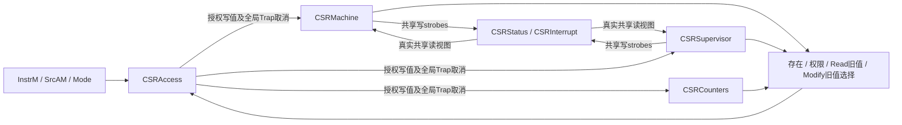

# 12：CSR 汇总与精确陷阱数据流

本阶段依据教材 §8.2.2–5、§8.4.3，将既有 `CSRAccess`、`CSRStatus`、
`CSRInterrupt`、`CSRMachine`、`CSRSupervisor`、`CSRCounters` 连接成 `CSR`。
它是独立的 RV32 特权寄存器子系统；本阶段尚未将 CSR 接入 CPU 流水线。
模块使用显式 `clk` 和高有效 `Bool` 同步 `reset`，IALIGN=32。
U/M 始终支持，S 可选；地址转换采用 Bare，无 MMU、PMP、虚拟化或浮点状态。

## 公共配置和接口

`PrivilegedConfig` 的字段完整保留供后续特权顶层及 CPU 使用：

| 字段 | 默认 | 边界与含义 |
| --- | --- | --- |
| `supervisorSupported` | true | 是否实现 S 及相关 CSR |
| `bigEndianSupported` | true | 是否允许 Status 保存端序控制位 |
| `sstcSupported` | false | Sstc 需要 S |
| `vectoredInterruptsSupported` | true | 支持 tvec mode01 向量中断 |
| `hpmCounters` | 0 | 活动 HPM 个数，0..29 |
| `hartId` | 0 | 无符号 32 位，0..2^32−1 |
| `wfiTimeoutCycles` | 65536 | 后续 WFI 使用，1..2^24 |

`InterruptInputs` 公共 Bundle 包含四个电平 `MExtInt`、`SExtInt`、`MTimerInt`、
`MSwInt` 及 `TIME_REGW: UInt64`；本模块公开同名输入。四个中断必须已经同步到
`clk` 域，64 位 time 必须在该域保持一致；这里不实现 CDC 或 CLINT/PLIC。

生产接口为 45 个端口（包括 clk/reset），各配置保留相同名称和宽度。
`InstrM`、`PCM`、`IEUAdrM`、`SrcAM` 是 32 位；当前及下一模式是 2 位；
`CauseM` 是不含 interrupt 标志的 5 位原因号；`HPMEventsM` 为 32 位事件脉冲。
有效/停顿/取消/Trap/返回/退休输入由调用方提供，CSR 自身不保存当前模式。

`CSRResultM` 是当前地址沿前读值，指令提交沿之后叶状态更新，调用方应保存旧读值。
`CSRReadM`/`CSRWriteM` 是 Access 的已授权读写意图；实际提交还需有效、非停顿、
非取消和非 reset。`CSRWriteM` 本身不表示本沿状态已经更新。

## 唯一共享状态及读修改路径



机器、监督、计数组地址互斥；选择存在组的 Read/Modify，未知地址默认机器组零读值。
存在性只依地址和静态配置，额外权限只依模式及沿前控制状态，均不依赖 CSRWriteM、
TrapM、非法访问或提交门控。组合关系是“地址/状态→权限→Access→写”，写值只在
时钟沿更新状态，因而不会形成“非法 CSR→Trap→写禁止→CSR不存在”的组合环。

Status 和 Interrupt 各仅实例化一次。机器 `mstatus/mstatush/mie/mip` 与监督
`sstatus/sie/sip` 引用这两份真实状态，不另建寄存器。机器/监督叶产生授权且带
复位抑制的共享写 strobes，交给 Status/Interrupt；reset 沿清零状态且不会因共享
strobes 在该沿写入源值。

`mip/sip` 读值可以包含外部 pending，Modify 值只含内部软件 pending。例如外部
SExtInt=1 时 CSRRSI mip,2 返回旧值 0x200，但只写内部 SSIP=1；外部电平撤销后
mip=0x002，不会将 SEIP 锁在软件状态里。通过监督视图清除 SSIP 也保留未委托位。

## 权限、提交和全局 Trap 取消

CSRAccess 处理六种 CSR 指令、rd=x0 的写且不读、RS/RC 的源字段=x0 时只读，
并检查地址存在性、最低模式、只读写入和额外权限。非零寄存器即使值为零仍是写意图。
监督 `satp` 在 Bare 中存在且读零，但 S 模式 TVM=1 时仍禁止；Sstc 比较器在 M
可配置，S 访问须同时满足 STCE 和 mcounteren.TM。用户计数器影子还取真实
mcounteren/scounteren；未活动 HPM 槽保留合法零 CSR，不能冒充不存在地址。

所有三个软件写组统一接 `Access.CSRWriteM && !TrapM`。即使本沿 Trap 的目标是
另一模式，机器 scratch、监督 scratch、计数器及共享 Status/Interrupt 软件写均取消。
叶模块仍保留 `ValidM && !StallW && !FlushM`、复位和自身陷阱优先级。
计数器周期增长属于硬件事件，并不会因普通无效 M 指令停止；退休增长接受真实
`InstrRetiredM`，并受有效、停顿、取消及 Trap 门控。HPM 的资格由调用方事件输入决定。

调用方必须区分当前 Trap/Ret 事件和它对年轻流水级产生的 flush；不能把当前事件
自身的重定向反接本模块 FlushM，否则会取消应当提交的陷阱记录。

## 精确记录、tval、向量和返回

Trap 目标由 `NextPrivilegeModeM` 给出：M 写机器记录，S 写监督记录。
EPC 输入始终是故障指令的 `PCM`；叶模块按 IALIGN=32 清除低两位。
Cause 输入独立拼接 `Cat(InterruptM, CauseM)`，叶模块将 interrupt 移到架构 bit31。
`tval` 的选择与 cause 拼接独立：

| 条件 | tval |
| --- | --- |
| 任意中断，ECALL 8/9/11 | 0 |
| 非法指令 2 | 完整 InstrM |
| 取指访问错 1、断点 3、取指页错 12 | PCM |
| 地址类及其他原因 | IEUAdrM |

例如 U 的非法指令在 PCM=0x80001237、InstrM=0xdeadbeef 时委托到 S，得到
sepc=0x80001234、scause=0x00000002、stval=0xdeadbeef。
同地址的原因 5 中断记录 cause=0x80000005、tval=0，EPC 仍来自 PCM。
返回选择不复制模式：`mretM=1` 输出 MEPC，否则输出 SEPC；模式转换由外部 PrivMode 完成。

向量从真实叶模块 MTVEC/STVEC 读取，按下一模式选择，base 清低两位。
只有 InterruptM=1 且实际 mode01 且配置支持向量时加入 `4*CauseM`；异常始终取 base。
机器写 mtvec=0x8000013d，叶模块 WARL 对齐后为 0x80000101，中断 cause11 跳到
0x8000012c，原因 2 异常跳到 0x80000100。监督写 stvec=0x8000027d 得到
0x80000241，原因 5 中断跳到 0x80000254。关闭向量支持后上述写值分别变为直接地址
0x8000013c/0x8000027c；汇总计算使用这些实际读值。加法按 RV32 字宽回绕。

## Sstc、时间与端序联动

Sstc 的 STCE 固定取 `MENVCFG_REGW(63)`，即 RV32 menvcfgh bit31，不取低字。
监督比较器以同域 64 位 TIME_REGW 作无符号比较，将原始 STimerInt 交给 Interrupt；
Interrupt 再按 STCE 选择比较器或内部软件 STIP。mcounteren.TM 和 STCE 只控制
S 的比较器访问许可，不控制 M 访问。TIME 也直接接 Counters 的 time/timeh 读视图。

比如 stimecmp=0x000000010000000a，time=0x0000000100000009 时 STIP=0，达到
相等值时 STIP=1。STCE=1 时整字 mip 写会清除潜藏的软件 STIP；只切换 STCE
不擅自清软件状态。这里不生成时钟计时源。

bigEndianSupported 原样传到唯一 Status。它按当前模式、MPRV/MPP 选择 UBE/SBE/MBE；
Bare 固定 SelHPTW=0。本阶段只提供 BigEndianM，实际数据字节交换由后续 LSU 连接。
S 关闭时监督组存在性为零、MIE仅 0x888、软件 S pending 为零，U 的计数器许可只受
mcounteren，不要求不存在的 scounteren。

## 验证方法和实际结果

测试为生产 CSR 建立只连接时钟/复位的包装层，刺激真正的六个叶模块，无仿制叶状态。
测试覆盖跨三组的六指令沿前旧值、权限/只读/未知地址、共享视图和软件 pending 修改、
全局 Trap 写取消、全部 32 原因的中断/异常 tval、两模式精确 EPC/cause、实际向量、
返回、提交门控/同步 reset、Counter/HPM/time 许可、Sstc 和大小端/返回栈。
配置验证覆盖所有 require 的边界，RTL 检查代表配置保持 45 个显式同步端口。

运行命令（从仓库根目录）：

```bash
./scripts/sbt-local.sh 'testOnly riscvpipeline.privileged.CSRSpec'
./scripts/sbt-local.sh 'runMain riscvpipeline.GenerateCSR target/chapter8/completion/csr/default'
./scripts/sbt-local.sh 'runMain riscvpipeline.GenerateCSR target/chapter8/completion/csr/no-s false'
./scripts/sbt-local.sh 'runMain riscvpipeline.GenerateCSR target/chapter8/completion/csr/sstc true true true 1'
verilator --lint-only --top-module CSR target/chapter8/completion/csr/default/CSR.v
```

2026-10-08 实际结果：可编译常零骨架运行 13 项，12 项行为测试按预期失败，配置边界
测试通过；替换为真实六叶连接后 13/13 通过，suite 无 aborted，sbt 退出 0。
默认、S 关闭、Sstc+HPM1 三种 GenerateCSR 均成功，三份 Verilator 5.036
`--lint-only --top-module CSR` 均退出 0，无 lint 警告或错误。生成测试确认三配置
45 个端口一致，时序状态使用 `always @(posedge clk)`，无异步 reset 和负沿。
新增 Scala 文件均满足 95 列，`git diff --check` 通过。构建仅出现工程既有 ChiselStage
3.6 弃用提示，保持现有工具链和生成 API，不升级依赖。

证据保存于 `target/chapter8/completion/csr/`：`red.log`、`green.log`、`generate.log`、
`lint-default.log`、`lint-no-s.log`、`lint-sstc.log` 及三份配置 RTL。此次按阶段范围执行
CSR 定向测试和代表配置生成/lint，不重复全工程 suite 或 CoreMark；整机验证留给后续阶段。
本阶段不声称完成 CPU 特权整合、跨时钟接口、平台中断控制器、地址转换或整机验收。
