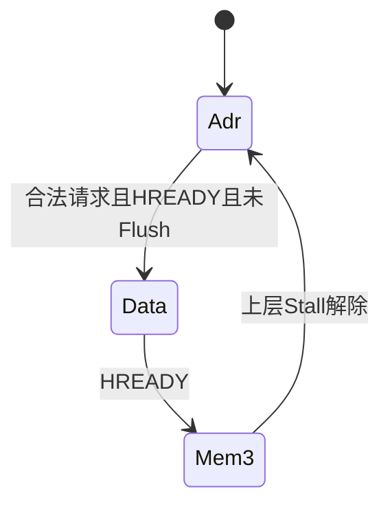

# 01：BusFSM——非突发 AHB 事务控制实验

本轮完成第九章第一个独立模块 `riscvpipeline.ebu.BusFSM`。它将核心读写请求分解为
Adr、Data、Mem3 三个阶段，处理等待、读数据捕获和事务提交边界。
**当前状态：模块实现和验证完成；2026-10-17 用户已授权连续推进后续模块，最后统一检查。**

## 实验依据与目标

- 教材 §9.5.1、表 9.9、图 9.23，印刷页 414–415（PDF 449–450）：
  地址阶段、数据阶段、响应保存阶段，以及对核心的停顿。
- 教材 §9.5.5，印刷页 423–426（PDF 458–461）：总线事务与流水线冲刷、中断的互锁。
- 本地 CVW revision `2f82f001139358be7646e910ff6fa2a140bed620` 的
  `src/ebu/busfsm.sv`，SHA-256 为
  `0e33cb440f48dd60599b73f9557a6af78ed3bd3acec5b1663eac1346d62d284d`。
  该参考文件未修改；运行目录保存了副本。

目标是先验证控制器自身的时序，再交给下一轮 AHBInterface 使用。本轮不连接 CPU、
EBU 或存储器，独立测试中的 IFU/LSU 是两种参数配置的简称，不表示整机已经接通。

实现环境：JDK 17.0.20.1、sbt 1.10.7、Scala 2.13.14、Chisel 3.6.1、
chiseltest 0.6.2；RTL lint 使用 Verilator 5.036。遵循项目
[Chisel 编码规范](../development/chisel-coding-standard.md)。

## 实现与接口

源码：[BusFSM.scala](../../src/main/scala/riscvpipeline/ebu/BusFSM.scala)；
测试：[BusFSMSpec.scala](../../src/test/scala/riscvpipeline/ebu/BusFSMSpec.scala)；
生成入口：[GenerateBusFSM.scala](../../src/main/scala/riscvpipeline/generators/GenerateBusFSM.scala)。

构造参数 `readOnly: Boolean = false`。false 用于 LSU，true 用于 IFU；
两种配置保持相同的 11 个端口。

| 方向 | 端口 | 位宽 | 契约 |
| --- | --- | --- | --- |
| 入 | `clk` | Clock | 同域上升沿 |
| 入 | `reset` | Bool | 仅在上升沿同步复位寄存器；不参与组合请求和输出门控 |
| 入 | `io.Stall` | Bool | 只保持 Mem3，等待上层消费结果 |
| 入 | `io.Flush` | Bool | 取消尚未接受的 Adr 请求 |
| 入 | `io.BusRW` | 2 | 00 无请求，01 写，10 读；11 被抑制 |
| 入 | `io.HREADY` | Bool | Adr 可接受，或 Data 响应完成 |
| 出 | `io.HTRANS` | 2 | 仅输出 IDLE=00 或 NONSEQ=10 |
| 出 | `io.HWRITE` | Bool | Adr 的有效写方向，或 Data 已接受的写方向 |
| 出 | `io.CaptureEn` | Bool | 读事务 Data 且 HREADY，指示本沿捕获响应 |
| 出 | `io.BusStall` | Bool | Adr 等待有效请求完成，以及整个 Data 阶段 |
| 出 | `io.BusCommitted` | Bool | 事务不可由中断重放的阶段标志 |

非法 11 或只读实例的写请求不会发起事务，也不会产生停顿。
本模块无地址、数据、字节掩码或 HRESP 端口，不保存这些信息；它们属于后续模块。
没有 BusAtomic，也不产生 SEQ、BUSY 或 burst。

## 状态和逐拍行为



Adr 无可接受请求时保持；Data 等待 HREADY 时保持；Mem3 等待 Stall 解除时保持。
同步 reset 在上升沿从任何状态回 Adr，并清零保存的写方向。
没有上升沿时，单独拉高或拉低 reset 都不改变当前相位的组合输出。
Flush 只影响 Adr 的请求资格，不能撤销已接受事务。

依照用户复查要求，请求及输出不再与 `!reset`。若 reset 保持高且上层仍提供合法请求，
每个上升沿把状态置回 Adr，但 Adr 的组合输出仍根据请求和 HREADY 计算；
例如读请求且 HREADY=1 时 HTRANS=NONSEQ、BusStall=1。无请求时输出为空闲。

| 阶段 | HTRANS | BusStall | CaptureEn | BusCommitted |
| --- | --- | --- | --- | --- |
| Adr 无请求／被取消 | IDLE | 0 | 0 | 0 |
| Adr 有请求、HREADY=0 | IDLE | 1 | 0 | 0 |
| Adr 有请求、HREADY=1 | NONSEQ | 1 | 0 | 0 |
| Data 等待 | IDLE | 1 | 0 | 1 |
| Data 读完成 | IDLE | 1 | 1 | 1 |
| Data 写完成 | IDLE | 1 | 0 | 1 |
| Mem3，LSU 配置 | IDLE | 0 | 0 | 1 |
| Mem3，IFU 配置 | IDLE | 0 | 0 | 0 |

地址接受沿锁存写方向。因此接受读后即使 BusRW 变化，仍按读完成；接受写后即使
BusRW 改读，也不会误捕获读响应。Mem3 不重发，即使原请求仍保持。
Stall 不得阻止 Adr 接受或 Data 完成；否则将把控制器自身产生的停顿反过来冻结事务。

代表性读测试在复位结束后发起请求，预期与实际断言一致：

| 相对周期 | 场景 | HTRANS | BusStall | CaptureEn |
| --- | --- | --- | --- | --- |
| 0–2 | Adr 等总线，HREADY=0 | 0 | 1 | 0 |
| 3 | Adr 被接受 | 2 | 1 | 0 |
| 4–7 | Data 等响应，HREADY=0 | 0 | 1 | 0 |
| 8 | Data 读完成 | 0 | 1 | 1 |
| 9 | Mem3，上层仍 Stall | 0 | 0 | 0 |

Data 完成沿负责写后续 FetchBuffer；Mem3 才能使用保存的读结果。本轮只检查捕获使能，
实际数据缓存在下一轮验证。对应两种配置的 VCD 保存在本轮运行目录的 `waves/`。

## 与教材及 CVW 的适配差异

| 项目 | 教材／当前 CVW | 本轮实现及原因 |
| --- | --- | --- |
| 状态集合 | CVW 另含原子事务状态 | 仅实现教材本章非突发三态 |
| CaptureEn | CVW 在整个 Data 为高 | 仅在读完成沿为高，避免等待或写响应覆盖缓存 |
| Flush | CVW 在任意 Flush 沿回 Adr | 只取消尚未接受请求，避免丢掉已开始的副作用 |
| 写方向 | CVW 依赖当前 BusRW | 锁存接受方向，防后续输入变化污染完成行为 |
| 非法请求 | CVW 未额外拦截 11 或只读写 | 安全抑制，并解除停顿 |
| IFU Mem3 | 教材图示通常仍 committed；425 页旁注允许完成取指后处理陷阱 | 采用当前 CVW 的只读 Mem3 清 committed；避免阻止较老同步异常而同时放行 M 槽 |
| 复位 | CVW HRESETn，内部同步状态 | 本项目显式高有效 Bool 同步 reset，仅作用于寄存器，不组合门控输出 |

HTRANS 由 HREADY 限定 NONSEQ，沿用当前 CVW 控制器契约；不是额外实现了一个任意
流水化、多 outstanding 请求的通用 AHB 主机。后续仲裁、地址保持和数据相位连接必须
与这一契约一致。上层还须区分原始取消意图和提交后重定向，避免组合反馈。

## 测试方法与结果

先编写行为测试并执行恒空闲骨架：18 项中 16 项按预期失败，证明缺失行为可被检出。
真实实现最初通过 18 项。独立评审补充了“写完成后再读”的同实例场景；在 target 中
构造只置位、不清零 AcceptedWrite 的变异实现，新用例正确失败。生产源码未被变异替换。
首版最后使用正常生产源码重新执行，19/19 通过；对应旧运行完整保留。

用户随后要求去掉组合逻辑中的 `!reset`。先修改复位测试，确认新预期在旧实现上
两配置均失败（2/2）；随后去掉五处 reset 门控，重新运行完整模块测试，
**19/19 通过**。新测试覆盖 LSU 读写及 IFU 读在 Adr/Data/Mem3 三阶段的无沿复位
脉冲、同步复位沿、持续复位和复位期间请求保持。

| 测试类别 | 数量 | 检查内容 | 结果 |
| --- | --- | --- | --- |
| 空闲 | 2 | 两配置、ready/stall 组合无幽灵请求 | 通过 |
| 地址／数据等待 | 2 | 地址接受、长等待、仅读完成捕获、Stall 不冻结事务 | 通过 |
| Mem3 保持 | 2 | 请求未撤销且上层继续停顿时不重发 | 通过 |
| Adr Flush | 2 | Flush 与 HREADY 同拍仍不接受，取消后能正常请求 | 通过 |
| 已接受读保护 | 2 | Data 等待／完成拍 Flush、原始请求改变不取消响应 | 通过 |
| 同步复位 | 2 | 无沿 reset 不改变输出、有沿回 Adr、持续复位按当前请求组合输出 | 通过 |
| 非法请求 | 2 | 11、只读写请求无传输及停顿 | 通过 |
| 连续等待组合 | 2 | Adr/Data/Mem3 各等待 0/1/2 拍，合计 81 次事务 | 通过 |
| 写方向保持 | 1 | Data 中改变请求和 Flush，写从不捕获 | 通过 |
| 写后读 | 1 | 同实例方向由写切回读并正确 Capture | 通过 |
| RTL 接口 | 1 | 两配置均 11 端口，宽度正确，仅同步上升沿状态 | 通过 |

81 是组合测试中的事务数，不另算成 81 个独立测试。每配置中的请求和预期独立定义，
没有从 DUT 的常量或状态转移函数生成参考预期。

本轮还完成生产及全部既有测试源码编译、两配置 RTL 生成、两配置 Verilator lint。
lint 均退出 0，无警告或错误；Scala 编译保留项目现有 ChiselStage 弃用提示，未升级依赖。
新增 Scala 文件符合 95 列及无行尾空白约定。

本轮详细逐例结果、原始日志、RTL、波形、源码快照与哈希见
[本次同步复位修订报告](../../target/chapter9-testplan/runs/20261016T094039485551Z-bus-fsm-sync-reset/report.md)。
首版证据见[历史运行](../../target/chapter9-testplan/runs/20261016T090912069968Z-bus-fsm/report.md)，
其 reset 输出屏蔽契约已被本次用户要求替代。

## 复现与本轮边界

从项目根目录执行：

```bash
JAVA_TOOL_OPTIONS='-XX:ActiveProcessorCount=4 -Xmx3g' \
  make test-bus-fsm SBT=./scripts/sbt-local.sh
make generate-bus-fsm SBT=./scripts/sbt-local.sh \
  BUS_FSM_TARGET_DIR=target/generated/bus-fsm-lsu BUS_FSM_READ_ONLY=false
make generate-bus-fsm SBT=./scripts/sbt-local.sh \
  BUS_FSM_TARGET_DIR=target/generated/bus-fsm-ifu BUS_FSM_READ_ONLY=true
verilator --lint-only --top-module BusFSM target/generated/bus-fsm-lsu/BusFSM.v
verilator --lint-only --top-module BusFSM target/generated/bus-fsm-ifu/BusFSM.v
```

本轮没有缺失工具或参考资料。BusFSM 尚未被 CPU 使用，未执行完整项目回归或独立
Verilator 行为仿真；本轮的 RTL 验证是生成、接口/同步复位检查和 lint。第九章整机验收
以及第七、八章回归按计划在集成后进行。
教材 §9.4 的 RV64GC、浮点 fadd_b11-01 和缓存突发项依照用户选择继续标为未覆盖。

首轮曾按要求暂停；2026-10-17 用户取消中间等待，下一模块为 AHBInterface。
