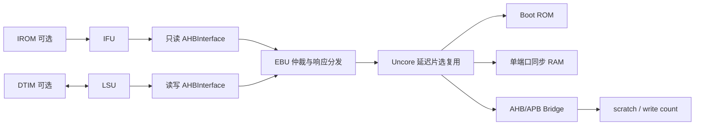

# 第九章总线接口实验报告

## 实验依据与范围

实验基于当前 RV32 五级流水线工程，教材为当前目录的《RISC-V System-on-Chip
Design, Edition 1》第九章，重点是 §9.4–9.5，印刷页410–426（PDF页445–461）。
实现对照本地 `~/cvw/src`，参考版本为
`2f82f001139358be7646e910ff6fa2a140bed620`；未修改参考仓库。
本项目起点为 `3be4a16`，工作分支为 `chapter9-bus-interface`。

用户确认只验收当前 RV32 配置，不扩展 RV64GC、浮点或缓存。所有新增总线状态均使用
显式时钟、高有效同步复位；请求与组合输出没有增加 `&& !reset` 门控。旧流水线已有
复位抑制保持其原有行为；AHB 的 HRESETn 只是复位极性导出。

## 实现结构

|本项目模块|本地 CVW 对照|
|---|---|
|BusFSM、AHBInterface|`src/ebu/busfsm.sv`、`ahbinterface.sv`|
|ControllerInput、EBUFSMArb、EBU|`src/ebu/controllerinput.sv`、`ebufsmarb.sv`、`ebu.sv`|
|AdrDec、AdrDecs|`src/mmu/adrdec.sv`、`adrdecs.sv`|
|RAMAHB、ROMAHB、AHBAPBBridge、Uncore|`src/uncore/ram_ahb.sv`、`rom_ahb.sv`、`ahbapbbridge.sv`、`uncore.sv`|
|BusIFU、BusLSU、总线停顿与顶层|`src/ifu`、`src/lsu`、`src/hazard/hazard.sv`、`src/wally`|

实验 APBRegisterBank 为本项目的固定语义外设，用于检查掩码和重复副作用。
保留来源模块的许可标识；具体接口和相对参考的时序调整见各模块报告。



BusFSM 采用 Adr、Data、Mem3 三态。Data 完成沿独立保存响应，Mem3 在其他模块等待时
保持数据而不重发。只读 IFU 的 Mem3 清除 committed，LSU 的 Mem3 继续保护已接受的
访存。EBU 给予 LSU 优先级，保存并重放冲突 IFU 请求；两处 ControllerInput 直接接收
外部 HREADY，再由仲裁器的 IFUDisable、LSUDisable 屏蔽各方 ready，防止捕获另一方
数据相位的响应。2026-10-20 精简时删除了初版额外添加的 DataOwner、IFUPending、
LSUPending 及相关门控，保留原仲裁器的保护时序；本次验证另见
[EBU 精简验证报告](21-ebu-simplification.md)。

RAM 使用原生 SyncReadMem 的单物理端口 masked readWrite，同步读响应到达后旁路并保持。
地址相位紧接写完成的读插入结构等待。Uncore 在 HREADY 时保存片选，用数据相位片选
返回响应；无命中返回 ready=1、data=0。AHB/APB 桥保证 Setup→Access，并在外设等待时
保持全部请求字段。APB 计数器每个完成的写 Access 加一，便于识别重复副作用。

总线等待冻结 F/D/E/M，较老 W 级写回一次后排空。M 级使用原始异常、返回、CSR 写或
fence 候选取消未接受取指；实际重定向在停顿释放后提交。集成时发现并消除了实际
RedirectM 与取指 stall 的组合反馈，详见 [流水线接入报告](16-bus-pipeline.md)。

|区域|默认地址|容量|权限与用途|
|---|---|---|---|
|Boot ROM|0x00001000|4 KiB|只读，可取指|
|AHB RAM|0x80000000|64 KiB|可读写、可执行|
|APB|0x10000000|4 KiB|offset0 scratch、offset4只读写次数|
|混合配置 IROM|0|4 KiB|本地取指|
|混合配置 DTIM|0|4 KiB|本地数据存储|

数据总线32位、地址34位，RV32 地址零扩展；单次 NONSEQ、HBURST=0，只支持 OKAY。
非法地址、未对齐及 ROM 写由核内检查产生异常。APB 是实验寄存器，不代表第20章的
UART、CLINT、PLIC 等完整外设。

## 验证方法

先完成每个模块的独立功能用例，再验证 RTL 生成和 Verilator lint，每个模块单独提交。
核心与 SoC 验收同时记录架构写、实际 AHB 完成写、真实 W 级提交和已接受 trap。
物理写按有效字节通道和预期端序核对，不能把原始 SB/SH 源值直接当作复制后的 HWDATA。

整机矩阵为4个程序 × 2种存储配置 × RAM额外等待0/1/2 × 种子1/17/2026 × 同实例复位2次，
共144条记录。种子用于 Verilator 未初始化状态与复位时序，不声称随机生成了指令程序。
程序由 CPU 初始化数据并安装 RAM 代码；每个签名字都由 CPU 真正 LW 读回并按索引报告。
检查全部有序写入、签名长度、完成协议及完成后八拍，防止只凭最终标志判断通过。

用例包括子字与符号扩展、RAM 代码执行后返回、IFU/LSU 并发、APB 掩码与次数、MBE
大小端读写、ECALL/MRET 和 committed 总线期间到来的机器软件中断。具体预期与复现命令
见 [整机 Test Plan](18-testplan.md)。检查器还修改真实通过 trace，验证其能拒绝错误、缺失、
重复、迟到写入以及缺失或错误 LW。

## 2026-10-17 运行结果

本节保留初版整机验收的历史结果。2026-10-20 的 EBU 精简及其新验证证据另见
[EBU 精简验证报告](21-ebu-simplification.md)：定向91/91、完整 Scala694/694、
Python105/105、整机 RTL144/144 均通过，不以本节旧运行替代本次验证。

APB 问题修复前，全项目 Scala `compile test` 通过：48个套件、688/688项，零失败、零跳过，
其中第九章定向测试85项；第八章完整284个程序用例各复位运行两次，共568次执行。
日志为 `target/chapter9/regression/scala.log`，JUnit 与结构化汇总保存在同目录。

第七章生产 RTL 回归为4个程序 × 种子1/17/2026，共12/12次仿真通过，包含24次
复位程序执行、7200观察周期与612个匹配访存事件；日志为
`target/chapter9/regression/chapter7-rtl.log`。最终 Python 全量105/105通过（含22项第九章平台/报告检查），日志为同目录
`python-final.log`。独立第八章 checker 先构建默认 CS01 fixture 后再运行 Python，
没有把缺失二进制当成通过；该 fixture 也不代表第八章完整 RTL 矩阵。

独立 RTL 首轮程序检查发现 APB 子字写入未更新 scratch：桥保留了字节地址+1/+2，
叶设备却仅匹配精确偏移0。此前的掩码单测都使用地址0，未覆盖这一组合。修复按32位字
译码，同时保留完整高位偏移检查，避免4 KiB别名；新增真实字节地址及跨桥测试。
修复提交 `e5fcccd` 后，所有关联路径重新验证：APBRegisterBank 7/7、Uncore 7/7、
SoC 4/4，共18/18通过；三层 RTL 重新生成和 lint 通过。该变更未改动其余流水线或特权
逻辑，先前完整回归保留，并以这些关联测试和新的完整 RTL 矩阵验证最终实现。
当前第九章定向用例总数为91。

平台复核还补齐 IRQ 上升、接受、下降的因果检查，解析错误和平台测试退出码门禁，
以及报告对原始轨迹和来源快照的重验。编译缓存改到工作区 `target/cache/ccache`，
避免写入只读的默认缓存目录。失败及中止运行均保留，不计为最终通过。

最终完整矩阵 **144/144通过**，原始运行与报告位于
[`20261017T012308175224Z`](../../target/chapter9-testplan/runs/20261017T012308175224Z/report.md)。
报告器独立重验后退出0：没有缺失或重复记录，没有证据核验错误；该次验收源码与归档快照完全一致。
最终平台代码提交为 `60bde52`，独立报告负例测试提交为 `45b0d32`；所有运行文件的
SHA256SUMS 另经完整复核，退出0。

|配置|通过记录|memory-switch观察周期数|
|---|---:|---:|
|bus-only-ram0|24/24|554|
|bus-only-ram1|24/24|618|
|bus-only-ram2|24/24|682|
|mixed-ram0|24/24|328|
|mixed-ram1|24/24|396|
|mixed-ram2|24/24|464|

观察周期数包含完成后八拍，不含复位。相同程序、配置的三种 seed 和两次复位结果一致；
RAM 等待增大后结果保持相同，观察周期相应增加。该数据用于时序核对，不是通用性能基准。

纯总线 memory-switch 的18次运行各与 Spike 严格比较128条提交，共2304条。
7份写入、LW和观察窗口的真实 trace 变体全部被拒绝；8份 IRQ 时序/状态变体
全部被拒绝；另有1份签名检查仍通过的中间寄存器结果变体被 Spike 差分拒绝，共16项
真实轨迹负向检查通过。6种配置均保留非空 line/toggle 原始采集与合并文件，未命中点保留。

运行目录包含程序、ELF、反汇编、固定预期、逐次实际轨迹、源快照、命令退出码、
源码/依赖哈希、SHA256SUMS、覆盖数据、逐例JSON与中文报告。前述失败及中止目录保留，
不会覆盖为这次通过；使用 [Test Plan说明](18-testplan.md) 中的命令可重新执行。

```bash
make test-chapter9 SBT=./scripts/sbt-local.sh
make test-chapter9-rtl SBT=./scripts/sbt-local.sh
make report-chapter9 CHAPTER9_RUN_DIR=target/chapter9-testplan/runs/20261017T012308175224Z
```


## 教材 Test Plan 对照与缺项

教材 §9.4 的六个原始用例是 `ahb64_ram_{0/1/2}_{0/1}_rv64gc`，运行 `fadd_b11-01`。
第一个参数是 RAM 额外等待0/1/2，第二个是 cache line fill burst 开关。当前实验通过
RV32 单次传输覆盖同样三种 RAM 等待，但没有执行这些原始六组合。缺少 RV64GC、浮点、
缓存及突发所需实现，不能把本地矩阵记为它们通过。

纯总线 memory-switch 的 Spike 对照使用指令字节相同的 `.text` 地址适配，以绕过 Spike
保留的0x1000启动 ROM；只映回 ROM PC 和经过 PC+4 验证的 JAL/JALR link，逐条严格比较，
无跳过或重新同步。这不是相同装载地址的完整差分。混合 DTIM 位于 Spike debug 区域；
完整特权、MMIO 和混合配置 Spike 差分未覆盖，采用独立固定预期验证。

未实现 AHB ERROR、burst、atomic、cache coherence 或外部 DDR。没有进行 FPGA 部署、
综合面积或时序收敛验证。代码覆盖数据来自带测试观察层的展开 RTL；不同程序镜像的计数合并保留各自源码路径，
未作为生产 Scala 唯一行覆盖率统计，也不表示所有输入空间已验证。
