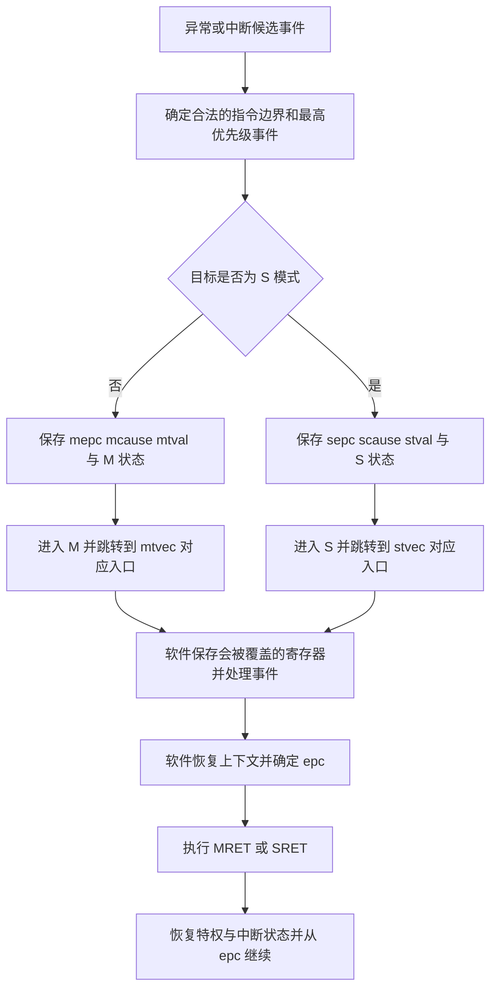

# RISC-V 第八章、CSR 与特权指令详解

> 阅读对象：已经了解 RISC-V 基本整数指令和五级流水线，希望进一步理解特权架构、异常与中断处理，并能将这些机制映射到 RTL 设计的读者。
>
> 主线：一次陷阱如何改变处理器状态，以及流水线如何保证这个变化发生在可恢复的指令边界。

本文以当前目录的 [《RISC-V System-on-Chip Design, Edition 1》](../../../RISC-V%20System-on-Chip%20Design%2C%20Edition%201.pdf) 为主要依据。第八章标题为 **Privileged Operations**，书内第 **335–381 页**，对应 PDF 第 **370–416 页**；阅读器显示的 PDF 页码与书页相差 35。本章之外的虚拟内存和 PMP 补充主要对应第十一章。

联网核对采用 RISC-V International 的 **20260120** 版本规范，其中 Machine-Level ISA、Supervisor-Level ISA 为 1.13，Zicsr 为 2.0。本文主要描述本章使用的 M/S/U 基础特权机制；H、AIA、双重陷阱及调试等扩展可能增加状态和规则，会在相关位置单独标明。汇编示例区分 RV32/RV64，外设地址和启动环境均不能直接套用于所有芯片。

## 阅读导航

- [1. 第八章的结构与核心问题](#chapter-map)
- [2. ISA、特权模式与精确陷阱](#privilege)
- [3. CSR 地址、权限和访问指令](#csr-access)
- [4. 状态寄存器与处理器配置](#status)
- [5. 陷阱、委托和中断的完整运行过程](#traps)
- [6. 特权指令与三种 Fence](#instructions)
- [7. 系统调用、定时器、缺页与模式切换案例](#examples)
- [8. 计数器、内存保护和扩展 CSR](#other-csrs)
- [9. Wally 如何在流水线中实现这些机制](#pipeline)
- [10. 第八章的测试方法](#testing)
- [11. 大小端转换及书中易误解之处](#book-notes)
- [12. 常用 CSR 地址与编码速查](#reference)
- [13. 官方规范与书籍阅读索引](#sources)

<a id="chapter-map"></a>
## 1. 第八章的结构与核心问题

第七章构建的整数流水线能够执行算术、分支、跳转和访存。第八章增加另一类能力：当普通执行被异常或外部事件打断时，处理器能够可靠地交出控制权，并在软件处理之后恢复执行。

| 书中章节 | 书页 | 学习重点 |
|---|---|---|
| 8.1 Principles | 336–338 | 为什么需要保护；陷阱为何必须有确定的恢复位置 |
| 8.2 RISC-V Practices | 339–359 | 特权级、指令、CSR、复位、陷阱及处理程序 |
| 8.3 Test Plan | 360–364 | 如何制造异常和中断，如何检查响应 |
| 8.4 Wally Implementation | 364–380 | 特权单元、CSR 电路、陷阱仲裁、流水线停顿与冲刷 |
| 8.5 Summary | 380–381 | 特权架构与五级流水线之间的联系 |

理解本章时需要同时关注三层：**架构规定软件能观察到什么，硬件决定何时更新状态，处理程序决定事件发生后做什么**。例如，架构规定发生非法指令异常时记录异常原因；硬件需要阻止该指令写回；软件可以终止进程，也可以模拟某条指令。三者职责不同，不能用“发生异常就跳转”概括全部工作。

特权机制的目标还包括限制错误或恶意程序的影响。安全涉及机密性、完整性和可用性；保护是具体的访问限制机制。硬件提供特权级和内存权限检查，操作系统负责资源分配和系统调用参数验证。处理器不会直接判断用户是否有权打开某个文件，这类策略属于软件。

本章对虚拟内存和 PMP 只给出入口，完整机制在第十一章；对调试模式和 Hypervisor 也没有展开。因此，理解第八章能够建立特权机制的基本框架，但实现完整 Linux 平台还需要 MMU、物理保护、定时器、中断控制器和固件配合。

<a id="privilege"></a>
## 2. ISA、特权模式与精确陷阱

### 2.1 基本指令集和特权架构怎样配合

RISC-V 的 ISA 是软件与硬件之间的约定。`RV32`、`RV64` 主要表示整数寄存器和基本整数运算的宽度；RV64 并不表示所有指令都长 64 位。常见指令是 32 位，压缩指令可以是 16 位。

| 指令集或扩展 | 主要能力 | 与本章的关系 |
|---|---|---|
| I | 整数运算、分支、跳转、访存等 | 基本执行能力；含 `ECALL`、`EBREAK` |
| M | 整数乘除法 | 与 Machine 特权模式名称中的 M 含义不同 |
| A | 原子内存操作 | 与多核同步、访存异常相关 |
| F/D | 单精度、双精度浮点 | 增加浮点状态及 `fcsr` |
| C | 压缩指令 | 改变指令对齐要求，影响断点和返回地址处理 |
| Zicsr | 六条 CSR 访问指令 | 提供显式读取、写入和位修改机制 |
| Zifencei | `FENCE.I` | 保证本 hart 后续取指观察到已可见的代码写入 |
| Zicntr/Zihpm | 基础及硬件性能计数器 | 支持计时、退休指令数和性能事件观测 |
| V | 向量操作 | 增加向量配置和执行状态 |

“非特权指令”不等于“只能在用户态执行”。通常 M/S 模式也能执行普通整数指令。反过来，CSR 访问指令定义在非特权规范中，也不等于所有 CSR 都可以在 U 模式访问；访问权限取决于目标寄存器和额外的控制字段。

### 2.2 三种基础特权模式

| 模式 | 编码 | 典型执行者 | 核心作用 |
|---|---|---|---|
| U，User | `00` | 应用程序 | 限制应用对机器资源的直接操作 |
| S，Supervisor | `01` | 操作系统内核 | 管理进程、虚拟内存和常规系统服务 |
| M，Machine | `11` | 启动代码、固件、SBI 实现 | 配置底层机器资源和其他特权环境 |

基础模型中权限关系是 `M > S > U`。实现可以只有 M，或 M/U，或 M/S/U。处理器复位首先进入 M；复位入口地址由平台定义，不能认为所有处理器都从 `0x80000000` 开始。

当前特权级是硬件维护的状态，不能简单等同于 `mstatus.MPP`。**MPP 保存的是进入 M 模式陷阱之前的模式，或者软件准备通过 MRET 返回的目标模式。** 处理器正在 M 模式运行时，MPP 完全可以是 U。

应用通过 `ECALL` 请求执行环境服务，陷阱入口由事先配置的 CSR 决定。应用无法把 `ECALL` 当成任意跳入内核地址的指令。服务号、参数寄存器及服务语义由 ABI 定义，ISA 本身不规定“某个服务号就是打印字符串”。

### 2.3 Exception、Interrupt 和 Trap

| 名称 | 中文含义 | 来源 | 示例 |
|---|---|---|---|
| Exception | 同步异常 | 当前指令的执行 | 非法指令、缺页、`ECALL` |
| Interrupt | 异步中断 | 指令流以外的事件 | 定时器到期、UART 接收、其他 hart 通知 |
| Trap | 陷阱 | 异常或中断引发的控制转移 | 记录原因、保存返回位置、进入处理程序 |

异常通常能够归因到具体指令；中断与某条指令的运算语义无关，但硬件仍要选择一个指令边界接受它。硬件检测到某个事件，不等于它立即成为软件可见的陷阱；事件可能被屏蔽，或者当前还不具备安全的提交边界。

本章讨论的普通同步异常和可屏蔽中断采用精确陷阱模型：在处理程序看来，较早指令已经完成，较晚指令尚未改变程序可见状态。同步异常的故障指令也不应留下正常执行的提交结果；部分复杂指令和扩展另有专门的进度规则。

例如，下面两条指令可以在硬件内部重叠执行：

```asm
div t1, t2, t3
add s0, s0, s1
```

如果 `ADD` 提前提交，而 `DIV` 尚未提交，此时中断返回到 `DIV` 会让 `ADD` 重复执行，返回到两条指令之后又会漏掉 `DIV`。所以，**执行完成和架构提交必须区分**。顺序五级流水线可以在最终写回附近控制提交；乱序处理器一般通过重排序缓冲区保持顺序提交。

精确性限制的是寄存器、CSR、程序可见内存等架构结果，不表示缓存、预测器等微架构结构完全没有受到推测执行影响。后者涉及另外的性能和安全问题。

<a id="csr-access"></a>
## 3. CSR 地址、权限和访问指令

### 3.1 CSR 是独立地址空间中的控制状态

CSR 是 Control and Status Register，即控制与状态寄存器。普通 `x0–x31` 主要承载运算数据；CSR 描述处理器如何执行、如何响应事件，以及已经发生了什么。

CSR 地址是指令内的 **12 位编号**，最多编码 4096 个位置，并不要求实现 4096 个寄存器。CSR 与普通内存地址空间不同。例如 `mstatus` 的 CSR 地址是 `0x300`，执行 `lw t0, 0x300(zero)` 读取的是内存地址 `0x300`，不会读取 `mstatus`。

每个 hart 通常拥有自己的特权状态和陷阱寄存器。一些 CSR 是其他状态的受控视图，而不一定对应独立的一组触发器；性能计数器也可能在特定实现中共享。

标准地址编码约定如下：

```text
csr[11:10]：00 / 01 / 10 为读写类别，11 为只读类别
csr[9:8]  ：目标 CSR 的最低访问特权类别
csr[7:0]  ：类别内编号
```

基础 M/S/U 下，`csr[9:8]` 的 `00/01/11` 分别对应 U/S/M。`10` 与 Hypervisor CSR 有关，不能简单当作独立的第四个普通特权级。调试专用 CSR 也有额外访问规则。

以 `0x300` 为例，高两位为 `00`，属于读写类别；随后两位为 `11`，最低需要 M 权限。`cycle=0xC00` 属于只读、U 类地址，但低特权访问仍可能被 `mcounteren/scounteren` 禁止。

这种地址编码只是第一层检查。还需要检查寄存器是否实现、扩展是否启用、当前模式和虚拟化条件，以及这次指令是否真的执行写操作。只读类别上的写操作会异常；读写类别中某些字段硬连线只读，写这些字段则可能被忽略。

### 3.2 六条 CSR 指令

CSR 指令采用 `SYSTEM` 主操作码 `0x73`。地址位于 `instr[31:20]`；寄存器源或五位立即数位于 `instr[19:15]`。以下公式展示普通可读写字段的核心数据变换，实际结果还受各 CSR 的字段规则约束。

| 指令 | `funct3` | 源值 | 写入 rd | CSR 的核心更新 |
|---|---|---|---|---|
| `csrrw rd, csr, rs1` | `001` | `x[rs1]` | 旧值 | 写源值 |
| `csrrs rd, csr, rs1` | `010` | `x[rs1]` | 旧值 | 旧值 OR 源掩码 |
| `csrrc rd, csr, rs1` | `011` | `x[rs1]` | 旧值 | 旧值 AND NOT 源掩码 |
| `csrrwi rd, csr, uimm` | `101` | 零扩展立即数 | 旧值 | 写立即数 |
| `csrrsi rd, csr, uimm` | `110` | 零扩展立即数 | 旧值 | OR 立即数掩码 |
| `csrrci rd, csr, uimm` | `111` | 零扩展立即数 | 旧值 | AND NOT 立即数掩码 |

立即数范围是 **0–31**，表示数值或位掩码，并不表示“选择第 uimm 位”。例如立即数 8 是 `0b01000`，用于设置或清除位 3；不能用立即数 128 设置位 7。

读改写对本 hart 上的一条 CSR 指令而言是不可分割的架构操作。处理程序不会在这条指令只完成读取、尚未完成写入的位置获得一个普通指令边界。这里的“原子”不等于跨 hart 的共享内存原子操作，也不意味着所有 CSR 和 MMIO 访问自动形成全局屏障。

若 `rd` 和 `rs1` 是同一个整数寄存器，源操作数取指令执行前的值；不能先把 CSR 旧值写入 rd，再拿变化后的 rd 当源值。

### 3.3 读写抑制是解码的一部分

| 指令条件 | 读取 CSR？ | 写入 CSR？ |
|---|---|---|
| `CSRRW/CSRRWI`，`rd=x0` | 否 | 是 |
| `CSRRW/CSRRWI`，`rd≠x0` | 是 | 是 |
| `CSRRS/CSRRC`，`rs1=x0` | 是 | 否 |
| `CSRRS/CSRRC`，`rs1≠x0` | 是 | 是，即使寄存器中的数值为 0 |
| `CSRRSI/CSRRCI`，`uimm=0` | 是 | 否 |
| `CSRRSI/CSRRCI`，`uimm≠0` | 是 | 是 |

`CSRRW` 的源寄存器为 `x0` 时会尝试写入零。`CSRRS/CSRRC` 的 `rd=x0` 只是丢弃返回值，并不取消读取。它们的写抑制条件检查的是 **源寄存器编号是否为 x0**，不能只检查源数据是否等于零。

这会直接影响合法性检查：`csrrs t0, cycle, zero` 是读取；`csrrs t0, cycle, t1` 即使 t1 的数值为零，仍然包含向只读 CSR 写入的尝试。`CSRRW` 不读取 CSR，也仍须检查目标存在性和写权限。[官方依据：Zicsr 的 CSR Instructions](https://docs.riscv.org/reference/isa/v20260120/unpriv/zicsr.html)。

### 3.4 常用伪指令与实例

| 写法 | 实际指令 | 用途 |
|---|---|---|
| `csrr rd, csr` | `csrrs rd, csr, x0` | 只读取 |
| `csrw csr, rs1` | `csrrw x0, csr, rs1` | 只写入 |
| `csrs csr, rs1` | `csrrs x0, csr, rs1` | 设置若干位 |
| `csrc csr, rs1` | `csrrc x0, csr, rs1` | 清除若干位 |
| `csrwi csr, uimm` | `csrrwi x0, csr, uimm` | 写立即数 |
| `csrsi/csrci csr, uimm` | 相应立即数指令，`rd=x0` | 设置或清除低位掩码 |

以下片段要求在 M 模式执行，仅展示 CSR 操作，启用中断前还必须配置有效入口和处理程序：

```asm
csrr t0, mstatus       # 获取当前状态
csrsi mstatus, 8       # MIE 位于 bit 3，8 在五位立即数范围内
csrci mstatus, 8       # 清除 MIE
li t1, 0x80
csrs mie, t1          # 设置 MTIE，bit 7，必须使用寄存器掩码
```

设置多个独立字段时，通常用位设置/清除保留其他字段。不能为了打开一个中断就把整个 `mstatus` 写成一个常数；这样可能同时改变特权返回、浮点状态和访存配置。

### 3.5 WPRI、WLRL 和 WARL

| 类型 | 含义 | 软件和硬件应怎样理解 |
|---|---|---|
| WPRI | Writes Preserve values, Reads Ignore values | 软件忽略读到的保留字段，修改其他字段时保留其值 |
| WLRL | Write Legal, Read Legal | 软件应写合法编码；不能依赖非法编码的结果 |
| WARL | Write Any, Read Legal | 允许尝试任意编码，但读回只能是实现支持的合法值 |

例如，某实现只支持 Bare 和 Sv39。向 WARL 字段尝试写入其他模式，并不意味着硬件必须实现这个模式。具体 CSR 可能规定忽略整个写入，或者返回某个合法设置，必须阅读寄存器自身的规则。

读写 CSR 内的只读字段也不等于整个 CSR 地址是只读。Wally 的 `misa` 内容固定，就是这种需要区分地址类别与字段可写性的例子。不能根据“写完没有变化”就判断必然发生非法指令异常。

<a id="status"></a>
## 4. 状态寄存器与处理器配置

### 4.1 mstatus 与 sstatus 的关系

`mstatus` 汇集特权执行的关键状态。`sstatus` 是其中供 S 模式使用的受限视图；对应字段共享状态，不是把 `mstatus` 复制到另一份独立寄存器。写 `sstatus` 时必须保护 S 模式不可访问的 M 字段。

下表列出本章基础模型中的主要字段。RV64 高位字段、扩展新增字段和 RV32 分拆 CSR 不能直接套用同一个完整位图。

| 字段 | 常用位号 | 含义 |
|---|---|---|
| SIE | 1 | 当前处于 S 模式时，S 目标中断的全局使能 |
| MIE | 3 | 当前处于 M 模式时，M 目标中断的全局使能 |
| SPIE | 5 | 进入 S 陷阱之前保存的 SIE |
| UBE | 6 | U 模式数据访问端序配置 |
| MPIE | 7 | 进入 M 陷阱之前保存的 MIE |
| SPP | 8 | S 陷阱之前的模式，0 为 U，1 为 S |
| VS | 10:9 | 向量上下文状态，存在时使用 |
| MPP | 12:11 | M 陷阱之前的模式或 MRET 返回目标 |
| FS | 14:13 | 浮点上下文状态 |
| XS | 16:15 | 其他扩展上下文状态汇总 |
| MPRV | 17 | M 模式显式数据访问的有效权限配置 |
| SUM | 18 | 允许 S 模式显式数据访问用户页 |
| MXR | 19 | 允许把可执行页视作可读页 |
| TVM | 20 | 拦截 S 模式的部分虚拟内存控制操作 |
| TW | 21 | 控制低特权 WFI 超时拦截 |
| TSR | 22 | 拦截 S 模式 SRET |
| UXL / SXL | RV64 的 33:32 / 35:34 | U/S 有效整数宽度配置 |
| SBE / MBE | RV64 的 36 / 37 | S/M 模式数据端序 |
| SD | RV32 的 31，RV64 的 63 | 扩展状态是否需要保存的汇总只读位 |

在 RV32，M 的部分高位状态通过 `mstatush` 访问。不能据此推导存在标准 `sstatush`；S 可见状态应按规范规定的 `sstatus` 布局使用。

### 4.2 MIE、MPIE、MPP 为什么一起使用

假设程序在 U 模式运行，处理器接收一个目标为 M 的陷阱。进入时硬件保存 `MPP=U`、`MPIE=旧 MIE`，并将 `MIE=0`，然后进入 M。这样，处理程序刚开始时不会立即被另一个普通 M 中断打断。

执行 `MRET` 时，硬件恢复目标模式为 MPP，把 MPIE 恢复到 MIE。MPP/MPIE 只有有限的一层保存位置，不能自动保存任意深度的嵌套陷阱。若处理程序要重新开中断，必须先把可能被覆盖的返回位置和状态保存到软件栈。

关闭 MIE 也不会禁止所有同步异常。例如，处理程序执行未实现指令、访问坏地址，仍可能产生异常。因此，入口最初几条指令和陷阱栈必须可靠，不能认为“中断关了就绝对不会再次陷阱”。

### 4.3 FS、VS、XS、SD 控制上下文开销

| 编码 | 状态 | 含义 |
|---|---|---|
| `00` | Off | 对相关扩展状态的访问被禁止 |
| `01` | Initial | 状态按照初始化约定使用 |
| `10` | Clean | 相对于软件保存的副本没有需要保存的新变化 |
| `11` | Dirty | 状态可能已经改变，需要考虑保存 |

浮点状态包括浮点寄存器和相关 CSR。若 FS=Off，访问这些状态的指令会产生非法指令异常。将 FS 设为 Initial 并不等于硬件自动清零全部浮点寄存器；软件必须满足上下文初始化约定。

硬件可以保守地把状态标记为 Dirty，不必精确到“数值一定发生变化”。操作系统保存了某线程的浮点上下文之后，可以标成 Clean，下一次切出这个线程时如果仍为 Clean，就无需重复保存。但切换到另一个线程时仍可能需要恢复另一个线程的状态，不能把 Clean 理解为“永远无需保存或恢复”。

`SD = (FS==Dirty) OR (VS==Dirty) OR (XS==Dirty)`。它帮助软件快速判断扩展上下文是否需要额外保存；普通整数寄存器的保存需求不由 SD 决定。[本书依据：8.2.3.1，书页 343–346。]

### 4.4 MPRV、SUM、MXR 影响访存权限

MPRV 允许 M 模式代码在显式 load/store 时使用 MPP 对应的有效权限和相关地址转换规则。例如，固件模拟一次用户态访存时，不能随意以 M 的权限绕过用户保护；MPRV 提供以受限权限执行数据访问的机制。它不把当前执行模式改成 MPP，也不按同样方式改变指令取指权限。

SUM 控制 S 模式是否允许显式 load/store 访问标记为用户可访问的页面。内核复制用户缓冲区时可能短时开启 SUM；即使 SUM=1，S 模式也不能因此直接从用户页取指执行。

MXR 允许 load 把可执行页当作可读页，可用于读取代码字节。这不会授予写权限，也不会取消 PMP、PMA 等其他检查。权限位通常是组合条件，不是“设置一个位就获得全部访问权”。

### 4.5 TVM、TW、TSR 与配置寄存器

TVM=1 时，S 模式读写 `satp` 或执行 `SFENCE.VMA` 受到拦截；TSR=1 时，S 模式 `SRET` 受到拦截；TW 则允许对低特权模式长时间停留在 WFI 的行为实施有界超时拦截。基础模型中的拦截通常产生非法指令异常，H 扩展会增加虚拟化专用规则。

`misa` 报告基础整数宽度和单字母扩展。扩展位通常以 A 为 bit 0、B 为 bit 1，依字母顺序排列；MXL 位于寄存器最高两位。许多多字母扩展不能仅凭 `misa` 完整发现，还需固件、平台描述或其他能力发现机制。实现可以不支持动态修改这些功能；本章 Wally 把相关能力固定为综合时配置。

`menvcfg/senvcfg` 控制某些能力是否向较低特权环境开放。例如 STCE 与 Sstc 定时器有关，PBMTE 与页表内存类型扩展有关，ADUE 与页表 A/D 位的硬件更新有关。CBZE、CBCFE、CBIE 控制缓存管理指令的可用性；FIOM 会加强特定低特权 I/O Fence 的内存排序范围。字段只有在相应扩展存在时才具有对应意义。

复位时只应依赖规范或平台明确保证的状态。基础保证包括进入 M、MIE/MPRV 清零和平台定义的复位 PC；普通寄存器、栈指针、陷阱入口等要由启动代码初始化。开启中断之前，先准备入口、栈及必要的保护配置。

<a id="traps"></a>
## 5. 陷阱、委托和中断的完整运行过程

### 5.1 哪些 CSR 共同构成陷阱机制

| 作用 | M 模式 CSR | S 模式 CSR | 谁决定其值 |
|---|---|---|---|
| 陷阱入口及入口模式 | mtvec | stvec | 软件配置 |
| 返回位置 | mepc | sepc | 陷阱进入时硬件写入，软件可以修改 |
| 原因 | mcause | scause | 硬件在陷阱进入时记录 |
| 辅助信息 | mtval | stval | 硬件记录地址、指令信息或零 |
| 软件临时状态 | mscratch | sscratch | 软件管理 |
| 状态与返回权限 | mstatus | sstatus | 陷阱、返回指令和显式 CSR 操作更新 |
| 中断使能 | mie | sie | 软件配置可写的使能位 |
| 中断待处理状态 | mip | sip | 外设信号和部分软件可写位共同影响 |

这些寄存器不是一次陷阱的完整软件栈帧。进入陷阱时硬件不会自动把 `ra`、`sp`、`a0` 等通用寄存器压栈；也不会自动替软件选择一个内核栈。

### 5.2 进入 M 模式陷阱时发生什么

下列伪代码描述基础架构的联合状态变化，不表示硬件必须花七个时钟逐项执行。它省略 H、双重陷阱和控制流完整性等扩展的额外动作。

```text
trap_to_M(return_pc, interrupt, cause, trap_value):
    mepc         := return_pc
    mcause       := (interrupt << (XLEN - 1)) | cause
    mtval        := trap_value
    mstatus.MPP  := current_privilege
    mstatus.MPIE := mstatus.MIE
    mstatus.MIE  := 0
    current_privilege := M
    pc := selected_machine_trap_entry
```

同步异常的 `return_pc` 通常是故障指令的 PC；中断的 `return_pc` 是选定边界上尚未执行完成、应该继续执行的指令地址。如果前面的指令已经提交，返回位置就不能再把它们执行一遍。

进入 S 模式陷阱时，同样更新 `sepc/scause/stval`，保存 `SPP/SPIE`、清除 SIE、切换到 S 并跳到 stvec 对应入口。**一个直接委托到 S 的陷阱不会先经历 M 处理程序，也不会正常写一遍 M 的陷阱记录。**



### 5.3 mcause/scause 怎样解释

最高位是中断标志，下面的位表示原因编码。RV32 的最高位是 bit 31，RV64 是 bit 63。`mcause=7` 表示 store/AMO access fault；RV32 的 `0x80000007` 才表示 M 定时器中断。不能只比较低位 7。

| 同步异常编码 | 含义 | 常见辅助信息 |
|---|---|---|
| 0 | 指令地址不对齐 | 非法跳转目标地址 |
| 1 | 指令访问错误 | 取指相关地址 |
| 2 | 非法指令 | 可选的非法指令位模式，或零 |
| 3 | 断点 | 与断点相关的地址，或零 |
| 4 / 5 | load 地址不对齐 / 访问错误 | 数据地址 |
| 6 / 7 | store/AMO 地址不对齐 / 访问错误 | 数据地址 |
| 8 / 9 / 11 | U / S / M 模式 ECALL | 通常为零 |
| 12 | 指令页错误 | 故障虚拟地址 |
| 13 | load 页错误 | 故障虚拟地址 |
| 15 | store/AMO 页错误 | 故障虚拟地址 |

这张表覆盖本章的基础原因，不是所有新扩展原因的全集。表中辅助信息应结合规范的平台要求理解；尤其不能假设每次非法指令异常都能从 mtval 取出完整原指令。跨页取指或访存故障时，辅助地址还可能指向失败的那一部分，而 epc 指向产生该访问的指令。

异常原因编码也不是统一的优先级编号。本书表 8.4 给出了相应实现使用的优先级安排；某些访存不对齐和页错误/访问错误之间，规范允许实现选择。RTL 要用明确的仲裁规则，不能按“数值最小者优先”推导。

### 5.4 mtvec/stvec 的 Direct 与 Vectored

低两位是 MODE，其余位组成基地址：

```text
BASE = xtvec & ~3
MODE = xtvec & 3
```

| MODE | 异常入口 | 中断入口 |
|---|---|---|
| 0，Direct | BASE | BASE |
| 1，Vectored | BASE | BASE + 4 × 原因编码 |

例如 `mtvec=0x80001001`，基地址为 `0x80001000`。机器定时器中断原因是 7，入口为 `0x8000101C`；非法指令异常仍进入 `0x80001000`。

向量表每个槽位相隔四字节，通常放一条跳转指令，转到更大的处理函数。向量槽位由架构原因编号确定，不是 UART 或 GPIO 的 PLIC 设备编号；多个外设可以共享一个 machine external interrupt 入口，再由软件查询具体来源。

BASE 至少四字节对齐。Wally 为简化向量地址组合采用更强的 64 字节对齐约束，这是具体实现选择，不能推广成所有 RISC-V 的统一要求。

### 5.5 medeleg/mideleg 怎样决定目标

`medeleg[i]` 控制原因 i 的异常能否直接交给 S；`mideleg[i]` 控制原因 i 的中断是否交给 S。只有实现支持的位才可写，软件不能假设所有原因都可委托。

| 当前模式 | 事件和配置 | 结果 |
|---|---|---|
| U | U-ECALL，medeleg[8]=1 | 直接进入 S |
| U | U-ECALL，medeleg[8]=0 | 进入 M |
| S | S-ECALL 未委托 | 进入 M，常用于 SBI 请求 |
| M | 某异常对应 medeleg 位为 1 | 仍在 M 处理，不向下降权 |
| M | 某中断委托到 S | 在 M 执行期间不会进入 S 中断处理程序 |

最需要记住的是：**委托提供直接进入较低处理层的路径，但普通陷阱不会从当前 M 降到 S。** 对异常，已经在 M 发生的事件留在 M；对委托中断，在高于其目标的模式执行时它被屏蔽。

设置 `mideleg` 也不是把机器定时器自动变成监督者定时器。传统系统中，M 固件接收 MTIP，随后在软件中请求 STIP；Sstc 则另行提供硬件产生 S 定时器中断的机制。

### 5.6 mip/mie 与全局使能的组合

本章最常用的六组待处理位和使能位如下。`mip` 里的名称以 P 结尾，`mie` 里的名称以 E 结尾。

| 位号/中断原因 | 待处理位 | 单类使能位 | 来源类别 |
|---|---|---|---|
| 1 | SSIP | SSIE | S 软件中断 |
| 3 | MSIP | MSIE | M 软件中断 |
| 5 | STIP | STIE | S 定时器中断 |
| 7 | MTIP | MTIE | M 定时器中断 |
| 9 | SEIP | SEIE | S 外部中断 |
| 11 | MEIP | MEIE | M 外部中断 |

首先检查 `mip[i] AND mie[i]`。然后根据委托确定目标模式，再检查当前模式和全局使能。在无 H 等扩展的基础模型里：

```text
目标 M：eligible = pending & enabled &
                 ((当前模式 < M) OR (当前模式 == M AND MIE))

目标 S：eligible = pending & enabled &
                 ((当前模式 < S) OR (当前模式 == S AND SIE))
```

这意味着，MIE=0 只在当前处于 M 时关闭 M 目标中断。处理器在 U 或 S 时，M 目标中断在全局层面仍然允许；其单类使能位仍须开启。相同地，在 U 时 S 目标中断不被 SIE=0 挡住，在 M 时却不能因 SIE=1 跳到 S。

把所有中断都写成 `pending & mie & MIE` 会出错；把 U 模式“全局允许”理解成“所有单类屏蔽无效”也会出错。这些组合条件是特权中断逻辑最值得逐项验证的部分。[本书依据：8.2.5.3–8.2.5.4，图 8.7–8.10，书页 354–357。]

### 5.7 谁清除待处理中断

中断 pending 描述请求是否仍然存在，不是“一进入处理程序就自动清零”的标记。处理程序必须使用来源规定的应答机制。

| 来源 | 请求如何产生 | 常见解除方法 |
|---|---|---|
| M timer | `mtime >= mtimecmp` | 把 mtimecmp 改成未来时刻 |
| M software | 平台软件中断 MMIO 置位 | 清除对应平台寄存器 |
| M/S external | 外设与 PLIC 等控制器 | 查询/claim 来源、处理设备、清设备原因并按控制器协议 complete |
| S software | 可写 SSIP 或平台机制 | 通过允许的 CSR/平台路径解除 |
| S timer | 固件请求或 Sstc 比较 | 清软件请求，或把 stimecmp 改成未来时刻 |

例如，MIP.MTIP 通常是来自定时器比较逻辑的只读状态，不能靠 `csrc mip, mask` 清除。若只执行 MRET 而没有解除电平请求，硬件会再次进入中断，表现为中断风暴。

`sip/sie` 是与 S 可见中断相关的受控视图，受委托和具体扩展影响；不能给 S 任意修改 M 中断的能力。基础 SEIP 的读取还可能由软件位与外部输入的 OR 得到，CSR 写入却只修改软件可写部分。这类字段不应机械地套用普通寄存器“读到什么就原样写回”的电路。

<a id="instructions"></a>
## 6. 特权指令与三种 Fence

### 6.1 ECALL：请求执行环境

ECALL 根据执行它的模式生成不同异常：U 为 8，S 为 9，M 为 11。然后按照委托配置进入对应处理程序。参数仍在原通用寄存器中，硬件不会替软件复制一组参数到 CSR。

`epc` 指向 ECALL 自己。完成服务后通常由软件把 epc 加 4，跳过已经处理的 ECALL；否则 MRET/SRET 会再次执行它。ECALL 是 32 位指令，即使系统支持压缩指令，这里的长度仍为四字节。它产生同步异常，不作为正常退休指令计数。

ECALL 也不是无条件提升一级的操作：M 执行 ECALL 可以留在 M；U 可以根据委托直接进入 S，或进入 M。服务语义最终由目标执行环境定义。

### 6.2 EBREAK：断点与调试入口

基础处理方式是生成 breakpoint 异常，epc 指向 EBREAK。外部调试机制可能配置 EBREAK 进入 Debug Mode；那时涉及 `dcsr/dpc` 等调试状态，不能把普通异常处理规则原样套过去。

软件断点常通过替换原指令实现，恢复执行可能需要还原原指令、单步，再重建断点。压缩形式 `C.EBREAK` 长度是两字节，所以通用断点处理不能一律把 epc 加 4。若代码被改写，还要按平台的取指一致性机制使后续执行看见改写结果。

### 6.3 MRET 与 SRET：返回位置和权限一起恢复

基础 MRET 的效果如下，`old_mpp` 必须使用修改 MPP 之前的值：

```text
old_mpp := mstatus.MPP
pc := mepc
current_privilege := old_mpp
mstatus.MIE := mstatus.MPIE
mstatus.MPIE := 1
mstatus.MPP := 最低的受支持特权模式
若 old_mpp < M：mstatus.MPRV := 0
```

SRET 对应使用 sepc、SPP、SIE、SPIE；在基础 M/S/U 模型中，SPP=0 返回 U，SPP=1 返回 S，并把 SPP 复位为 0、SPIE 置 1。返回到低于 M 的模式时也清除 MPRV。H 等扩展增加额外返回状态，需阅读对应扩展规则。

MRET 只能在 M 执行。SRET 要求支持 S，可以在 S 或更高模式执行；TSR 对 S 中执行 SRET 的拦截不能写成“TSR=1 时 M 中的 SRET 也一律非法”。

| 比较项 | 普通 `ret` | `mret` / `sret` |
|---|---|---|
| 返回位置 | 通常是 ra | mepc / sepc |
| 修改特权级 | 否 | 是 |
| 恢复中断状态 | 否 | 是 |
| 自动恢复通用寄存器 | 否 | 否 |
| 典型场景 | 函数返回 | 陷阱返回或受控进入另一模式 |

软件可以事先设置 MPP 和 mepc，再用 MRET 从 M 进入 U/S。这是受权限保护的状态切换，不是普通分支。

### 6.4 WFI：等待与接受中断是两个条件

WFI 向实现表示当前 hart 可以等待可能需要服务的中断。实现可以停顿、进行时钟门控，也可以选择直接把它当作 NOP；软件不能依赖 WFI 必然降低功耗或一定持续睡眠。

唤醒不要求 MIE/SIE 已开启，也不等于一定进入处理程序。局部已使能的 pending 中断需要能够使等待恢复；恢复后是否真正陷阱，还要满足第 5.6 节的目标模式和全局使能条件。实现也允许由于其他原因恢复，所以等待循环应重新检查工作条件。

如果 WFI 后接受中断，返回位置位于 WFI 后面的指令，不应让返回后无限重新陷在同一个 WFI 上。TW 支持低特权等待的有界超时拦截；U 模式 WFI 的合法性还受支持的特权环境影响。[官方补充：Machine-Level ISA 的 Wait for Interrupt](https://docs.riscv.org/reference/isa/v20260120/priv/machine.html)。

下面只展示等待结构，工作条件的检查和竞态控制由系统实现：

```asm
idle_loop:
    wfi
    # 此处检查工作队列或 pending 条件，再决定继续等待还是处理工作
    j idle_loop
```

### 6.5 FENCE、FENCE.I、SFENCE.VMA 分别解决什么

| 指令 | 同步对象 | 常用触发场景 | 不能据此保证的事情 |
|---|---|---|---|
| FENCE | 指定类别的内存和 I/O 访问顺序 | 数据发布、设备协议、可观察 CSR 与 MMIO 排序 | 自动刷新所有缓存或 TLB |
| FENCE.I | 本 hart 数据写入与后续取指 | JIT、自修改代码、软件断点 | 自动同步其他 hart 的取指 |
| SFENCE.VMA | 本 hart 页表更新与隐式地址转换 | 修改页表、复用 ASID、更新映射 | 自动通知其他 hart 或成为通用数据 Fence |

FENCE 的 predecessor/successor 集合用 R/W/I/O 区分内存读写和设备输入输出。比如先写共享数据，再发布通知，需要确保观察者不会先看到通知再看到旧数据；具体 Fence 取决于平台和通信协议。

FENCE.I 保证本 hart 已可见的先前写入与之后取指同步。它不规定一定完整回写 D-cache 或完整清空 I-cache；这些是实现可以选择的手段。其他 hart 执行改写后的代码时，也需要相应的发布和远端取指同步。[官方依据：Zifencei](https://docs.riscv.org/reference/isa/v20260120/unpriv/zifencei.html)。

SFENCE.VMA 不访问 `rs1/rs2` 指定的内存内容；它们分别提供虚拟地址和 ASID 的筛选条件：

| rs1 | rs2 | 地址转换缓存的作用范围 |
|---|---|---|
| x0 | x0 | 所有地址、所有地址空间，含全局映射 |
| x0 | 非 x0 | 指定 ASID 的地址空间，不含全局映射 |
| 非 x0 | x0 | 指定虚拟地址的叶级映射，所有地址空间 |
| 非 x0 | 非 x0 | 指定虚拟地址和 ASID 的叶级映射，不含全局映射 |

这里也区分寄存器编号与数值：`rs2=x0` 表示全空间；一个值为零但编号非 x0 的 rs2 表示 ASID 0。简单硬件可以做更大范围的失效，但软件不能假设所有硬件只支持全刷。

```asm
# S 或 M 模式；假设 a0 保存待同步的虚拟地址，a1 保存 ASID
sfence.vma zero, zero
sfence.vma a0, zero
sfence.vma a0, a1
```

写 `satp` 不意味着自动清空旧 TLB，也不替代页表写入的同步。其他 hart 持有旧映射时，需要显式通知它们执行本地同步并确认完成，即 TLB shootdown。[官方补充：Supervisor Memory-Management Fence Instruction](https://docs.riscv.org/reference/isa/v20260120/priv/supervisor.html)。

<a id="examples"></a>
## 7. 系统调用、定时器、缺页与模式切换案例

### 7.1 U 模式系统调用进入 S

假设 U 程序在 `0x1000` 执行 ECALL；medeleg[8]=1，stvec 为 Direct，BASE=`0x80002000`。

1. 硬件识别 U-ECALL，选择 S 为处理目标。
2. `sepc=0x1000`、`scause=8`，并按规则设置 stval。
3. `SPP=0`，`SPIE=旧 SIE`，`SIE=0`，当前模式变成 S。
4. PC 变为 `0x80002000`。软件建立安全的入口上下文。
5. 内核验证服务号、指针和长度等参数，执行被允许的服务。
6. 返回值按 ABI 写回，软件设置 `sepc=0x1004`。
7. 恢复需保留的上下文后执行 SRET，从 `0x1004` 继续 U 程序。

ECALL 的合法性不取决于 SIE 是否开启；SIE 控制中断，不禁止这类同步异常。内核也不能相信用户传入的任意指针，只因为请求已经通过 ECALL 到达内核。

### 7.2 M 定时器中断的状态变化

假设程序在 M 执行，MIE=1、MTIE=1、mideleg[7]=0，PC 的下一条待执行指令是 `0x8020`。定时器达到比较值后，MTIP=1。

硬件在安全边界接受中断，把 RV64 的 mcause 写为 `0x8000000000000007`，mepc 写为 `0x8020`，MPP 写为 M、MPIE 写为 1、MIE 清零，然后进入 mtvec 对应入口。处理程序读取定时器、更新比较值，解除持续请求，再恢复上下文并执行 MRET。

返回时 PC 是 `0x8020`，不加 4。因为这里保存的是尚待执行的指令；跳过它会丢失一次正常运算。若同样的 M 中断发生在 U，保存的 MPP 则为 U，返回后恢复 U。

### 7.3 一个不嵌套的 RV64 教学处理程序

下面给出可汇编的独立片段，要求 RV64、M 模式、可用的普通 RAM 和类似本书 CLINT 的定时器地址。它处理 M 定时器中断，并把 ECALL 当成“记录完成后继续”的教学事件；它没有实现操作系统服务。它不启用嵌套，不调用其他函数，只修改并保存 t0/t1/t2；普通运行栈及 PMP/内存配置须由启动环境准备好。

```asm
.equ MTIME,    0x0200bff8
.equ MTIMECMP, 0x02004000

.section .text
.balign 4
demo_setup:
    csrci mstatus, 8           # 配置期间先关闭本模式的 M 中断
    la t0, demo_trap
    csrw mtvec, t0            # Direct 入口，标签四字节对齐
    la t0, demo_trap_stack_top
    csrw mscratch, t0         # 软件约定：保存陷阱栈顶
    csrw medeleg, zero
    csrw mideleg, zero
    li t0, MTIME
    ld t1, 0(t0)
    addi t1, t1, 2047
    li t0, MTIMECMP
    sd t1, 0(t0)              # 设置下一次到期时刻
    li t0, 0x80
    csrw mie, t0              # 本教学程序只开启 MTIE
    csrsi mstatus, 8
    ret

.balign 4
demo_trap:
    csrrw sp, mscratch, sp     # 获得陷阱栈，原 sp 暂存在 mscratch
    addi sp, sp, -32           # 保持 16 字节对齐
    sd t0, 0(sp)
    sd t1, 8(sp)
    sd t2, 16(sp)
    csrr t0, mcause
    bgez t0, demo_exception    # RV64：最高位为 0 表示同步异常

    li t1, 1
    slli t1, t1, 63
    ori t1, t1, 7
    bne t0, t1, demo_fail_stop
    li t0, MTIME
    ld t1, 0(t0)
    addi t1, t1, 2047
    li t0, MTIMECMP
    sd t1, 0(t0)              # 解除定时器请求，预约下一次
    j demo_return             # 中断不修改 mepc

demo_exception:
    li t1, 8
    beq t0, t1, demo_ecall
    li t1, 9
    beq t0, t1, demo_ecall
    li t1, 11
    bne t0, t1, demo_fail_stop
demo_ecall:
    csrr t2, mepc
    addi t2, t2, 4            # 只对本例已处理的 ECALL 跳过四字节
    csrw mepc, t2
demo_return:
    ld t2, 16(sp)
    ld t1, 8(sp)
    ld t0, 0(sp)
    addi sp, sp, 32
    csrrw sp, mscratch, sp
    mret

demo_fail_stop:
    # 未知异常停留在处理程序，便于调试；不直接忽略故障
    j demo_fail_stop

.section .bss
.balign 16
demo_trap_stack:
    .space 1024
demo_trap_stack_top:
```

这段代码的关键是 `CSRRW` 的交换作用与进入/退出的对称性。mscratch 本身没有“硬件自动换栈”的能力；只有软件执行这条交换指令之后，sp 才变成陷阱栈地址。无嵌套时，退出会把陷阱栈顶放回 mscratch，同时恢复原 sp。

如果在交换后立即再次陷阱，mscratch 中已经是原程序 sp，不能机械重复这套入口。可嵌套处理程序需要区分来自用户态和内核态的入口，并保护当前陷阱帧。关闭 MIE 仍不能避免入口访存自身发生同步异常。

本例从“当前时间+间隔”预约下一次事件，简化了说明。严格周期调度通常基于上一个截止时间累计，并处理延迟或错过的周期。计时寄存器宽度、回绕和平台访问约束也要在真实系统中考虑。

### 7.4 RV32 的 64 位计时器访问

RV32 分两次读取 64 位计时值时，低半部分可能在两次读取之间进位。对 CSR 视图采用高—低—高读取，只有两次高位相同才接受这个样本：

```asm
read_time_retry:
    rdtimeh t0
    rdtime t1
    rdtimeh t2
    bne t0, t2, read_time_retry
    # 此时 t0:t1 是本次读取的一致 64 位样本
```

这要求平台实现相应计数器，并允许当前模式读取。对支持同样分拆访问的 MMIO 计时器也需要对应的一致性方案，不能把 CSR 与 MMIO 路径混成一条指令。

RV32 写 64 位 mtimecmp 时还可能出现中间比较值过小，导致临时触发中断。在支持下列访问方式、little-endian、强排序的典型平台上，a0/a1 为新的低/高 32 位，a2 是比较寄存器地址：

```asm
li t0, -1
sw t0, 0(a2)       # 先让低半部分取最大值，避免临时小值
sw a1, 4(a2)       # 更新高半部分
sw a0, 0(a2)       # 最后写真实低半部分
```

定时器 pending 信号可能延迟反映新的比较值；处理程序应允许一次已经进入管线的额外中断，而不能假设写比较值后所有路径立即同步清零。

### 7.5 缺页后重新执行原指令

假设 U 程序执行 `lw a0, 0(a1)`，其页映射尚未建立，load page fault 被委托给 S。sepc 指向这条 LW，scause=13，stval 按要求记录故障虚拟地址。

内核先判断地址是否合法。若只是可按需建立的映射，准备物理页、更新页表并完成必要的地址转换同步；然后保留 sepc，不跳过 LW，恢复上下文并执行 SRET。LW 再执行一次，这次获得数据。

如果访问违反权限，内核可能终止进程或发送信号，而不是重试。也不能把所有 page fault 都解释为“从磁盘换入页面”；不存在映射、写只读页和特权权限不匹配都可能产生页错误。

### 7.6 从 M 受控进入 U

下列 M 模式片段设置返回目标，要求已支持 U，用户入口及用户栈可访问，PMP/页表等配置已经完成：

```asm
li t0, 0x1800       # MPP[12:11] 掩码
csrc mstatus, t0    # MPP=00，目标 U
la t0, user_entry
csrw mepc, t0
mret
user_entry:
    # 已经在 U 模式，执行应用程序；此处只是示意入口
    nop
```

目标模式由 MPP 决定，目标地址由 mepc 决定，两者都要正确。本书 Code Example 8.1 用 ECALL 参数请求任意切换模式，是测试环境便于制造场景的约定；生产系统不能允许用户通过任意参数取得 M 权限。

<a id="other-csrs"></a>
## 8. 计数器、内存保护和扩展 CSR

### 8.1 cycle、time、instret 与机器计数器

| 寄存器组 | 计数内容 | 关键区别 |
|---|---|---|
| mcycle / cycle | 周期数 | 机器可写计数器与低特权只读视图 |
| time | 实时时间计数器视图 | 频率可独立于 hart 主时钟 |
| minstret / instret | 已退休指令数 | 计提交结果，不是计取指次数 |
| mhpmcounter3–31 / hpmcounter3–31 | 平台性能事件 | 事件种类和数量取决于实现 |
| mhpmevent3–31 | 事件选择 | 决定相应计数器观察什么事件 |

RV32 通过带 h 的 CSR 读取高半部分；RV64 可以用一次 CSR 访问读取 64 位计数值。读取时需检查是否实现及当前权限。第 7.4 节的高—低—高方式同样适用于这些可能进位的计数器。

`mcounteren` 控制较低特权环境对计数器的访问，`scounteren` 进一步控制 U 环境。基础 M/S/U 系统中，U 的允许条件需要同时满足上层设置；这些寄存器中的 CY、TM、IR 分别对应 cycle、time、instret，HPM 位对应可选事件计数器。

`mcountinhibit` 则控制计数器是否继续增长，CY 控制 mcycle，IR 控制 minstret，HPM 位控制其他计数器。**禁止访问和停止计数是不同动作**：可以禁止用户读，却继续为固件计数；也可以让一个允许读取的计数器停止。time 来自平台计时设施，不由 mcountinhibit 的常规周期/退休控制停止。

指令遇到同步异常而未正常退休，不能算作一次成功退休。错误路径的取指、流水线气泡和被冲刷指令也不能增加 minstret。正确的实现需要考虑有效位、停顿与提交事件，而不只是看到流水线某个位置非空就加一。

性能测量常见公式为 `CPI = Δcycle / Δinstret`。它适合观察整体执行效率，但读取开销、中断处理、计数过滤及平台行为可能影响样本。周期数也不是固定频率下的真实时间，DVFS 或暂停主时钟时尤其需要区别。[官方参考：Zicntr/Zihpm](https://docs.riscv.org/reference/isa/v20260120/unpriv/counters.html)。

### 8.2 time CSR 与 mtime MMIO 的区别

`time` 的 CSR 地址是 `0xC01`。平台的 `mtime` 通常是内存映射计时寄存器，通过 load/store 访问。CSR 视图可以直接反映平台计时值，也可以由执行环境支持；不存在一个通用的 `mtime` CSR 地址供 `csrw mtime, ...` 使用。

传统 CLINT 平台还提供每 hart 的 `mtimecmp` 与软件中断寄存器。mtimecmp 的写入改变定时器请求条件，随后反映为 mip.MTIP。这体现了三层关系：**外设保存计时和比较状态，输入信号传到核心，核心通过 mip/mie 和状态位决定接受中断。**

Sstc 增加 `stimecmp`，让 S 环境直接管理自己的定时器比较；RV32 使用 stimecmp/stimecmph。使用前必须满足 menvcfg.STCE、计时器访问许可等相关控制规则；存在硬件支持不等于低特权软件已经获准使用它。该扩展减少传统“请求 M 固件设置时间—M 中断—软件转发 S 中断”的开销。[官方参考：Sstc](https://docs.riscv.org/reference/isa/v20260120/priv/sstc.html)。

### 8.3 机器信息寄存器

| CSR | 含义 | 软件用途 |
|---|---|---|
| mvendorid | 厂商标识 | 识别提供实现的厂商 |
| marchid | 架构实现标识 | 区分某种核心设计 |
| mimpid | 实现版本 | 区分修订、产品或版本 |
| mhartid | 硬件线程标识 | 多 hart 启动和任务分配 |
| mconfigptr | 配置信息结构指针 | 提供可选机器描述入口 |

这些是机器级只读信息，通常由 M 固件读取。无对应信息的实现可以按规范允许的方式返回零；但多 hart 的 mhartid 必须能区分各 hart，且编号未必连续。软件不能默认“hartid 等于数组中的连续下标”，除非平台已给出该约定。

本章描述的单 hart Wally 使用固定厂商/架构/版本标识，mhartid=0。那是该书实现的配置事实，不能当成 RISC-V 架构规定的固定取值。

### 8.4 satp：页表根、ASID 和转换模式

satp 的三个关键字段是 MODE、ASID、PPN。MODE 选择 Bare 或某种分页方式；ASID 用于区分不同地址空间的缓存转换；PPN 是根页表物理页号，根页表基地址为 `PPN << 12`。

| 平台 | MODE | ASID | PPN |
|---|---|---|---|
| RV32 | bit 31 | 30:22 | 21:0 |
| RV64 | 63:60 | 59:44 | 43:0 |

RV32 常用 Sv32，MODE=1；RV64 的 Sv39/Sv48/Sv57 分别使用 8/9/10。支持的模式、ASID 宽度和物理地址宽度由实现决定；不能根据字段宽度推定芯片实际支持全部范围。

启用分页后，地址转换硬件查询 TLB，未命中时遍历 satp 指向的页表。操作系统改变某个映射，需要写页表并进行适当的 SFENCE.VMA；更换 satp 也必须考虑 ASID 复用与旧转换项。M 的普通取指和通常的数据访问使用机器物理环境，MPRV 等机制可以改变显式数据访问的有效环境。

页表的 R/W/X/U 等权限描述虚拟页的访问资格，PMP/PMA 还可限制翻译后的物理访问。通过页表权限检查，不代表一定通过物理地址检查。[本书补充依据：11.2.1.1，书页 478–479。]

### 8.5 PMP：物理地址区域保护

`pmpaddrN` 定义区域边界或编码，`pmpcfgN` 包含各区域的八位配置字段。字段 R/W/X 分别控制读、写、执行，A 控制匹配方式，L 控制锁定。RV32 每个配置 CSR 可容纳四项，RV64 可容纳八项，后者采用偶数编号配置 CSR。

| A 编码 | 模式 | 区域描述 |
|---|---|---|
| 00 | OFF | 本条目不匹配 |
| 01 | TOR | 从前一地址寄存器给出的下界到本寄存器给出的上界 |
| 10 | NA4 | 自然对齐的四字节区域，实现粒度可能不支持它 |
| 11 | NAPOT | 自然对齐、大小为二次幂且至少八字节的区域 |

普通 TOR 区间为 `[pmpaddr[i-1]<<2, pmpaddr[i]<<2)`，上界不包含在内；条目 0 的下界为零。NAPOT 使用地址编码最低连续 1 的数量表示大小：若末尾有 k 个连续 1，则区域大小为 `2^(k+3)` 字节。

例如要用 NAPOT 描述基地址 `0x80000000`、大小 4096 字节，编码为 `(0x80000000 >> 2) | (4096/8 - 1) = 0x200001FF`。这个例子只说明编码；完整配置还要选择条目编号、权限、优先级及平台支持粒度。

最低编号的匹配条目优先，检查还要覆盖访问的全部字节。基础 PMP 中，未锁条目主要约束 S/U；设置 L 后也约束对应的 M 访问，并阻止通常的条目修改直至复位。锁定 TOR 还有前一地址边界相关的锁定效果，不能只保护当前地址寄存器。Smepmp 等扩展会改变基础规则。

如果实现了 PMP，S/U 访问没有命中任何允许条目通常被拒绝；只有 M 通常允许未匹配访问。这也是从 M 切到 U 之前必须先配置物理访问许可的原因。[本书补充依据：11.2.2.2，书页 491–493。]

### 8.6 浮点和向量 CSR

浮点 `fflags=0x001` 保存五类累计异常标志：NX 不精确、UF 下溢、OF 上溢、DZ 除零、NV 非法运算。`frm=0x002` 提供动态舍入模式，`fcsr=0x003` 组合两者。一般浮点运算出现这些条件时设置标志，不会因为设置 fflags 就自动产生本章的普通陷阱。软件可以检查并清除累计标志；FS=Off 时，对浮点状态的访问仍会被禁止。[官方参考：F 扩展](https://docs.riscv.org/reference/isa/v20260120/unpriv/f-st-ext.html)。

向量扩展的 `vl` 表示本次处理的元素数，`vtype` 描述元素宽度、寄存器组合等配置，`vlenb` 报告向量寄存器字节长度；它们是只读 CSR，不能通过 CSRW 任意写入，vl/vtype 由专门的向量配置指令更新。`vstart` 保存可恢复执行的起始元素位置，`vxrm/vxsat/vcsr` 控制定点舍入和饱和状态。VS 控制向量上下文是否可访问及是否需要保存。[官方参考：V 扩展](https://docs.riscv.org/reference/isa/v20260120/unpriv/v-st-ext.html)。

### 8.7 Hypervisor、调试和其他扩展的边界

H 扩展增加 HS/VS 等虚拟化环境以及 `hstatus/hedeleg/hideleg`、`vsstatus/vstvec/vsepc` 等状态。`vsatp` 控制客体虚拟地址到客体物理地址的转换，`hgatp` 控制客体物理地址到宿主物理地址的转换；`HFENCE.VVMA/HFENCE.GVMA` 同步相应的转换。它们有额外的委托和虚拟指令异常规则，不能仅在 M/S/U 表格中加一行就完整描述。[官方参考：H 扩展](https://docs.riscv.org/reference/isa/v20260120/priv/hypervisor.html)。

Debug Mode 使用 `dcsr/dpc/dscratch` 等寄存器并通过调试协议控制停机、步进和恢复。部分调试 CSR 只允许在 Debug Mode 访问，M 并非对调试专用状态天然拥有普通 CSR 访问权。AIA、计数过滤、状态使能、可恢复不可屏蔽中断及双重陷阱等扩展也会增加寄存器与指令。本章基础公式不能直接替代这些扩展各自的规范。

<a id="pipeline"></a>
## 9. Wally 如何在流水线中实现这些机制

### 9.1 特权单元增加了哪些状态和组合逻辑

书中图 8.12–8.14 在原五级流水线之外增加 privileged 单元。`privdec` 识别特权指令；`csr` 存储寄存器并处理读写及陷阱更新；`trap` 仲裁事件和目标；`privmode` 维护当前模式；`privpiperegs` 把较早阶段发现的异常信息推迟到统一处理点。

| 阶段 | 特权机制关注的事情 |
|---|---|
| F，Fetch | 取指地址、取指故障、PC 重定向 |
| D，Decode | 指令有效性、操作数相关、早期解码故障 |
| E，Execute | 计算地址、分支目标等信息 |
| M，Memory | 汇集最终故障，读取 CSR，仲裁陷阱和特权操作 |
| W，Writeback | 允许成功指令提交，更新架构结果 |

书中实现把特权指令主要安排在 M 处理，相关 CSR 和模式更新发生在进入 W 的时钟边沿。这里的 M stage 是 Memory stage，和 M-mode 是两个不同概念。这个命名混淆经常造成“机器模式指令只能在 M 阶段执行”一类错误理解。

CSR 硬件不一定是一个统一的 4096 深度存储器。常见实现是地址译码、多路选择器、若干带写使能的寄存器，以及每个字段的专门更新逻辑。状态寄存器、pending 位和计数器不能全部退化为普通任意读写的存储单元。

### 9.2 异常必须与原指令一起传递

若取指阶段发现指令访问错误，不能马上让该事件越过所有较早指令。需要把“这一条取指对应的故障”与它的 PC、有效位一起传递；解码阶段非法指令也需要保持关联，访存阶段最后才能知道的数据访问错误则在 M 汇集。

必要的信息至少包括事件标志、指令 PC、指令位模式或故障地址，以及当前管线槽是否有效。暂停时这些信息不能与指令错位；冲刷时必须一并失效。否则可能出现“故障属于 A，mepc 却记录了 B”的问题。

错误分支路径上的非法指令被冲刷之后不能再成为可见异常。分支重定向和陷阱重定向如果同周期发生，也要依程序年龄和提交边界仲裁，不能简单 OR 控制信号后让最后一个 mux 输入碰巧获胜。

### 9.3 M 阶段故障如何实现精确性

假设某周期流水线中 W 有较早的指令 A，M 有故障指令 B，E/D 有较晚的 C/D。正确效果是允许 A 完成，取消 B 的正常寄存器、CSR 或内存写入，清除 C/D，并按照 B 的 PC 和原因更新陷阱记录。

图 8.15 及 8.4.5.1 的 flush 信号正是服务于这种提交语义。不能看到“FlushW”便认为已经处于 W 的较老指令必然要撤销；要结合流水线寄存器在边沿的行为，区分当前 W 的提交与本来将从 M 进入 W 的故障槽。

```text
若 M 中存在需要接受的陷阱：
    较老提交结果按精确边界完成
    故障槽的普通写使能 = 0
    较年轻槽 valid = 0
    更新 epc/cause/tval/status 与目标模式
    下一取指地址 = 陷阱入口
```

store 尤其需要注意：一旦总线设备接受了具有副作用的写入，不能靠清空流水线撤销。设计必须在真正发出不可撤销的访问前完成必要权限检查和提交控制。引入总线、缓存和可变延迟事务后，需要进一步处理已经发出的请求，这也是后续章节的重要内容。

### 9.4 显式 CSR 写入和陷阱写入怎样仲裁

CSR 除了软件写，还会由陷阱、返回指令、FPU 标志和计数事件隐式更新。不同来源可能同周期指向同一状态，硬件必须根据各寄存器规则选择优先级。

例如，当前 CSR 指令如果自己因无权限而异常，不能一边触发陷阱一边继续执行它请求的写入；陷阱状态更新应体现没有成功执行该指令的结果。对计数器，同一条指令的显式写入与隐式递增之间也有规定的覆盖关系，不能随意先写再加一。

跨共享视图的检查也很重要：写 sstatus 后读取 mstatus，相应字段必须一致；写 sie 后读取 mie 的相应允许位，不能出现两个独立寄存器失去同步。

### 9.5 CSR 读取为什么有相关停顿

书中 Wally 在 M 读取 CSR，使读值能反映较早指令的 CSR 更新和浮点标志。返回值进入普通整数写回通路，随后的消费者可能已经来到 D/E，却还拿不到它。

```asm
csrr t0, mstatus
andi t1, t0, 8
```

在本章实现里，这种相关通过 `CSRRdStallD` 停顿解决，书页 375–376 给出对应读取到使用的延迟安排。别的处理器可以前递、序列化或采用其他策略；具体停几个周期是微架构事实，不是 ISA 对 CSRR 的统一规定。

检测相关时需要看有效指令、实际源操作数是否使用、目的寄存器是否为 x0，不能让无效槽或丢弃结果的 CSR 写导致无意义停顿。

### 9.6 CSR 写、XRET 和 Fence 为什么冲刷后续指令

CSR 写可能改变后续指令的执行环境。例如修改舍入模式、允许浮点状态，或启用地址转换；年轻指令如果已经按旧环境译码或取指，继续执行可能不正确。书中采用较简单的策略：在更新 CSR 时冲刷并重新取后续指令。

图 8.17 的 PC 通路因此不止选择 `PC+4` 和分支目标，还要选择 CSR/Fence 之后的重取地址、陷阱入口以及 mepc/sepc。书中重取使用流水线中已经保存的后继 PC，不应机械改成当前取指 PC 加 4；前端可能已经走得更远，也可能包含压缩指令。

| M 阶段事件 | 正常提交 | 后续指令 | PC 目标 |
|---|---|---|---|
| 同步异常/接受中断 | 按精确边界取消相应槽的正常结果 | 清除 | xtvec 对应入口 |
| MRET/SRET | 指令自身完成状态切换 | 清除 | mepc/sepc |
| 成功 CSR 写 | 写入成功，返回旧值按 rd 处理 | 本章 Wally 冲刷并重取 | 后继指令地址 |
| Fence | 完成规定的同步 | 必要时冲刷重取 | 后继指令地址 |
| 无相关 CSR 读 | 返回读值 | 正常流动 | 正常取指 |

本章“每次 CSR 写都冲刷”是保守实现策略。架构要求后续执行观察到应有状态，却不规定高性能处理器必须对所有 CSR 写一律全流水线冲刷。

### 9.7 WFI 与中断接受的流水线边界

书中 WFI 保持在 M，等待 pending 或超时；满足恢复条件后，WFI 自身应正常完成，然后在后继指令边界接受中断。若把 WFI 当成故障指令冲掉，却把 epc 留在 WFI，会破坏期望的返回位置。

Wally 使用等待计数器支持超时配置，书中默认阈值为 `2^16` 周期。这是实现参数；TW 的架构语义是有界等待拦截，不要求统一 65536 周期。该书版本也说明尚未实现相应时钟门控，所以停顿并不能直接当成功耗已经优化的证据。

实现还会在 M 槽无效时推迟普通中断接受，保证有合适的 PC 可记录。这种安排要结合有界响应和长延迟访存考察。只在空闲管线气泡上检测一次 pending，容易错过事件；仅等待“所有槽都完全空”又可能导致持续执行时永远无法响应。

<a id="testing"></a>
## 10. 第八章的测试方法

### 10.1 书中的测试组织

书中 8.3 使用汇编测试制造异常与中断，处理程序把原因、辅助值和部分状态写入 signature memory，最终检查签名。本章列出的 Wally 测试覆盖 CSR、模式返回、全局/局部中断配置、各类异常和外设中断。

这些测试是书中对应版本和平台的测试事实。书中也明确存在覆盖空白，例如部分计数器和 Fence 未被显式充分测试，参考模拟器也未必有同样的外围设备。因此，不能把“某个 Wally 测试通过”理解为“实现了所有最新 RISC-V 特权扩展”。

### 10.2 如何制造事件并检查结果

| 场景 | 制造方法 | 核心检查 |
|---|---|---|
| 非法指令 | 执行 `.word 0` | cause=2；epc 正确；故障指令无正常提交 |
| 非法 CSR 访问 | U 读取 mstatus；写只读 cycle | 权限/只读检查发生在实际读写条件下 |
| ECALL | 分别在 M/S/U 执行 | 原因编码、委托目标、epc 长度处理 |
| EBREAK | 普通或压缩断点 | 普通异常与调试路径、长度处理 |
| 指令地址不对齐 | 在 IALIGN=32 时跳到仅两字节对齐目标 | 记录跳转指令及不对齐目标信息 |
| 数据地址不对齐 | 对要求自然对齐的区域做跨界访问 | 根据 EEI/PMA/平台行为确认硬件处理或陷阱 |
| 访问错误 | 访问不存在、禁止或不支持的物理区域 | access fault 与正确故障地址 |
| 页错误 | 非法 PTE、无映射或权限不符 | page fault，而非直接混同物理访问错误 |
| 定时器中断 | 更新比较寄存器并等待到期 | pending、使能、入口、应答及返回 |
| 软件中断 | 写平台软件中断寄存器或允许的 SSIP | 源与清除路径正确 |
| 外部中断 | 配置 GPIO/UART 和控制器 | 控制器路由、设备识别、claim/complete |

指令跳转目标不对齐的异常与故障取指地址要区分：在相应基本跳转语义下，epc 指向导致非法目标的跳转指令，tval 才用于表示目标。启用 C 后 IALIGN=16，基本分支/跳转产生的目标已经满足两字节对齐，因此本章所述的四字节对齐异常场景随之改变。

### 10.3 中断测试应覆盖模式和屏蔽组合

至少覆盖 pending=0/1、单类使能=0/1、全局使能=0/1、目标模式高于/等于/低于当前模式，以及委托位是否实现。最能暴露错误的对照是：同样 MIE=0，当前 M 不接受 M 中断，当前 U/S 却仍可接受已单类使能的 M 中断。

还应测试多个 pending 同时存在、处理程序解除请求、未解除请求后的重入，以及 WFI 被唤醒但没有真正进入处理程序的情形。外部中断的控制器优先级与核心的 root interrupt 优先级要分开验证。

### 10.4 流水线测试应检查被取消的副作用

只检查 cause 不足以证明精确性。需要把寄存器、内存和 CSR 作为观察结果，同时检查：

- 较老指令已完成，较晚的 store 未写入设备或内存。
- 故障指令没有普通写回，错误分支路径上的异常未发生。
- 停顿多个周期不会重复提交 CSR 写入或重复递增退休计数。
- CSR 读后紧接依赖运算取得新值，CSR 写后年轻指令观察到新环境。
- MRET/SRET 后模式、epc、中断状态与预期一致。
- 陷阱记录属于同一条指令，没有 PC、地址、原因错配。

RAM、MMIO 和总线握手都要有明确的观测点。测试程序不能先用了不存在的外设地址，再把“不触发中断”归因于核心中断逻辑；签名区和测试栈也必须处于被允许访问的内存中。

<a id="book-notes"></a>
## 11. 大小端转换及书中易误解之处

### 11.1 8.4.7 的大小端例子

对 RV64 数值 `0xFEDCBA9876543210` 做一次八字节存储，从低地址到高地址的字节排列为：

| 端序 | 地址 A 到 A+7 的字节 |
|---|---|
| Little-endian | 10 32 54 76 98 BA DC FE |
| Big-endian | FE DC BA 98 76 54 32 10 |

同端序下再做八字节读取，恢复相同数值；但子字读取不同：

| 读取操作 | Little-endian 结果 | Big-endian 结果 |
|---|---|---|
| `ld`，地址 A | FEDCBA9876543210 | FEDCBA9876543210 |
| `lwu`，地址 A | 0000000076543210 | 00000000FEDCBA98 |
| `lwu`，地址 A+4 | 00000000FEDCBA98 | 0000000076543210 |
| `lbu`，地址 A+1 | 0000000000000032 | 00000000000000DC |

Wally 在数据通路加入 byte swap，并针对 big-endian 的子字选择调整字节定位。端序改变的是多字节数据在内存中的排列，不改变整数运算本身的数学含义。数据端序也不改变指令以 little-endian 的 16 位 parcel 排列的取指约定。[本书依据：8.4.7，书页 378–380。]

### 11.2 阅读时需要校正或补足的地方

| 书中位置或简化描述 | 应采用的理解 |
|---|---|
| 8.2.3 只列读写 CSR 高两位的 00/01 | 10 也属于读写类别；权限和字段规则另行检查 |
| 书页 347 边注称 time/h 不是 CSR | time/timeh 是 CSR；mtime 是通常经 MMIO 访问的计时设施 |
| 8.2.3.1 出现 sstatus/h 表述 | 不据此定义标准 sstatush；按规范区分 sstatus 与 mstatush |
| 表 8.3 把宽度编码 11 描述为 128 | 本文所核对的当前 Machine/Supervisor 1.13 把该编码保留，不能作为当前通用 RV128 能力 |
| 8.4.3.3 的 misa.XLEN、mstatus.MXL | 规范字段名为 misa.MXL、mstatus.SXL/UXL；注意书中名称笔误 |
| 陷阱“禁用中断” | 清目标模式的全局使能；不代表禁止同步异常或所有更高目标事件 |
| 书中示例统一把异常 epc 加 4 | 只适合该演示策略；缺页重试不加，压缩断点长度也不同 |
| WFI 等到中断再继续 | 架构允许其他原因恢复甚至 NOP 实现；恢复不等于进入处理程序 |
| 向量入口 64 字节对齐 | 是本章 Wally 的硬件选择，通用规范允许不同对齐约束 |
| 数据未对齐访问一定异常 | 要按平台、区域属性和支持机制判断，部分实现支持硬件处理 |

前几项地址、字段和视图校正可与 [官方 CSR 约定](https://docs.riscv.org/reference/isa/v20260120/priv/priv-csrs.html) 及 [Machine-Level ISA](https://docs.riscv.org/reference/isa/v20260120/priv/machine.html) 对照。书的用途是解释设计思路；实际兼容性由所实现版本的规范和平台约定决定。

书中 trap.S 还使用固定的测试寄存器和 signature 指针，只保存少量临时状态，并通过 `jal` 调用定时器辅助函数。复制成通用中断处理程序时必须重新分析 ra、参数寄存器和所有可能被覆盖的状态。异步中断可以发生在普通程序任意位置，不能拿函数 ABI 中“调用者保存寄存器”的约定替代陷阱入口的保存义务。

<a id="reference"></a>
## 12. 常用 CSR 地址与编码速查

下表是本章学习常用的地址索引，不保证每个实现都具有所有条目。最低访问类别不覆盖计数使能、扩展使能、虚拟化和调试等额外限制；RW 也不表示每一位都可任意修改。

| CSR | 地址 | 类别 | 作用 |
|---|---|---|---|
| fflags / frm / fcsr | 0x001 / 0x002 / 0x003 | U-RW | 浮点标志与舍入 |
| vstart / vxsat / vxrm / vcsr | 0x008 / 0x009 / 0x00A / 0x00F | U-RW | 向量执行及定点状态 |
| sstatus | 0x100 | S-RW | S 可见状态 |
| sie / stvec | 0x104 / 0x105 | S-RW | S 中断使能与入口 |
| scounteren / senvcfg | 0x106 / 0x10A | S-RW | 用户计数器许可与环境配置 |
| sscratch / sepc | 0x140 / 0x141 | S-RW | 临时状态与返回位置 |
| scause / stval / sip | 0x142 / 0x143 / 0x144 | S-RW | 原因、辅助信息和 pending |
| stimecmp / stimecmph | 0x14D / 0x15D | S-RW | Sstc；高半部只用于 RV32 |
| satp | 0x180 | S-RW | 地址转换环境 |
| mstatus / misa | 0x300 / 0x301 | M-RW | M 状态与 ISA 信息 |
| medeleg / mideleg | 0x302 / 0x303 | M-RW | 异常、中断委托 |
| mie / mtvec | 0x304 / 0x305 | M-RW | M 中断使能与入口 |
| mcounteren / menvcfg | 0x306 / 0x30A | M-RW | 下层计数许可与环境配置 |
| mstatush / menvcfgh | 0x310 / 0x31A | M-RW | RV32 高半部状态 |
| mcountinhibit | 0x320 | M-RW | 计数增长控制 |
| mhpmevent3–31 | 0x323–0x33F | M-RW | HPM 事件选择 |
| mscratch / mepc | 0x340 / 0x341 | M-RW | 临时状态与返回位置 |
| mcause / mtval / mip | 0x342 / 0x343 / 0x344 | M-RW | 原因、辅助信息和 pending |
| pmpcfg0–15 | 0x3A0–0x3AF | M-RW | PMP 配置；RV64 仅用偶数编号 |
| pmpaddr0–63 | 0x3B0–0x3EF | M-RW | PMP 地址编码 |
| mcycle / minstret | 0xB00 / 0xB02 | M-RW | 机器周期与退休计数 |
| mhpmcounter3–31 | 0xB03–0xB1F | M-RW | 机器 HPM 计数 |
| mcycleh / minstreth | 0xB80 / 0xB82 | M-RW | RV32 高半部计数 |
| cycle / time / instret | 0xC00 / 0xC01 / 0xC02 | U-RO | 基础计数只读视图 |
| hpmcounter3–31 | 0xC03–0xC1F | U-RO | HPM 只读视图 |
| vl / vtype / vlenb | 0xC20 / 0xC21 / 0xC22 | U-RO | 向量长度与配置视图 |
| cycleh / timeh / instreth | 0xC80 / 0xC81 / 0xC82 | U-RO | RV32 只读高半部 |
| mvendorid / marchid / mimpid | 0xF11 / 0xF12 / 0xF13 | M-RO | 厂商、设计、版本标识 |
| mhartid / mconfigptr | 0xF14 / 0xF15 | M-RO | hart 标识与配置入口 |

机器计数地址中 `0xB01` 不是通用 mtime CSR，不能由“mcycle、minstret 的顺序”自行补出它。可选性能计数器数量、固定事件选择及 CSR 存在性仍需以实现说明为准。

| 指令 | 固定编码或关键格式 |
|---|---|
| ECALL | 0x00000073 |
| EBREAK | 0x00100073 |
| SRET | 0x10200073 |
| MRET | 0x30200073 |
| WFI | 0x10500073 |
| SFENCE.VMA | opcode=0x73，funct3=000，funct7=0001001，rd=0 |
| CSR 指令 | opcode=0x73，csr 在 31:20，源/立即数在 19:15，rd 在 11:7 |
| FENCE / FENCE.I | opcode=0x0F；不能把它们误当作 0x73 的 SYSTEM 指令 |

完整解码还要检查规定的保留字段、源目的字段和扩展条件。识别 opcode 之后仅凭一个高位字段判断 MRET、WFI 等，会错误接受一些非法编码。[本书依据：8.4.2 与末页表 I.8；地址对照：官方 CSR 列表。]

<a id="sources"></a>
## 13. 官方规范与书籍阅读索引

本文主体是对用户提供书籍内容的中文解释，代码案例为围绕本章机制编写的教学片段。表格中的基础规则与扩展入口结合以下官方规范核对；示例通过汇编语法检查不等于已经在真实芯片上完成运行验证。

| 阅读目标 | 本书位置 | 官方来源 |
|---|---|---|
| ISA 总体结构与版本 | 第 2 章、附录 | [RISC-V ISA Manuals](https://docs.riscv.org/reference/isa/index.html) |
| CSR 地址与字段约定 | 8.2.3，书页 342–349 | [Control and Status Registers](https://docs.riscv.org/reference/isa/v20260120/priv/priv-csrs.html) |
| 六条 CSR 指令及读写抑制 | 8.2.2.1，书页 341 | [Zicsr 2.0](https://docs.riscv.org/reference/isa/v20260120/unpriv/zicsr.html) |
| M 状态、陷阱、中断和返回 | 8.2.3–8.2.6，书页 343–359 | [Machine-Level ISA 1.13](https://docs.riscv.org/reference/isa/v20260120/priv/machine.html) |
| S 状态、satp 与 SFENCE.VMA | 第 8、11 章 | [Supervisor-Level ISA 1.13](https://docs.riscv.org/reference/isa/v20260120/priv/supervisor.html) |
| 周期、时间和 HPM | 8.2.3.4，书页 346–348 | [Zicntr/Zihpm 2.0](https://docs.riscv.org/reference/isa/v20260120/unpriv/counters.html) |
| 取指一致性 | 8.4.5.5，书页 376 | [Zifencei 2.0](https://docs.riscv.org/reference/isa/v20260120/unpriv/zifencei.html) |
| S 定时器比较机制 | 8.2.5.4，书页 356 | [Sstc 1.0](https://docs.riscv.org/reference/isa/v20260120/priv/sstc.html) |
| 浮点状态 | 8.2.3.1、第 16 章 | [F 2.2](https://docs.riscv.org/reference/isa/v20260120/unpriv/f-st-ext.html) |
| 向量 CSR | 本文扩展补充 | [V 1.0](https://docs.riscv.org/reference/isa/v20260120/unpriv/v-st-ext.html) |
| 虚拟化与两阶段转换 | 本文扩展补充 | [H 1.0](https://docs.riscv.org/reference/isa/v20260120/priv/hypervisor.html) |

建议先读本书图 8.1 理解一组陷阱 CSR，再读图 8.10 的中断条件，最后结合图 8.13–8.17 理解状态更新、停顿、冲刷和 PC 选择。对每个案例，都追踪同一组问题：当前模式是什么、事件目标是谁、保存哪个 epc、故障指令有没有提交、软件是否改变返回位置、返回后会不会再次满足同一个中断条件。
